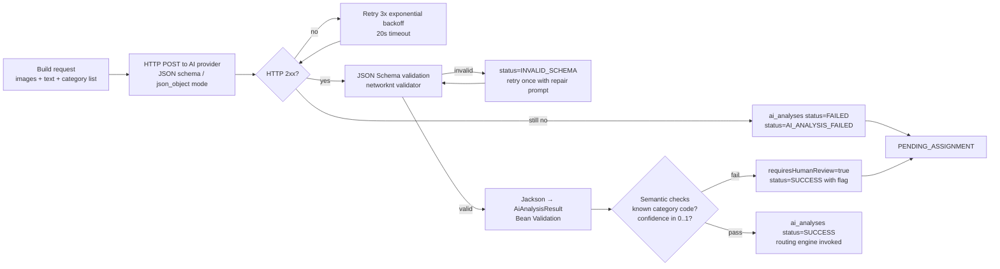
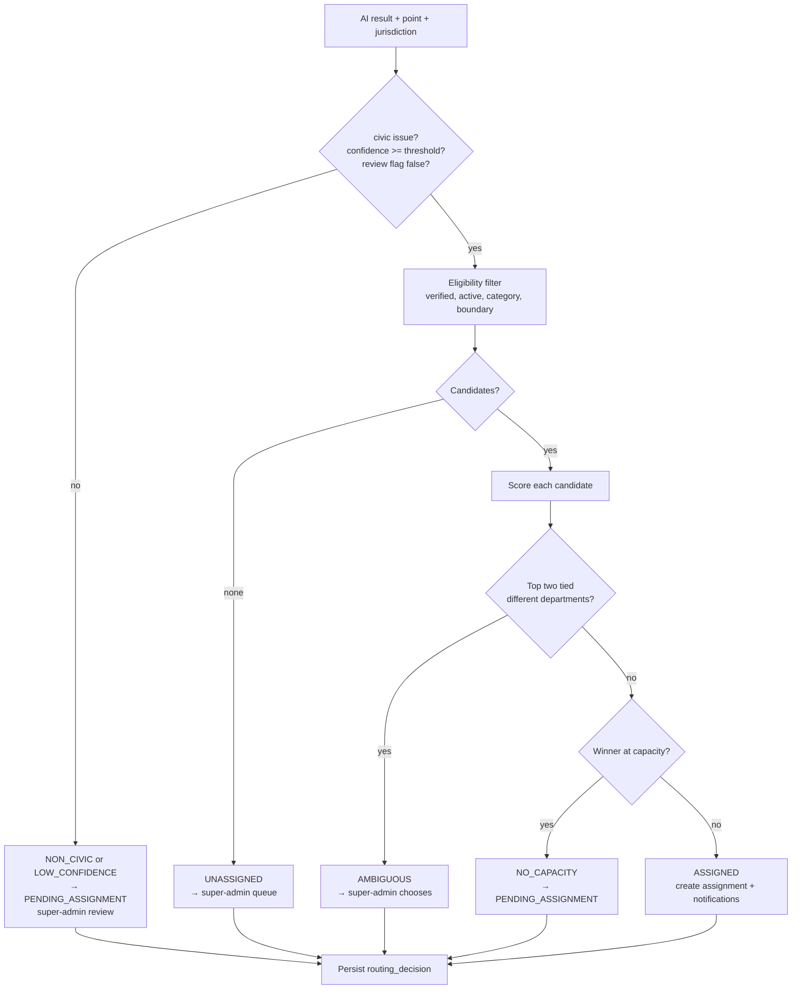

# CivicSense — AI Analysis & Geographical Routing Design

| Field | Value |
|---|---|
| Document | `AI_ROUTING_DESIGN.md` |
| Version | 0.2 (Phase 12 verification boundary added) |
| Status | Implemented locally; hosted PostGIS/provider verification remains blocked |
| Last updated | 2026-11-22 |

---

## 1. Non-negotiable rules

These rules are encoded in tests, not just documentation:

1. **AI never chooses the responsible department.** Its `recommendedDepartment` string is stored as `ai_analyses.recommended_department_hint` and is display-only. Actual assignment is performed solely by `RoutingEngine` using category + geography + department registration data.
2. **AI never invents a location.** No coordinate or address field is populated from image content. Only GPS (`location.source = GPS`) or the map-picked point (`MANUAL`) plus reverse geocoding may set location.
3. **Office proximity is irrelevant.** `departments.office_location` is never used in routing scores.
4. **Low confidence is never auto-assigned.** `confidence < threshold` → `PENDING_ASSIGNMENT` + super-admin review.
5. **Unrelated or unusable images are flagged, not silently accepted.** `isCivicIssue = false` or `isBlurry = true` → human review flag; super admin decides.
6. **Original AI output is immutable.** Every attempt, successful or failed, writes an `ai_analyses` row with `raw_response`.
7. **Provider failures never lose a complaint.** The complaint is committed before analysis; failure transitions to `AI_ANALYSIS_FAILED` → `PENDING_ASSIGNMENT`.
8. **Routing inputs and candidates are persisted** in `routing_decisions` with a `ruleset_version`.
9. **Public data is private by default.** No API returns exact citizen coordinates or `storage_key` without authorization.

---

## 2. AI integration architecture

### 2.1 Abstraction

```java
public interface AiVisionClient {
    AiAnalysisResult analyze(AiAnalysisRequest request) throws AiProviderException;
    String providerName();
}

public record AiAnalysisRequest(
    List<ImageReference> images,   // storage keys + short-lived presigned GET URLs
    String citizenDescription,
    String manualAddressHint,      // optional, never treated as authoritative location
    String promptVersion
) {}

public record AiAnalysisResult(
    boolean civicIssue, String categoryCode, String subcategoryCode,
    String severity, String description, boolean safetyRisk,
    String visibleDamage, boolean blurry, boolean requiresAdditionalInfo,
    double confidence, String recommendedDepartmentHint,
    boolean requiresHumanReview, String rawJson, int latencyMs, int attemptNumber
) {}
```

Implementations:
- `OpenAiCompatibleVisionClient` — HTTP via Spring `RestClient` with configured `base-url`, `api-key`, `model`. Works with OpenAI, Azure OpenAI (compatible endpoint), OpenRouter, Groq, or Ollama without changing routing logic.
- `StubAiVisionClient` — deterministic fixture responses for tests/dev. **Guard:** bean is created only when `civicsense.ai.provider=stub` and the active Spring profile is not `prod`; the application fails fast if `stub` is selected in production.

**Storage abstraction (approved Phase 1 environment):** AI image references are resolved through an S3-compatible `ObjectStorageClient` (AWS SDK S3 v2). During initial development this points at **Supabase Storage** (`CIVICSENSE_S3_ENDPOINT` in root `.env`); later it can point at MinIO/R2/S3 with no change to AI or routing code. Supabase Storage is used only as a private binary store — no Supabase database functions, auth, or edge functions participate in classification or routing.

### 2.2 Request construction

- Images are sent as short-lived presigned HTTPS URLs (never raw bytes through the app), `detail: "high"` where supported.
- The citizen description and optional address hint are sent as text — with an explicit instruction: *"Do not infer a street address, ward, or department from the image. Location must come from supplied coordinates."*
- Category codes are injected into the prompt from the active `issue_categories` tree (cached), so the model chooses from the platform's vocabulary.
- `prompt_version` is stored on every analysis (e.g. `civic-v1`) to make results comparable across prompt changes.

### 2.3 Structured output and validation pipeline



**Validation order:** JSON syntax → JSON Schema (shape) → Jackson mapping → Bean Validation (ranges) → semantic checks against DB categories → threshold check. Any failure sets `requiresHumanReview = true` and still persists the raw response.

### 2.4 Structured JSON schema (draft 2020-12)

```json
{
  "$schema": "https://json-schema.org/draft/2020-12/schema",
  "$id": "https://civicsense.app/schemas/ai-analysis-v1.json",
  "title": "CivicIssueAnalysis",
  "type": "object",
  "additionalProperties": false,
  "required": [
    "isCivicIssue", "category", "subcategory", "severity", "description",
    "safetyRisk", "visibleDamage", "isBlurry", "requiresAdditionalInfo",
    "confidence", "recommendedDepartment", "requiresHumanReview"
  ],
  "properties": {
    "isCivicIssue": { "type": "boolean" },
    "category": {
      "type": "string",
      "enum": [
        "ROAD_MAINTENANCE", "WASTE_MANAGEMENT", "SANITATION", "WATER_SUPPLY",
        "ELECTRICITY", "DRAINAGE", "PARKS_PUBLIC_SPACES",
        "PUBLIC_INFRASTRUCTURE", "UNCATEGORIZED"
      ]
    },
    "subcategory": { "type": "string", "minLength": 2, "maxLength": 60 },
    "severity": { "type": "string", "enum": ["LOW", "MEDIUM", "HIGH", "CRITICAL"] },
    "description": { "type": "string", "minLength": 10, "maxLength": 500 },
    "safetyRisk": { "type": "boolean" },
    "visibleDamage": { "type": "string", "maxLength": 300 },
    "isBlurry": { "type": "boolean" },
    "requiresAdditionalInfo": { "type": "boolean" },
    "confidence": { "type": "number", "minimum": 0, "maximum": 1 },
    "recommendedDepartment": { "type": "string", "maxLength": 200 },
    "requiresHumanReview": { "type": "boolean" }
  }
}
```

Example conforming response:

```json
{
  "isCivicIssue": true,
  "category": "ROAD_MAINTENANCE",
  "subcategory": "POTHOLE",
  "severity": "HIGH",
  "description": "Large pothole causing difficulty for passing vehicles.",
  "safetyRisk": true,
  "visibleDamage": "Deep pothole across half the lane, broken asphalt edges.",
  "isBlurry": false,
  "requiresAdditionalInfo": false,
  "confidence": 0.94,
  "recommendedDepartment": "Road Maintenance Department",
  "requiresHumanReview": false
}
```

The provider is instructed to set `requiresHumanReview = true` whenever: `isCivicIssue = false`, `isBlurry = true`, `confidence < 0.75`, or `requiresAdditionalInfo = true`. The backend **recomputes** this flag independently rather than trusting the model.

### 2.5 Timeouts, retries, thresholds (all env-configurable)

| Setting | Default | Purpose |
|---|---|---|
| `CIVICSENSE_AI_TIMEOUT_MS` | 20000 | connect + read timeout |
| `CIVICSENSE_AI_MAX_ATTEMPTS` | 3 | exponential backoff 500 ms → 1 s → 2 s, jitter |
| `CIVICSENSE_AI_CONFIDENCE_THRESHOLD` | 0.75 | below → human review, no auto-assign |
| `CIVICSENSE_AI_PROMPT_VERSION` | `civic-v1` | stored with each analysis |
| `CIVICSENSE_AI_MAX_IMAGES` | 5 | cost control |

AI response logging stores the raw JSON but strips signed URLs by replacing them with `storageKey` references. API keys are never logged.

---

## 3. Duplicate detection

Runs after image verification and before/parallel with AI analysis. **Flags; never auto-rejects.**

Candidate window:
- `created_at >= now() - 7 days`
- `ST_DWithin(complaints.location::geography, :point::geography, 100)` (100 m)
- exclude self and already `CLOSED`/`REJECTED` unless `REOPENED`

Signals:
1. **Image:** 64-bit perceptual hash; Hamming distance ≤ 10 against any `complaint_images.phash`.
2. **Text:** `pg_trgm.similarity(description, candidate.description) > 0.60`.
3. **Category:** same `category_id` (or AI category code).

Rule: flag when (image match **AND** same category) **OR** (text match **AND** same category), with the geo window always required. Pick the best match (smallest distance / highest similarity) for `duplicate_of_id`, write `duplicate_flag_reason`, show a non-blocking warning in the citizen UI, and place it in the super-admin duplicate queue. Super admin dismisses or links definitively.

Extensions required: `pg_trgm` (added in `V1__enable_extensions.sql`).

---

## 4. Geographical processing

### 4.1 Location acquisition

| Source | Flow | Stored `location_source` |
|---|---|---|
| Device GPS | `navigator.geolocation` → lat/lon sent with complaint | `GPS` |
| Manual map pick | Leaflet click/drag marker → lat/lon + optional address label | `MANUAL` |
| Fallback | No coordinates → submission blocked with clear UI error (a civic report without a location cannot be routed) | — |

GPS accuracy from the browser is included in the request as optional `accuracyMeters`; if accuracy > 100 m, the UI prompts the citizen to refine on the map.

### 4.2 Reverse geocoding

`GeocodingClient` interface:

```java
public interface GeocodingClient {
    GeocodingResult reverseGeocode(double latitude, double longitude);
    String providerName();
}
```

Implementations: `NominatimClient` (dev, strict 1 req/s + identifying User-Agent), `MapboxClient` / `HereClient` (production, key via env), `StubGeocodingClient` (tests). Provider chosen by `CIVICSENSE_GEO_PROVIDER`.

- Cache in `geocoding_cache` keyed by `(provider, round(lat,5), round(lon,5))` (~1 m precision), TTL 30 days. This both improves latency and respects provider rate limits.
- On failure: keep the raw coordinates, leave address fields null, set `requiresHumanReview = true`, and continue routing (point-in-polygon does not need an address string).
- **Production warning:** public Nominatim is not licensed for bulk production use; configure a paid/self-hosted provider before launch. Documented in `.env.example`.

### 4.3 Stored location fields

`complaints.location` (PostGIS `Point,4326`), denormalized `latitude`, `longitude`, `address_line`, `city`, `state`, `postal_code`, `country`, `ward`, `zone`, `jurisdiction_id`. Ward/zone are resolved by point-in-polygon against `jurisdictions` (smallest containing polygon wins), falling back to geocoder-provided administrative text.

---

## 5. Routing engine

### 5.1 Eligibility filter (applied first)

A department is eligible only if **all** hold:

1. `verification_status = VERIFIED`
2. `is_active = true`
3. `accepts_complaints = true`
4. `auto_assign_enabled = true` (for automatic routing; manual admin assignment may ignore this)
5. open complaint count `< max_open_complaints` (when set)
6. has a row in `department_issue_categories` for the AI category, its subcategory, or the category's parent
7. has at least one **active, valid** `service_area` whose boundary contains the point OR whose ward/zone matches the complaint's ward/zone OR whose jurisdiction matches `complaints.jurisdiction_id`

`PENDING_VERIFICATION` departments are excluded — they cannot receive live complaints.

### 5.2 Geography matching and specificity

| Match type | `geoScore` | How determined |
|---|---:|---|
| Polygon contains point | 1000 | `ST_Intersects(:point, sa.boundary)` (GiST index) |
| Ward match | 600 | `sa.covers_ward = complaint.ward` |
| Zone match | 400 | `sa.covers_zone = complaint.zone` |
| City match | 200 | `departments.city = complaint.city` (weakest fallback) |
| No match | 0 | not eligible |

If a department matches via both polygon and ward, the highest specificity is used. Point-in-polygon against `jurisdictions` first sets `complaints.jurisdiction_id`; service areas referencing that jurisdiction get a small confidence boost in the reason text but **not** a different score tier (keeps scoring transparent).

### 5.3 Category matching

| Match type | `catScore` |
|---|---:|
| Exact subcategory row | 300 |
| Category row | 240 |
| Parent category row | 150 |
| No match | not eligible |

### 5.4 Score and outcomes

```
total = geoScore + catScore + departments.routing_priority   // priority default 100
```

Rules, in order:
1. Filter eligible departments and compute `total` for each.
2. Sort by `total DESC`, then `created_at ASC` (oldest registration wins a true tie).
3. If no candidates → `UNASSIGNED`, status `PENDING_ASSIGNMENT` → `UNASSIGNED`, super-admin notification.
4. If top candidate exists but `confidence < threshold` or AI flagged `requiresHumanReview` or `isCivicIssue=false` → `LOW_CONFIDENCE` / `NON_CIVIC`, status `PENDING_ASSIGNMENT`, no assignment, candidates stored.
5. If top two totals are equal and belong to **different** departments → `AMBIGUOUS`, status `PENDING_ASSIGNMENT`, super-admin chooses. **No coin flip.**
6. If winner is at capacity → `NO_CAPACITY`, status `PENDING_ASSIGNMENT`, candidates stored.
7. Otherwise → `ASSIGNED`: create `complaint_assignments` (`AUTO`), set `related_department_id`, status `ASSIGNED`, notify citizen + all department admins, set SLA `resolution_due_at`.

### 5.5 Decision record (every run)

`routing_decisions` stores:
```json
{
  "rulesetVersion": "routing-v1",
  "aiCategoryCode": "ROAD_MAINTENANCE",
  "confidence": 0.94,
  "locationPoint": "SRID=4326;POINT(77.5946 12.9716)",
  "matchedJurisdictionId": "…",
  "candidates": [
    { "departmentId": "…", "name": "Road Maintenance Dept", "geoScore": 1000,
      "geoMatch": "POLYGON", "catScore": 300, "catMatch": "SUBCATEGORY",
      "priority": 100, "total": 1400, "reasons": ["Ward 12 polygon", "POTHOLE handled"] }
  ],
  "selectedDepartmentId": "…",
  "outcome": "ASSIGNED",
  "reason": "Single highest-scoring eligible department."
}
```

Outcomes enum: `ASSIGNED`, `UNASSIGNED`, `AMBIGUOUS`, `LOW_CONFIDENCE`, `NON_CIVIC`, `NO_CAPACITY`.

### 5.6 Routing flow



---

## 6. Human override and re-routing

- **Super admin classification override** (`PATCH /admin/complaints/{id}/classification`): appends a new `ai_analyses` row with `source=ADMIN_OVERRIDE` (original preserved), sets `admin_override_*` fields, then invokes the routing engine again with `rulesetVersion` unchanged but `reason` noting the override.
- **Manual assignment** (`POST /admin/complaints/{id}/assign`): bypasses scoring with mandatory reason, creates `ADMIN_CORRECTION` assignment, status → `ASSIGNED`.
- **Department reassignment request**: `PENDING` until super admin approves; on approval, previous assignment closed, new `REASSIGN` assignment created, notifications sent, audit logged.
- Both override paths are audited and visible on the complaint timeline.

---

## 7. Failure handling matrix

| Failure | Behaviour | Visible to |
|---|---|---|
| AI provider timeout / 5xx | 3 retries → `AI_ANALYSIS_FAILED` → `PENDING_ASSIGNMENT` | Citizen sees "analysis pending review"; super admin queue |
| Invalid JSON / schema | `INVALID_SCHEMA`, one repair retry, human review flag | Super admin queue with raw response |
| Unknown category code | `UNCATEGORIZED`, human review flag | Super admin |
| Geocoding down | Coordinates kept, address null, routing still runs by polygon | Dept sees map pin; admin may fill address |
| No PostGIS match | `UNASSIGNED` + notification | Super admin |
| Multiple equal winners | `AMBIGUOUS` + candidates list | Super admin |
| Department pending verification | Excluded from candidates | Super admin sees pending dept separately |
| Duplicate flagged | Non-blocking warning, `duplicate_of_id` set | Citizen (warning), super admin (queue) |
| Storage verification fails | Image `REJECTED`, complaint not submitted until ≥1 verified image | Citizen (inline error) |

---

## 8. Test matrix (to be implemented in Phases 5–6)

### 8.1 AI tests (WireMock-backed)
- Pothole photo + description → `ROAD_MAINTENANCE/POTHOLE`, `HIGH`, valid schema.
- Garbage pile / overflowing bin → `WASTE_MANAGEMENT`.
- Blocked drain → `DRAINAGE` or `SANITATION` per seeded taxonomy.
- Water leakage, damaged streetlight, fallen tree, broken footpath.
- Unrelated photo (e.g. a cat) → `isCivicIssue=false`, review flag.
- Blurry photo → `isBlurry=true`, review flag.
- Low confidence (0.6) → no auto-assign.
- Invalid JSON, schema violation, HTTP 500, timeout → correct failure status + raw response retained.
- Provider swap: stub vs OpenAI-compatible client produce identical routing given identical result.

### 8.2 Routing tests (Testcontainers PostGIS — historical target)

No Docker or Testcontainers was introduced. The standing decision is no Docker,
so the locally executed evidence uses H2 plus JTS for structural geometry checks
only; the PostGIS cases below remain an operator verification target.
- Exactly one verified department covers Ward 12 + handles POTHOLE → `ASSIGNED`.
- Two departments cover the point with equal scores → `AMBIGUOUS`, nothing assigned.
- Two departments, different priority → higher priority wins.
- No department covers the point → `UNASSIGNED` + notification.
- Point outside all service areas → `UNASSIGNED`.
- Only matching department is `PENDING_VERIFICATION` → excluded → `UNASSIGNED`.
- AI confidence 0.6 → `LOW_CONFIDENCE`, no assignment.
- Polygon and ward both match for same dept → highest specificity used once.
- Department at capacity → `NO_CAPACITY`.
- Office located far away but service area contains point → still assigned (proves office proximity ignored).
- Admin override triggers re-route to different department.
- Department isolation: admin of Dept A cannot GET complaint of Dept B (404).

---

## 9. Observability

Metrics to expose via Actuator/Micrometer (Phase 5+):
- `civicsense.ai.requests{provider,outcome}` counter
- `civicsense.ai.latency` timer
- `civicsense.ai.schema_failures` counter
- `civicsense.routing.outcomes{outcome}` counter
- `civicsense.routing.latency` timer
- `civicsense.duplicates.flagged` counter

Dashboards/alerts are out of scope for Phase 0 but the metric names are fixed now so implementation is consistent.

---

## 10. Review questions

1. Is `0.75` a suitable initial confidence threshold, or should it start higher/lower?
2. Should equal-score ambiguity be resolved by round-robin among tied departments instead of administrator choice? (Design defaults to administrator choice per the requirement "allow administrator intervention".)
3. Is the 100 m / 7-day duplicate window appropriate for the target city density?

---

## 11. Phase 8 addendum — administrator governance of AI output

Phase 8 implements the previously deferred administrator classification override while preserving the AI audit trail:

- `GET /admin/complaints/{id}/analyses` returns append-only history with `source = AI | ADMIN_OVERRIDE`. The original AI row is never edited or deleted; raw provider payloads are never exposed.
- `PATCH /admin/complaints/{id}/classification` validates category/subcategory and optional severity/description, requires a 10–1000 character reason, appends an `ADMIN_OVERRIDE` analysis with actor/reason metadata, and forces a fresh `routing-v1` decision.
- `POST /admin/complaints/{id}/reroute` preserves every previous decision and marks only the newest row `current=true`; candidate scores and reasons remain inspectable in the admin detail UI.
- AI confidence and hints remain advisory. No provider output or override silently assigns a department without a persisted human action and audit record.

Local H2/JTS integration tests cover these invariants. Hosted PostGIS execution and real provider calls remain unverified.

---

## 12. Phase 12 addendum — hardening boundary

Phase 12 did not change AI classification, routing rules, geocoding behavior or
provider selection. Its only relevant effects are:

- Correlation IDs from the global request filter now propagate into AI-related
  logs and audit rows, so provider failures can be traced without logging raw
  prompts, images, tokens or full citizen coordinates.
- Structured ECS JSON console logging is enabled; aggregation/alerting remains
  operator-provided. The Micrometer metric names in §9 remain a design target,
  not implemented counters.
- Storage-failure tests confirm that a failed image analysis or image retrieval
  does not delete or roll back the complaint itself.
- Real PostGIS `ST_Intersects` jurisdiction routing, hosted storage transfers
  and real AI/geocoding provider calls were **not executed**. The exact missing
  credentials/access are listed in `DEVELOPMENT_ROADMAP.md §16.5` and reported
  without secret values by `scripts/phase12-hosted-preflight.ps1`.
