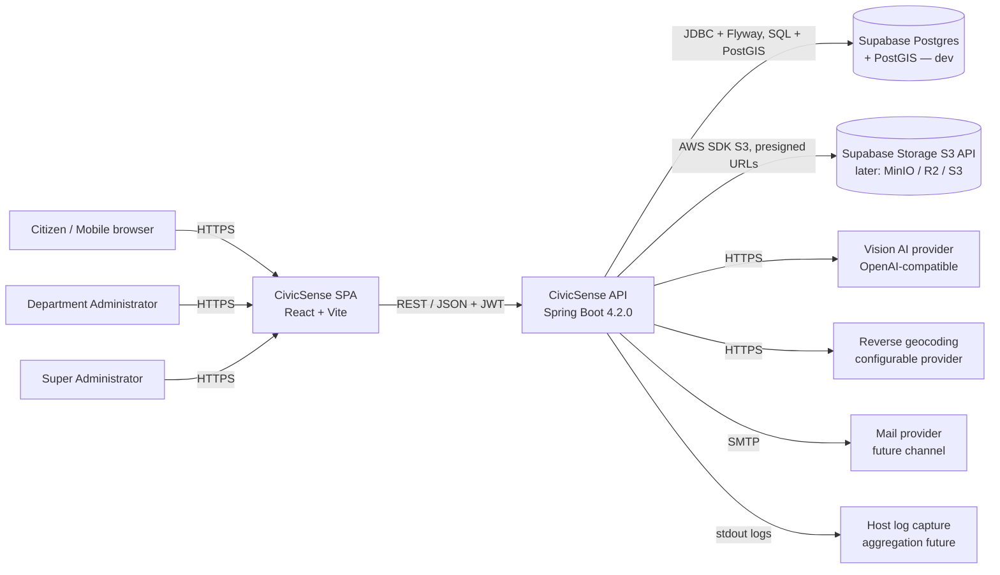
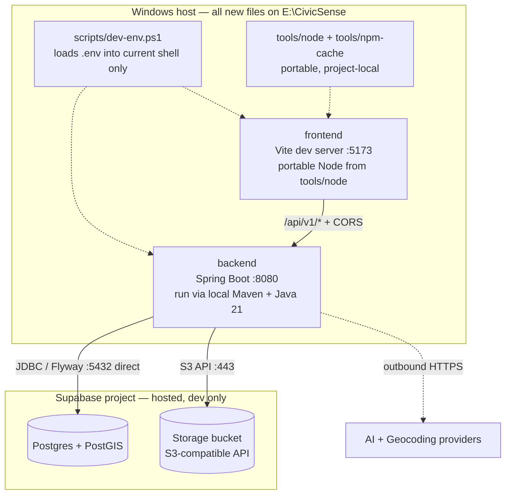
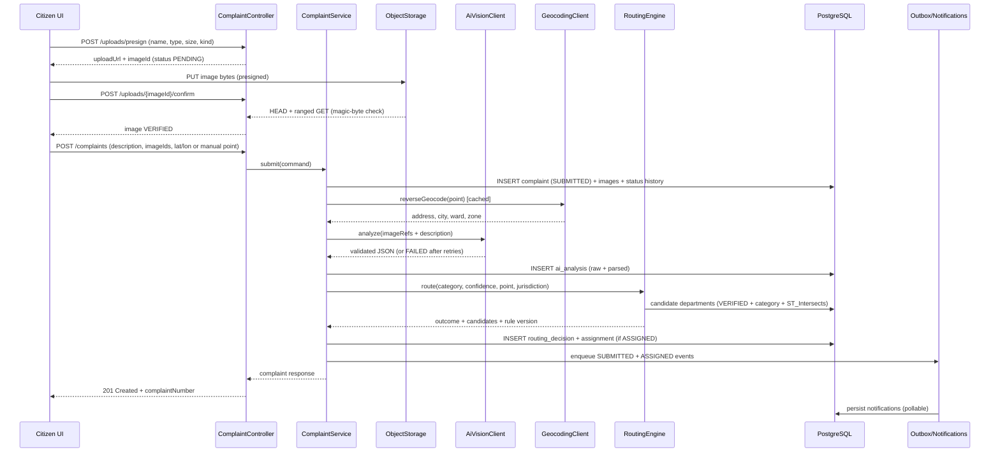

# CivicSense — System Architecture

| Field | Value |
|---|---|
| Document | `ARCHITECTURE.md` |
| Version | 0.5 (Phase 12 production hardening added) |
| Status | Phase 12 complete locally and checkpointed as `phase12-approved`; hosted verification remains blocked |
| Last updated | 2026-11-22 |
| Owner | Senior Full-Stack Architect (agent) |

---

## 1. Executive summary

CivicSense is a role-based civic issue reporting and management platform. Citizens submit photo + text + location reports; a multimodal AI classifies each report; a deterministic backend routing engine matches the classification and geography to a verified department; department administrators work the complaint through a guarded state machine; citizens track and close the loop. A separate super administrator governs departments, jurisdictions, categories, overrides, and audit.

This document defines the architecture that the remaining phases will implement. It is deliberately written before entity classes or controllers exist.

**Guiding principles**

1. **AI advises; the backend decides.** AI never selects the responsible department, invents a location, or bypasses the state machine.
2. **Every automated decision is reproducible.** Routing inputs, candidate scores, rule-set version, and raw AI responses are persisted.
3. **Department isolation is enforced server-side**, derived from the JWT — never from a client-supplied department ID.
4. **No fake data in production paths.** Seed data is Flyway-scripted, clearly named, and environment-gated.
5. **Fail safe, never silently drop.** Failed AI, missing departments, and ambiguous routing all produce visible queues for administrators.

---

## 2. Environment and local-scope decisions (approved 2026-11-21)

### 2.1 Actual scan

| Item | Detected | Impact / action |
|---|---|---|
| Project directory `E:\CivicSense` | Empty at Phase 0 | Greenfield; no existing code to preserve |
| Java | `21.0.9` LTS (Oracle, `C:\Program Files\Java\jdk-21`) | ✅ Ready for Spring Boot 3.x (pre-existing; not modified) |
| Maven | `3.9.16` (`C:\maven\...`) | ✅ Ready (pre-existing; not modified) |
| Git | `2.52.0.windows.1` | ✅ Ready; Phase 1 runs `git init` in `E:\CivicSense` |
| Node.js / npm | Not installed | ✅ Will be installed as a **portable ZIP under `E:\CivicSense\tools\node`**; no global install |
| Docker / Docker Compose | Not installed | ⛔ **Explicitly not installed and not configured** in this environment |
| `psql` client | Not installed | Not required; database work uses JDBC/Flyway against Supabase |
| `winget` | Available | Not used for application dependencies |

### 2.2 Approved environment rules (owner decision)

1. **No unnecessary global installations on C:**. All newly installed tooling, application dependencies, generated files, and configuration live under `E:\CivicSense`.
2. **Portable Node.js**: current LTS release extracted to `E:\CivicSense\tools\node\node-v<version>-win-x64`; activated per-shell via `scripts\dev-env.ps1`. npm cache/prefix redirected into `E:\CivicSense\tools\npm-cache` and `E:\CivicSense\tools\npm-global` using a project-local `.npmrc`.
3. **No Docker** in Phase 1. Compose files, container images, and Testcontainers are deferred; Phase 1 verification uses hosted services.
4. **Supabase** supplies hosted PostgreSQL + PostGIS and S3-compatible object storage **during initial development only**.
5. **Spring Boot remains the single source of business logic.** Supabase is used strictly as: (a) a PostgreSQL server with PostGIS, and (b) an S3-compatible blob store. Supabase Auth, Edge Functions, REST/PostgREST, and Realtime are **not** used. Authentication, AI analysis, routing, state machine, and authorization stay in the backend exactly as designed.
6. **No system-wide environment variable changes.** `scripts\dev-env.ps1` loads root `.env` into the current PowerShell process only. Nothing is written to user/machine env scopes.
7. **Credentials never in source or Git**: root `.env` and all `.env.*` secrets are git-ignored; `.env.example` contains placeholders only. See `docs\SUPABASE_SETUP.md`.
8. **Provider abstractions stay portable**: JDBC + Flyway for the database (works with Supabase or any PostgreSQL with PostGIS), AWS SDK S3 v2 with configurable endpoint for storage (works with Supabase Storage, MinIO, R2, or S3). Switching providers is configuration-only. See §12 and `docs\SUPABASE_SETUP.md`.

---

## 3. Scope

### In scope (all phases)
- Three roles: `CITIZEN`, `DEPARTMENT_ADMIN`, `SUPER_ADMIN`.
- Department self-registration with `PENDING_VERIFICATION`, super-admin verification.
- Photo upload (camera + gallery), description, GPS or manual map location.
- AI analysis with validated structured JSON, retries, timeouts, confidence threshold, audit retention.
- Reverse geocoding, PostGIS point-in-polygon jurisdiction matching, deterministic routing engine.
- Full complaint state machine, status history, audit log, in-app notifications (extensible channels).
- Duplicate flagging, admin overrides, unassigned/ambiguous review queues.
- Analytics from real tables for all three roles.
- Responsive React UI, JWT auth with refresh rotation, security hardening, tests, deployment documentation.

### Out of scope for the initial release (interfaces prepared)
- Push notifications remain unimplemented (channel interface reserved).
- Email delivery is provider-gated rather than assumed: the Phase 12 SMTP channel stays disabled until an operator supplies a provider.
- Public API / third-party integrator access.
- Scheduled maintenance SLAs with penalty billing.
- Docker, Docker Compose, Testcontainers, and Kubernetes in Phase 1. These remain planned for later phases when a local PostGIS/MinIO stack is introduced; the database/storage interfaces are already provider-neutral.

---

## 4. Key technical decisions and justifications

| # | Decision | Alternatives considered | Chosen default & justification |
|---|---|---|---|
| 1 | Spring Boot **4.2.0**, Java 21 (Phase 1 pinned 3.5.16; Phase 10 upgraded after the dependency audit) | Boot 3.5.16, Micronaut, Quarkus | Phase 1 required Boot 3.x/Java 21; Phase 10's high/critical advisories required Spring 7/Boot 4. Boot gives Security, Data JPA, Flyway, Validation, Actuator in one maintained BOM; Java 21 is retained. |
| 2 | JWT access (15 min) + rotating refresh token (7 days) hashed in DB | Server-side sessions, Spring Authorization Server | Stateless API works for SPA + mobile later; DB-backed refresh gives revocation/rotation without a full OAuth2 server. BCrypt strength 12 was the v1 default; Phase 12 added a gradual `{argon2id}` upgrade with legacy BCrypt verification and rehash-on-login (§19). |
| 3 | Layered architecture with explicit **domain service** layer | Clean/Hexagonal with ports for everything | Requirement says Controller → Service → Repository → Entity. Add thin `domain` interfaces for AI/geocoding/storage so providers are swappable without full hexagonal ceremony. |
| 4 | **PostgreSQL 16 + PostGIS 3.4** | MySQL 8 spatial, GeoMesa, application-side polygon math | Spec mandates PostGIS. `ST_Intersects` with GiST indexes is the correct, performant point-in-polygon implementation. |
| 5 | UUID v4 primary keys, `TIMESTAMPTZ` everywhere | BIGINT identity, UUID v7 | UUIDs avoid ID enumeration across departments; `gen_random_uuid()` in DB + application generation for pre-persist references. |
| 6 | Flyway versioned SQL migrations | Hibernate `ddl-auto` | Required by spec; gives reviewable schema evolution and separated seed data. |
| 7 | S3-compatible storage via **AWS SDK S3 v2** with configurable endpoint; **Supabase Storage** in initial development, MinIO/R2/S3 later. Presigned PUT/GET, backend verifies magic bytes | Store BLOBs in Postgres, proxy all files through app, Supabase Storage REST API | Spec forbids DB binaries. Direct upload scales; verification prevents "claimed PNG, actually HTML" attacks. One S3 interface means provider swaps are config-only. Private bucket only. |
| 8 | AI abstraction `AiVisionClient` with an OpenAI-compatible HTTP implementation + a clearly labeled `StubAiVisionClient` for tests | Vendor SDK locked in, local Ollama only | One interface, configurable `base-url`/`model`/`key` supports OpenAI, Azure OpenAI, OpenRouter, Groq, or Ollama. Stub is never active when `prod` profile is on. |
| 9 | Structured output via JSON-schema mode + Jackson DTO + Bean Validation + `networknt` JSON Schema validator | Parse free text with regex | Validated schema is a hard requirement. Double validation catches both shape and semantic errors. |
| 10 | Routing is a **pure domain service** with persisted `routing_decisions` | Let AI output `recommendedDepartment` drive assignment | Spec explicitly forbids assigning from visual appearance. AI suggestion is stored as `recommended_department_hint` only and is advisory. |
| 11 | Transactional **outbox** (`outbox_events`) for notifications | Direct DB write + immediate send | Ensures "notification created iff complaint committed" without distributed transactions. Idempotency keys prevent duplicates. |
| 12 | In-app notifications via TanStack Query polling (30s) in v1; WebSocket reserved | STOMP/WebSocket from day one | Polling is simpler, robust behind proxies, and sufficient for Phase 9 acceptance. Channel interface allows later upgrade. |
| 13 | Rate limiting with **Bucket4j** in-memory, Redis-backed noted for multi-instance | Resilience4j, Spring Gateway | Lightweight, annotation-driven, enough for single-instance dev/phase builds. Note Redis swap for horizontal scale. |
| 14 | State machine as typed `StatusTransitionPolicy` bean + `status_history` table | Database-driven transition table, no validation | Compile-time safety and testability; DB table would add indirection without benefit. All transitions still logged. |
| 15 | React + TS + Vite + Tailwind + shadcn/ui (Radix primitives) + TanStack Query v5 + RHF + Zod + Leaflet + Recharts | Next.js, Angular, plain CSS | Spec stack. Vite SPA pairs cleanly with a stateless Spring API; shadcn is a copy-in component pattern (not a runtime dependency). Exact Vite version chosen by portable Node LTS compatibility in Phase 1. |
| 16 | Generate TS API types from Springdoc OpenAPI (`openapi-typescript`) | Hand-maintained duplicate types | Keeps frontend/backend contracts synchronized (agent rule #14). |
| 17 | Tests: JUnit5 + Mockito + **hosted Supabase for integration tests in Phase 1**, later local PostGIS/MinIO via containers + WireMock; Vitest + RTL + MSW; Playwright E2E | H2 in-memory only | H2 cannot run PostGIS. Hosted PostGIS lets routing tests run now without Docker; a disposable test schema keeps test data isolated from development data. |
| 18 | Analytics via native SQL aggregate queries (optional materialized views later) | Hardcoded dashboard numbers | Rule #8 forbids hardcoded statistics. |
| 19 | **Supabase Postgres as a plain database**, never as application/auth layer | Supabase Auth + PostgREST + Edge Functions replacing backend | Preserves the required Spring Boot business logic, JWT auth, AI pipeline, and routing engine. Supabase is interchangeable with any PostGIS-capable PostgreSQL. |
| 20 | **Flyway owns the application schema** on Supabase; no manual table creation in the dashboard | Hand-created tables, `ddl-auto=update` | Reproducible migrations and a clean source of truth. Only one-time, non-schema Supabase setup is documented (`docs\SUPABASE_SETUP.md`). |
| 21 | **Portable, project-local tooling**: Node ZIP in `tools\node`, npm cache/prefix in `tools\`, `.env` loaded by a PowerShell session script | winget/global installs, system env vars, C: installs | Meets the owner's local-scope requirement; nothing is installed outside `E:\CivicSense`, and no system state is modified. |

---

## 5. System context



---

## 6. Development / deployment view (Phase 1: no Docker)



- `frontend` runs with Vite's dev server; the backend enables CORS for `http://localhost:5173`. In later phases a production static server can replace Vite without code changes.
- `backend` is stateless and remains the only place where business rules live. Supabase supplies infrastructure only.
- Supabase direct connection (port 5432) is used for Flyway migrations; a transaction pooler (6543) may be used for application queries later, never for DDL.
- No local database or object-storage service is installed in Phase 1. A future local PostGIS + MinIO stack is a configuration change only (`SPRING_DATASOURCE_*`, `CIVICSENSE_S3_*`).

---

## 7. Backend architecture

### 7.1 Package structure

```
backend/
├── pom.xml
├── src/main/java/com/civicsense/
│   ├── CivicSenseApplication.java
│   ├── common/                     # ProblemDetail, ApiException, PageResponse, BaseEntity
│   │   ├── error/
│   │   ├── persistence/
│   │   └── util/
│   ├── config/                     # Security, CORS, OpenAPI, Async, WebClient, Flyway, Clock
│   ├── security/                   # JwtService, JwtAuthenticationFilter, CurrentUser,
│   │                               # DepartmentScopeGuard, RateLimitInterceptor
│   ├── module/
│   │   ├── auth/                   # controller, service, dto
│   │   ├── user/
│   │   ├── department/             # registration, verification, team, service areas
│   │   ├── category/
│   │   ├── jurisdiction/
│   │   ├── complaint/              # submission, lifecycle, comments, evidence, feedback
│   │   ├── ai/                     # AiVisionClient + providers, AiAnalysisService
│   │   ├── routing/                # RoutingEngine, rules, RoutingDecision
│   │   ├── geo/                    # GeocodingClient + providers, LocationService
│   │   ├── storage/                # ObjectStorageClient, presign, verification
│   │   ├── notification/           # outbox dispatcher, channels, NotificationService
│   │   ├── analytics/
│   │   └── audit/
│   └── infrastructure/             # provider implementations, persistence adapters
├── src/main/resources/
│   ├── application.yml
│   ├── application-dev.yml
│   ├── application-test.yml      # H2 test double; Flyway disabled
│   └── db/migration/V1__enable_extensions.sql ... V13__phase10_password_reset.sql
└── src/test/                       # unit, integration (Testcontainers), contract, e2e support
```

Each module follows `controller → service → repository → entity`, with DTOs (`*Request`, `*Response`) at the boundary. Controllers contain zero business logic (agent rule). Cross-module calls go through service interfaces, not repositories.

### 7.2 Complaint submission flow



**Important:** the HTTP request does not fail if AI or geocoding is unavailable. The complaint is committed first; analysis failures are recorded and the complaint enters `PENDING_ASSIGNMENT`/`AI_ANALYSIS_FAILED` for admin handling. Timeouts are bounded (AI 20 s connect/read, 3 attempts with backoff; geocoding 5 s, 2 attempts).

### 7.3 State machine ownership

`ComplaintService.transition(id, targetStatus, actor, reason)` is the only write path for `complaints.status`. It:
1. loads the complaint with a lock (`SELECT ... FOR UPDATE`),
2. asks `StatusTransitionPolicy` whether `(from, to, actor.role)` is legal and whether guards pass (e.g. AFTER evidence exists for `RESOLVED`, reason present for `REJECTED`/`REOPENED`),
3. writes `complaint_status_history`, updates the entity, and emits an outbox event,
4. returns a `ProblemDetail` 409 for illegal transitions.

---

## 8. Frontend architecture

```
frontend/
├── index.html
├── vite.config.ts
├── tailwind.config.ts
├── src/
│   ├── main.tsx
│   ├── app/                    # router, providers (Query, Auth, Theme, Toast), layouts
│   ├── components/
│   │   ├── ui/                 # shadcn/ui generated primitives
│   │   └── shared/             # StatusBadge, EmptyState, ErrorState, MapPanel, FileDropzone
│   ├── features/
│   │   ├── auth/               # login, register citizen, register department
│   │   ├── landing/
│   │   ├── citizen/            # dashboard, report, complaints, tracking, notifications, profile
│   │   ├── department/         # queues, detail, analytics, service areas, team, settings
│   │   ├── admin/              # approvals, users, complaints, jurisdictions, categories, audit
│   │   └── notifications/
│   ├── lib/
│   │   ├── api/                # axios client, generated OpenAPI types, query keys
│   │   ├── auth/               # token store (memory + httpOnly-refresh via /auth/refresh)
│   │   ├── maps/               # Leaflet setup, provider config, tile layers
│   │   └── validation/         # shared Zod schemas
│   ├── hooks/
│   ├── styles/
│   └── types/
```

**Token handling:** access token in memory; refresh token in an `httpOnly`, `Secure`, `SameSite=Strict` cookie set by `/auth/login`. Axios interceptor refreshes once on 401, then replays the request. This avoids `localStorage` XSS exposure.

**Route guards:** `<RequireRole roles={[...]}>` wraps each route tree and checks `/auth/me` from TanStack Query cache. Department routes additionally require `departmentVerificationStatus === 'VERIFIED'`; otherwise the UI shows a verification-pending screen (the backend still enforces this independently).

**Design system:** neutral charcoal surfaces + white cards, emerald `#059669` primary, amber warnings, red critical, no purple/indigo. Tailwind tokens defined once in `tailwind.config.ts`; motion limited to 150–200 ms transforms/opacity; all interactive elements keyboard-reachable with visible focus rings; status colours paired with text labels (not colour-only).

---

## 9. Cross-cutting concerns

- **Validation:** Zod on the client; Bean Validation (`@Valid`, custom `@GeoPoint`, `@AllowedFileSignature`) on the server. Never trust either alone.
- **Errors:** RFC 7807 `ProblemDetail` from Spring; a single `GlobalExceptionHandler`; frontend maps `problem.status` to a toast/inline error.
- **Correlation IDs:** `CorrelationIdFilter` generates or echoes `X-Correlation-Id` at the request boundary, exposes it via CORS, and populates MDC. The ID is propagated into error bodies, health responses, audit rows, async workers and scheduled cleanup (see §19 and `docs/DEPLOYMENT.md §7`).
- **Audit:** `@Audited` AOP annotation on state-changing service methods → `audit_logs` with actor, action, entity, before/after JSON, IP, user agent.
- **Logging:** Boot 4.2 ECS structured JSON console logging is enabled with `logging.structured.format.console: ecs`; no custom Logback configuration is required. Never log tokens, passwords, raw reset tokens, raw image bytes, or full citizen coordinates (log rounded point to 3 decimals).
- **Time:** all timestamps UTC; `Clock` bean injected for testability; SLA deadlines computed server-side.
- **Privacy:** exact citizen coordinates are never returned in public/admin-global DTOs unless the requester is the owner, the assigned department, or super admin — and even then the map shows a configurable precision circle by default with an "exact location" expand action that is itself audited.

---

## 10. Security architecture

| Control | Implementation |
|---|---|
| Password hashing | New/reset passwords use Argon2id with `{argon2id}`; legacy BCrypt strength-12 hashes verify and transparently upgrade after successful login (§19) |
| Authentication | JWT access + rotating refresh (hashed at rest, revoked on logout/reuse) |
| Authorization | `@PreAuthorize("hasRole(...)")` on controllers **plus** service-layer ownership checks |
| Department isolation | Complaint lookups use `findByIdAndDepartmentId(id, jwt.departmentId)`; no client-supplied department ID accepted on dept endpoints. V6 RLS scaffolding remains disabled (§17); app-layer checks are authoritative. |
| File uploads | Presign allowlist (`image/jpeg`, `image/png`, `image/webp`), max 10 MB/image, ≤5 images, magic-byte verification, private objects, short-lived presigned GET (5 min), per-user/per-IP rate limits |
| Injection | Parameterized JPA queries only; native SQL used solely for fixed PostGIS queries with bind parameters |
| CORS | Explicit `civicsense.allowed-origins` env list; credentials enabled only for the known SPA origin |
| Rate limiting | Login 5/15min/IP; password reset request and confirmation 5/15min/IP; complaint submit 3/min/user; presign 10/min/user; global 120/min/IP. In-memory/single-instance; Redis required for scale-out. |
| Headers | Spring Security headers + configurable CSP for SPA (`default-src 'self'`, image/tile allowlist, inline styles only for Vite runtime injection) |
| Secrets | All keys in env vars / `.env` (git-ignored); the placeholder-only `.env.example` is the authoritative template, refreshed in Phase 11. `scripts/secret-scan.ps1` scans tracked files. See `docs/DEPLOYMENT.md`. |
| Unassigned/ambiguous | Visible admin queues; nothing is discarded |

---

## 11. Configuration surface (authoritative template: `.env.example`; see `docs/DEPLOYMENT.md`)

```
# Datasource — Supabase direct connection (port 5432) for Flyway
# Value is placed in root .env by the developer; NEVER in source or Git.
SPRING_DATASOURCE_URL=jdbc:postgresql://<project-ref>.supabase.co:5432/postgres?sslmode=require
SPRING_DATASOURCE_USERNAME=postgres
SPRING_DATASOURCE_PASSWORD=<supabase-db-password>
# Optional application pooler (transaction mode, 6543) — not used for migrations
CIVICSENSE_DB_APP_URL=jdbc:postgresql://<project-ref>.supabase.co:6543/postgres?sslmode=require
# JWT
CIVICSENSE_JWT_SECRET=...            # >=32 bytes, env only
CIVICSENSE_JWT_ACCESS_MINUTES=15
CIVICSENSE_JWT_REFRESH_DAYS=7
# CORS
CIVICSENSE_ALLOWED_ORIGINS=http://localhost:5173
# Storage (S3-compatible abstraction; Supabase Storage in dev)
CIVICSENSE_STORAGE_PROVIDER=supabase-storage   # or minio / s3 / r2
CIVICSENSE_S3_ENDPOINT=https://<project-ref>.storage.supabase.co/storage/v1/s3
CIVICSENSE_S3_BUCKET=civic-images
CIVICSENSE_S3_ACCESS_KEY=<supabase-storage-access-key>
CIVICSENSE_S3_SECRET_KEY=<supabase-storage-secret-key>
CIVICSENSE_S3_REGION=us-east-1
CIVICSENSE_S3_PATH_STYLE=true
# AI (OpenAI-compatible)
CIVICSENSE_AI_BASE_URL=https://api.openai.com/v1
CIVICSENSE_AI_API_KEY=...
CIVICSENSE_AI_MODEL=gpt-4o-mini
CIVICSENSE_AI_TIMEOUT_MS=20000
CIVICSENSE_AI_MAX_ATTEMPTS=3
CIVICSENSE_AI_CONFIDENCE_THRESHOLD=0.75
CIVICSENSE_AI_PROVIDER=openai-compatible   # or stub (dev/test only)
# Geocoding
CIVICSENSE_GEO_PROVIDER=nominatim          # or mapbox/here/photomock
CIVICSENSE_GEO_BASE_URL=https://nominatim.openstreetmap.org
CIVICSENSE_GEO_API_KEY=...                 # required for paid providers
CIVICSENSE_GEO_RATE_LIMIT_RPS=1
# Maps (frontend, VITE_ prefixed)
VITE_MAP_PROVIDER=osm
VITE_MAP_TILE_URL=https://tile.openstreetmap.org/{z}/{x}/{y}.png
VITE_MAP_TILE_ATTRIBUTION=© OpenStreetMap contributors
# Notifications (Phase 12; all values must be supplied before enabling)
CIVICSENSE_MAIL_ENABLED=false
CIVICSENSE_MAIL_FROM=...
CIVICSENSE_MAIL_HOST=...
CIVICSENSE_MAIL_PORT=587
CIVICSENSE_MAIL_USERNAME=...
CIVICSENSE_MAIL_PASSWORD=...
CIVICSENSE_MAIL_SMTP_AUTH=true
CIVICSENSE_MAIL_STARTTLS=true
```

---

## 12. External services and indicative costs

| Service | Dev | Production estimate | Notes |
|---|---|---|---|
| PostgreSQL + PostGIS | **Supabase free tier** (dev, approved) | Supabase Pro ~$25/mo, or self-host/local PostGIS ~$0 + VM | Supabase enables PostGIS via `CREATE EXTENSION ... WITH SCHEMA extensions`; Flyway migrations connect on port 5432 |
| Object storage | **Supabase Storage** (dev, included in project quota) | Supabase storage quota, or R2 free 10 GB then ~$0.015/GB; S3 ~$0.023/GB + requests | S3-compatible API used through AWS SDK; private bucket; switch provider via env only |
| Vision AI | Stub provider, free | Mini vision models ≈ **$1–15 per 1,000 reports** depending on image detail/model | Prices change; verify before switch-on. Local Ollama = $0 + hardware |
| Reverse geocoding | Nominatim (1 req/s, attribution, no bulk) | Mapbox/HERE/MapTiler ≈ $0–100/mo by volume; BigDataCloud free tier | **Do not use public Nominatim for production volume** (ToS); caching reduces calls |
| Map tiles | OSM tiles with attribution (fair use) | MapTiler/Mapbox ~$0–50/mo or self-host | Configure via `VITE_MAP_TILE_URL` |
| Email | Local fake transport in tests | SMTP provider ~$0–10/mo at low volume | Provider-gated SMTP channel added in Phase 12; no live provider configured |
| Hosting | Local processes on `E:\CivicSense` (portable Node + local Maven/Java), no Docker | VPS or PaaS ~$20–60/mo; Supabase continues as DB/storage or is replaced by local PostGIS/MinIO | Scale-out needs Redis for rate limits |

---

## 13. Risks and mitigations

| Risk | Mitigation |
|---|---|
| AI misclassifies or hallucinates | Confidence threshold, human review queue, admin override, raw response retained, never trusted for department choice |
| No verified department covers a location | `UNASSIGNED` state + super-admin queue; never drop |
| Ambiguous multiple departments | Explicit scoring + `AMBIGUOUS` outcome held for admin choice |
| Department data leak via ID manipulation | JWT-derived scope on every query + integration tests; RLS evaluated but not enabled (§17.3, §19.3) |
| PostGIS polygon quality poor | Service areas validated on save (valid geometry, no self-intersection), ward/zone fallback, admin editing UI |
| Geocoding provider rate limit / legal use | Cache by rounded coordinate, configurable provider, documented ToS warning |
| Upload abuse | Presign PUT expiry (15 min by default), signed GET expiry (5 min), size/type/magic-byte checks, rate limits, private bucket |
| No global tooling / no Docker on this host | Portable Node under `tools\node`, project-local npm cache, session-only env via `scripts\dev-env.ps1`; hosted Supabase replaces local DB/storage in Phase 1 (§2) |
| Supabase credentials leak into Git | `.env` git-ignored, `.env.example` placeholders only, secret scanning in Phase 10, no credentials in source or migration files |
| Supabase-specific behaviour (extensions schema, storage API) leaks into business logic | JDBC/Flyway and AWS SDK S3 abstractions; no Supabase SDK in application code; documented one-time setup in `docs\SUPABASE_SETUP.md` |
| Accidental use of Supabase Auth/REST bypassing backend rules | Backend is the only component holding DB/storage credentials for the app; Supabase Auth/PostgREST/Realtime explicitly unused; RLS not relied on for tenant isolation |

---

## 14. Phase 0 exit criteria

- [x] All five planning documents created
- [x] ER diagram produced in `DATABASE_DESIGN.md`
- [x] API surface enumerated in `API_DOCUMENTATION.md`
- [x] AI + routing design detailed in `AI_ROUTING_DESIGN.md`
- [x] Phased roadmap with dependencies written in `DEVELOPMENT_ROADMAP.md`
- [x] Environment inspected and prerequisites recorded
- [x] Plan approved by project owner (2026-11-21) with local-scope + Supabase modifications
- [x] Environment decisions reflected in this document and `DEVELOPMENT_ROADMAP.md`
- [ ] **Phase 1 has not yet been reported as complete**

> Historical Phase 0 note: no application code existed when this exit checklist was written. Later phases added the backend, frontend, and Flyway migrations documented in this file and in `DEVELOPMENT_ROADMAP.md`.

---

## 15. Phase 8 platform governance architecture

Phase 8 adds a SUPER_ADMIN-only governance plane without changing the citizen or department execution planes.

```text
Super-admin SPA (/admin/*)
  └─ RequireRole(['SUPER_ADMIN'])          # UX guard only
       └─ typed admin API client
            └─ /api/v1/admin/**             # URL security + controller @PreAuthorize
                 ├─ AdminController         # insight, departments, users, audit, reference reads
                 ├─ AdminComplaintController# global queue, AI history, complaint governance
                 └─ AdminPlatformService    # real SQL aggregates and guarded mutations
                      └─ repositories / EntityManager criteria queries
```

Key boundaries:

- **Authorization:** both admin controllers are class-level `@PreAuthorize("hasRole('SUPER_ADMIN')")`. Role is never inferred from a request body. Department-scoped Phase 7 routes remain department-only; cross-department complaint IDs still return `404` to department admins.
- **Audit:** administrative mutations require a 10–1000 character reason. `AuditAspect` copies it from the request record into the append-only `audit_logs` row together with actor, role, action, entity type/id, correlation id, and timestamp. Migration V11 adds the `reason` column and audit indexes.
- **Immutability:** AI analyses, routing decisions, assignments, and status history are append-only. Classification corrections append `ADMIN_OVERRIDE` analyses; reroutes supersede the current decision rather than deleting it; unassignment closes the active assignment while retaining the old row.
- **AI boundary:** provider output remains advisory and is never trusted for department choice. No silent AI assignment, fake production data, raw provider payload, storage key, or secret is serialized to the admin UI.
- **Session safety:** department suspension and user suspension/disable are database-state changes re-read by guards on every request; refresh-token families are revoked for suspended/disabled users.
- **Persistence:** V11 migrates `audit_logs.reason` plus `idx_audit_created_at` and `idx_audit_entity_id`. H2 integration tests mirror the column. Hosted PostgreSQL/PostGIS execution remains a Phase 1 §1.1 verification item.
- **Frontend:** seven admin pages reuse the existing design system and server-derived data. Loading, empty, error/retry, confirmation, AI-vs-override badges, routing candidate reasons, and responsive table/card layouts are covered by component tests. Frontend role guards do not replace backend enforcement.

The Phase 8 implementation contract is retained at `docs/PHASE8_IMPLEMENTATION_CONTRACT.md`; endpoint payloads and verification results are documented in `API_DOCUMENTATION.md §17` and `DEVELOPMENT_ROADMAP.md §12`.

---

## 16. Phase 9 notification delivery architecture

Phase 9 completes the outbox pipeline that Phase 3 reserved. The complaint transaction remains the source of truth; notification delivery is a separate, retryable post-commit side effect.

```text
Complaint / auth / admin service transaction
  └─ writes workflow rows + audit/history
  └─ NotificationService.notify(...)
       └─ INSERT outbox_events (same transaction, JSON payload)
            │
            ├─ afterCommit ApplicationEvent
            │    └─ notificationTaskExecutor (SyncTaskExecutor in test, bounded pool otherwise)
            │         └─ OutboxDispatcher -> OutboxEventProcessor.process(eventId)
            │
            └─ scheduled OutboxDispatcher sweep (production, 30 s backoff, max 5 attempts)
                 └─ OutboxEventProcessor.process(eventId)  [REQUIRES_NEW transaction]
                      ├─ atomic claim with 2 min lease
                      ├─ preference lookup (in-app enabled)
                      ├─ dedupe by (outbox_event_id, recipient_user_id)
                      ├─ InAppNotificationChannel -> notifications row SENT
                      └─ success: PROCESSED | failure: FAILED + last_error + next_attempt_at
```

Key boundaries:

- **Failure isolation:** the processor runs in `REQUIRES_NEW`; delivery exceptions are logged on the outbox row and never propagate into the complaint workflow transaction.
- **Idempotency:** a repository existence check plus the V12 unique index prevent duplicate notifications when the post-commit listener and scheduler overlap or a retry reprocesses a claimed event.
- **Lease and backoff:** stale `PROCESSING` rows become claimable, retryable `FAILED` rows wait 30 seconds, and five attempts leave a terminal `FAILED` row with `last_error` for operational inspection.
- **Channels:** `InAppNotificationChannel` is authoritative and enabled. `PasswordResetEmailChannel` handles only `auth.password_reset_requested` and is provider-gated; push remains unavailable. Preference updates that try to enable unsupported external channels are rejected.
- **Payload hygiene:** outbox payloads carry recipient, complaint reference, type, title, body, and correlation metadata. Internal notes, raw AI payloads, object-storage keys, and credentials are excluded.
- **Ownership and roles:** all read/read-all/preference operations derive the recipient from the authenticated principal. Another user's notification ID is indistinguishable from a missing ID; role-specific deep links stay inside the recipient's route surface.
- **Frontend:** notification queries are invalidated by workflow mutations, unread-fetch failures are visible instead of collapsing to zero, and citizen/department/admin detail screens expose the complete resolution, feedback, dispute, and information-response path.

The Phase 9 implementation contract is retained at `docs/PHASE9_IMPLEMENTATION_CONTRACT.md`; endpoint payloads and verification results are documented in `API_DOCUMENTATION.md §18` and `DEVELOPMENT_ROADMAP.md §13`.

---

## 17. Phase 10 security architecture

Phase 10 hardens the existing single-instance application without changing the authorization model or introducing external infrastructure.

### 17.1 Dependency stack and remediation

The initial Phase 10 audit found 22 high/critical Maven advisories on Spring Boot 3.5.16 (8 critical, 14 high) in Spring Framework, Tomcat, Netty, Jackson, HttpComponents Core, and PostgreSQL JDBC. Boot 3.5.16 is the final 3.5.x release, and the Spring Framework fixes exist only in the 7.x line, so the application moved to the coherent Spring Boot 4.2.0 stack with springdoc 3.2.1 and Boot 4 modular starters (`webmvc`, `jackson2`, `aspectj`, `flyway`, and the matching test starters). Compatibility changes were limited to `HealthIndicator`/`AutoConfigureMockMvc` package moves and POM starter names. The final audit reported zero OSV advisories across 212 Maven coordinates and zero npm vulnerabilities.

### 17.2 Request-boundary controls

- `ApiRateLimitFilter` runs after JWT authentication and applies a global per-IP bucket plus submit/presign buckets keyed by authenticated user with an IP fallback. Login and password reset use `RateLimitService`. Rejections are RFC 7807-shaped `429` responses with `Retry-After`.
- All buckets are in-memory and per instance. Redis/shared-state limiting is a prerequisite for horizontal scale-out and is not implemented here.
- `SecurityConfig` adds a configurable CSP and keeps Spring Security frame denial/content-type protections. Inline styles are allowed solely for Vite runtime injection; no browser meta CSP is added.
- Password reset is public but rate-limited by IP on both request and confirmation endpoints. Only SHA-256 token hashes are stored; the raw token exists only in the `auth.password_reset_requested` outbox payload and the outbound email body, never in API responses, in-app notifications or logs.

### 17.3 RLS decision

*Phase 10 historical decision, reaffirmed by Phase 12 (§19): RLS was evaluated
but not enabled.* V6 RLS policy scaffolding remains commented out/disabled. The application connects as the owning database role, background delivery/retention work uses `REQUIRES_NEW` transactions, and the automated suite uses an H2 test double rather than PostgreSQL row-level security. Enabling RLS now would create a false sense of enforcement and risk breaking those flows. Application-layer role checks, ownership checks, and department-scoped repository queries remain the sole authoritative isolation boundary. Revisit RLS when a least-privilege application role and a real PostgreSQL integration suite are available; until then, no RLS enforcement is claimed.

### 17.4 Argon2id decision

*Phase 10 historical decision, superseded by Phase 12 (§19): a gradual
rehash-on-login upgrade was implemented.* BCrypt strength 12 remained the v1 password hash. Argon2id would add a native/library dependency, require a hash-version migration strategy for existing users, and require revalidation of login/reset/lockout flows. No current compliance or threat-model trigger demands it. Revisit if a regulatory requirement appears or the project adopts a supported Argon2 provider with an explicit rehash-on-login migration plan. This is an evidence-based deferral, not a silent algorithm change.

### 17.5 Retention and secret hygiene

`DataRetentionService` deletes rows older than a configurable 24-month cutoff from `audit_logs`, `ai_analyses`, and `ai_analysis_runs`. Scheduling is disabled by default and there is no deletion API. `scripts/secret-scan.ps1` provides a repeatable tracked-file scan; `.env` stays ignored/untracked, and the placeholder-only `.env.example` was refreshed in Phase 11.

### 17.6 Verification boundary

Browser E2E uses local Microsoft Edge with deterministic API stubs. It verifies UI routing, authorization UX, notification deep links, and reset form behavior, but not hosted Supabase/PostGIS, real Flyway V1–V13, production storage/email/push/AI providers, or real rate-limit distribution across instances. Phase 1 §1.1 remains open. Endpoints and exact results are documented in `API_DOCUMENTATION.md §19` and `DEVELOPMENT_ROADMAP.md §14`.

---

## 18. Phase 11 deployment documentation (2026-11-22)

`docs/DEPLOYMENT.md` is the single authoritative operations guide for the
supported Supabase + local-process path. It covers fresh-clone startup, Flyway
V1–V13, storage setup, backup/restore (including a repeatable local H2 dry run),
logging/monitoring, and security configuration. `.env.example` was refreshed to
include the Phase 10 CSP, rate-limit, password-reset, and retention keys.

No Dockerfiles or compose files were added: Docker remains conditional on an
explicit owner decision and the standing decision is no Docker. No source, API,
Flyway migration, or H2 schema changed. No production infrastructure,
monitoring stack, or external provider integration was created. The local smoke
check and two backup/restore dry runs passed; hosted verification remains open
under Phase 1 §1.1. Full results are in `docs/DEPLOYMENT.md §9` and
`DEVELOPMENT_ROADMAP.md §15`.

---

## 19. Phase 12 production readiness (2026-11-22)

Phase 12 is the final planned development phase. It hardens the existing
single-process architecture without changing public API contracts, RBAC rules,
ownership checks, rate-limit values, or Flyway migrations.

### 19.1 Runtime components added

- `CorrelationIdFilter` and `MdcTaskDecorator`: one request-boundary ID is
  generated or accepted, exposed through CORS, and propagated into MDC, async
  tasks and scheduled work. `GlobalExceptionHandler`, `MetaHealthController`,
  `AuditAspect`, the security entry/denial handlers and the rate-limit filter no
  longer create independent IDs.
- `UpgradingPasswordEncoder`: Argon2id hashes use the `{argon2id}` prefix;
  legacy BCrypt values remain verifiable; successful login rehashes legacy
  passwords. Bouncy Castle 1.85 supplies the provider after the audit flagged
  1.84. `bcrypt-strength: 12` remains configured for legacy verification.
- `PasswordResetEmailChannel`: an `ObjectProvider<JavaMailSender>`-gated SMTP
  channel consumes only `auth.password_reset_requested` outbox events. It uses a
  deterministic Message-ID, never logs the raw token, and converts provider
  exceptions to a sanitised `IllegalStateException` so provider text is not
  persisted in `last_error`.
- `OutboxEventRepository`/`OutboxDispatcher`/`OutboxEventProcessor`: terminal
  `FAILED` rows with null `next_attempt_at` are no longer treated as due;
  new `PENDING` rows remain due.

### 19.2 Observability contract

`logging.structured.format.console: ecs` selects Boot 4.2's built-in ECS JSON
console output (`json` is not a valid Boot 4.2 format name). Logs carry service,
timestamp, level, thread and correlation context where available. Secrets,
tokens, raw reset tokens, full coordinates and complaint content are excluded.
Log aggregation and alerting remain operator responsibilities.

### 19.3 Deliberate non-implementations

- **Redis/shared rate limiting:** not added. No shared store, Redis client, CLI
  or scale-out decision exists; all existing Bucket4j limits are unchanged.
  Horizontal scale-out requires a shared store first.
- **PostgreSQL RLS:** not enabled. No least-privilege application role or real
  PostgreSQL integration matrix exists, and background delivery/retention
  transactions could break. Application-layer authorization remains
  authoritative.
- **Hosted integrations:** not claimed. Supabase/PostGIS, S3, SMTP and hosted
  deployment checks are blocked by missing credentials/access and are reported
  by `scripts/phase12-hosted-preflight.ps1` without printing values.

### 19.4 Verification boundary

Backend 149 tests, frontend 39 unit and 5 Playwright tests, focused Phase 12
tests, dependency audit, secret scan, local no-Docker smoke/restart and the H2
backup/restore dry run all passed. No hosted database, storage, email or
deployment check was executed; Phase 1 §1.1 remains open. Full results are in
`DEVELOPMENT_ROADMAP.md §16` and `docs/PHASE12_IMPLEMENTATION_CONTRACT.md §11`.
