# CivicSense — Database Design

| Field | Value |
|---|---|
| Document | `DATABASE_DESIGN.md` |
| Version | 0.3 (Phase 12 hardening recorded) |
| Status | Phase 12 complete locally and checkpointed as `phase12-approved`; hosted verification remains blocked |
| Last updated | 2026-11-22 |
| Engine | PostgreSQL 16 + PostGIS 3.4 |

---

## 1. Design principles

1. **UUID v4 primary keys** everywhere (`gen_random_uuid()` DB default, `pgcrypto` extension enabled). No sequential IDs that leak volume or enable enumeration.
2. **`TIMESTAMPTZ` for all time** in UTC. No `DATE`/`TIMESTAMP` without zone.
3. **PostGIS for geography**: `geometry(Point,4326)` for complaint/office points, `geometry(MultiPolygon,4326)` for boundaries, GiST indexes, `ST_Intersects` / `ST_Contains` for jurisdiction matching.
4. **Normalized core, denormalized read paths**: `latitude`/`longitude`, `ward`, `zone`, `related_department_id` are copied onto `complaints` for fast list queries; the authoritative geometry remains in PostGIS columns. Consistency is enforced in the service layer.
5. **Append-only history**: `complaint_status_history`, `complaint_assignments`, `ai_analyses`, `audit_logs`, `routing_decisions` are never updated or deleted in normal operation.
6. **Seed data is isolated** into `V2__seed_reference_data.sql` and guarded by `civicsense.seed.enabled`; real application data never lives in migrations beyond reference categories/jurisdictions.
7. **Soft outcomes, not deletions**: departments are suspended, users disabled, categories deactivated.

---

## 2. Naming conventions

| Object | Convention | Example |
|---|---|---|
| Tables | `snake_case`, plural | `complaint_status_history` |
| Primary key | `id` | `complaints.id` |
| Foreign key | `<singular_table>_id` | `complaints.citizen_id` |
| Indexes | `idx_<table>_<columns>` | `idx_complaints_status_created` |
| Unique indexes | `uq_<table>_<columns>` | `uq_users_email_lower` |
| Check constraints | `ck_<table>_<rule>` | `ck_complaints_status` |
| Enums | `VARCHAR` + `CHECK` (not PG enum) so adding a value needs no `ALTER TYPE` | `status VARCHAR(30)` |
| Audit columns | `created_at`, `updated_at`, `version` | optimistic locking via `@Version` |

---

## 3. ER diagram

```mermaid
erDiagram
    USERS ||--o| CITIZEN_PROFILES : "has profile"
    USERS ||--o{ REFRESH_TOKENS : "owns"
    USERS ||--o{ DEPARTMENT_ADMINS : "acts as"
    USERS ||--o{ COMPLAINTS : "submits"
    USERS ||--o{ NOTIFICATIONS : "receives"
    USERS ||--o{ AUDIT_LOGS : "performs"
    USERS ||--o{ COMPLAINT_COMMENTS : "writes"
    USERS ||--o{ COMPLAINT_INTERNAL_NOTES : "writes"
    USERS ||--o{ COMPLAINT_FEEDBACK : "submits"
    USERS ||--o{ COMPLAINT_STATUS_HISTORY : "changes"
    USERS ||--o{ COMPLAINT_ASSIGNMENTS : "assigns"

    DEPARTMENTS ||--o{ DEPARTMENT_ADMINS : "employs"
    DEPARTMENTS ||--o{ DEPARTMENT_ISSUE_CATEGORIES : "handles"
    DEPARTMENTS ||--o{ SERVICE_AREAS : "covers"
    DEPARTMENTS ||--o{ COMPLAINTS : "currently handles"
    DEPARTMENTS ||--o{ COMPLAINT_ASSIGNMENTS : "receives"
    DEPARTMENTS ||--o{ COMPLAINT_INTERNAL_NOTES : "authors"
    DEPARTMENTS ||--o{ REASSIGNMENT_REQUESTS : "target of"

    ISSUE_CATEGORIES ||--o{ ISSUE_CATEGORIES : "parent of"
    ISSUE_CATEGORIES ||--o{ DEPARTMENT_ISSUE_CATEGORIES : "mapped to"
    ISSUE_CATEGORIES ||--o{ COMPLAINTS : "classifies"
    ISSUE_CATEGORIES ||--o{ COMPLAINTS : "subclassifies"

    JURISDICTIONS ||--o{ JURISDICTIONS : "parent of"
    JURISDICTIONS ||--o{ SERVICE_AREAS : "defines"
    JURISDICTIONS ||--o{ COMPLAINTS : "locates"

    COMPLAINTS ||--o{ COMPLAINT_IMAGES : "contains"
    COMPLAINTS ||--o{ AI_ANALYSES : "analysed by"
    COMPLAINTS ||--o{ COMPLAINT_ASSIGNMENTS : "assigned via"
    COMPLAINTS ||--o{ COMPLAINT_STATUS_HISTORY : "records"
    COMPLAINTS ||--o{ COMPLAINT_COMMENTS : "discussed in"
    COMPLAINTS ||--o{ COMPLAINT_INTERNAL_NOTES : "noted in"
    COMPLAINTS ||--o{ NOTIFICATIONS : "generates"
    COMPLAINTS ||--o| COMPLAINT_FEEDBACK : "closed by"
    COMPLAINTS ||--o{ ROUTING_DECISIONS : "routed by"
    COMPLAINTS ||--o{ REASSIGNMENT_REQUESTS : "reassigned via"
    COMPLAINTS ||--o{ COMPLAINTS : "possible duplicate of"

    ROUTING_DECISIONS }o--o| DEPARTMENTS : "selected"
    COMPLAINT_ASSIGNMENTS }o--o| ROUTING_DECISIONS : "based on"
    OUTBOX_EVENTS ||--o{ NOTIFICATIONS : "dispatched as"
    PLATFORM_SETTINGS }o--o| USERS : "updated by"

    USERS {
        uuid id PK
        varchar email
        varchar password_hash
        varchar role
        varchar account_status
        boolean email_verified
        timestamptz created_at
    }
    CITIZEN_PROFILES {
        uuid id PK
        uuid user_id FK
        geometry default_location
        jsonb notification_preferences
    }
    REFRESH_TOKENS {
        uuid id PK
        uuid user_id FK
        varchar token_hash
        timestamptz expires_at
        timestamptz revoked_at
    }
    DEPARTMENTS {
        uuid id PK
        varchar name
        varchar department_code
        varchar department_type
        varchar official_email
        varchar verification_status
        boolean accepts_complaints
        int routing_priority
        geometry office_location
    }
    DEPARTMENT_ADMINS {
        uuid id PK
        uuid user_id FK
        uuid department_id FK
        varchar admin_level
        boolean is_primary
    }
    ISSUE_CATEGORIES {
        uuid id PK
        varchar code
        varchar name
        uuid parent_category_id FK
        boolean is_active
    }
    DEPARTMENT_ISSUE_CATEGORIES {
        uuid department_id FK
        uuid category_id FK
        int priority
        boolean is_primary
    }
    JURISDICTIONS {
        uuid id PK
        varchar code
        varchar name
        varchar level
        uuid parent_id FK
        geometry boundary
    }
    SERVICE_AREAS {
        uuid id PK
        uuid department_id FK
        uuid jurisdiction_id FK
        varchar name
        geometry boundary
        varchar covers_ward
        varchar covers_zone
    }
    COMPLAINTS {
        uuid id PK
        varchar complaint_number
        uuid citizen_id FK
        uuid category_id FK
        uuid subcategory_id FK
        varchar status
        varchar severity
        geometry location
        uuid related_department_id FK
        uuid jurisdiction_id FK
        numeric ai_confidence
        uuid duplicate_of_id FK
    }
    COMPLAINT_IMAGES {
        uuid id PK
        uuid complaint_id FK
        varchar storage_key
        varchar image_kind
        varchar phash
        varchar upload_status
    }
    AI_ANALYSES {
        uuid id PK
        uuid complaint_id FK
        varchar provider
        varchar model
        jsonb raw_response
        jsonb parsed_result
        numeric confidence
        varchar status
    }
    COMPLAINT_ASSIGNMENTS {
        uuid id PK
        uuid complaint_id FK
        uuid department_id FK
        varchar assignment_type
        boolean is_active
        timestamptz assigned_at
    }
    COMPLAINT_STATUS_HISTORY {
        uuid id PK
        uuid complaint_id FK
        varchar from_status
        varchar to_status
        uuid changed_by_user_id FK
        timestamptz created_at
    }
    COMPLAINT_COMMENTS {
        uuid id PK
        uuid complaint_id FK
        uuid author_user_id FK
        text body
    }
    COMPLAINT_INTERNAL_NOTES {
        uuid id PK
        uuid complaint_id FK
        uuid department_id FK
        uuid author_user_id FK
        text body
    }
    NOTIFICATIONS {
        uuid id PK
        uuid recipient_user_id FK
        uuid complaint_id FK
        varchar type
        varchar delivery_status
        timestamptz read_at
    }
    COMPLAINT_FEEDBACK {
        uuid id PK
        uuid complaint_id FK
        uuid citizen_id FK
        smallint rating
        boolean resolution_confirmed
    }
    AUDIT_LOGS {
        uuid id PK
        uuid actor_user_id FK
        varchar action
        varchar entity_type
        varchar entity_id
        jsonb after_state
        timestamptz created_at
    }
    ROUTING_DECISIONS {
        uuid id PK
        uuid complaint_id FK
        varchar ruleset_version
        jsonb candidates
        varchar outcome
        uuid selected_department_id FK
    }
    REASSIGNMENT_REQUESTS {
        uuid id PK
        uuid complaint_id FK
        uuid from_department_id FK
        uuid to_department_id FK
        varchar status
    }
    OUTBOX_EVENTS {
        uuid id PK
        varchar event_type
        jsonb payload
        varchar status
        varchar idempotency_key
    }
    PLATFORM_SETTINGS {
        varchar key PK
        jsonb value
        text description
    }
    GEOCODING_CACHE {
        uuid id PK
        varchar provider
        numeric lat_key
        numeric lon_key
        jsonb response
    }
```

> `GEOCODING_CACHE` is shown in the entity list above but omitted from relationship lines because it is a standalone technical cache with no foreign keys.

---

## 4. Table definitions

### 4.1 Identity and access

#### `users`
| Column | Type | Null | Key | Notes |
|---|---|---|---|---|
| `id` | `uuid` | no | PK | default `gen_random_uuid()` |
| `email` | `varchar(255)` | no | UQ (lower) | unique index `uq_users_email_lower ON (lower(email))` |
| `password_hash` | `varchar(255)` | no | | BCrypt strength 12 |
| `role` | `varchar(20)` | no | | `CITIZEN`, `DEPARTMENT_ADMIN`, `SUPER_ADMIN` |
| `account_status` | `varchar(20)` | no | | `ACTIVE`, `PENDING_VERIFICATION`, `SUSPENDED`, `DISABLED` |
| `full_name` | `varchar(150)` | no | | collected at registration (incl. department admin name) |
| `phone` | `varchar(30)` | yes | | E.164 preferred |
| `email_verified` | `boolean` | no | | default `false` |
| `failed_login_attempts` | `integer` | no | | default `0` |
| `locked_until` | `timestamptz` | yes | | simple lockout |
| `last_login_at` | `timestamptz` | yes | | |
| `locale` | `varchar(10)` | no | | default `en` |
| `created_at`, `updated_at` | `timestamptz` | no | | defaults `now()` |
| `version` | `integer` | no | | optimistic locking |

Checks: `ck_users_role`, `ck_users_account_status`. Indexes: `idx_users_role`, `idx_users_account_status`, `idx_users_last_login`.

#### `citizen_profiles`
`id`, `user_id` (UQ FK → users), `default_location geometry(Point,4326)`, `latitude`, `longitude`, `address_line`, `city`, `state`, `postal_code`, `country`, `notification_preferences jsonb` default `'{}'`, `created_at`, `updated_at`. GiST index on `default_location`.

#### `refresh_tokens`
`id`, `user_id` FK, `token_hash varchar(255)` UQ (SHA-256 of raw token), `expires_at`, `revoked_at`, `replaced_by uuid` (self), `ip_address inet`, `user_agent text`, `created_at`. Indexes on `user_id`, `expires_at`. Rotation: old token revoked and `replaced_by` set on refresh; reuse of a revoked token revokes the whole family.

---

### 4.2 Departments and reference data

#### `departments`
| Column | Type | Notes |
|---|---|---|
| `id` | `uuid` PK | |
| `name` | `varchar(200)` | official name |
| `department_code` | `varchar(30)` UQ | e.g. `ROAD-MNT-7K2Q`, generated server-side |
| `department_type` | `varchar(80)` | `ROAD_MAINTENANCE`, `WASTE_MANAGEMENT`, … |
| `description` | `text` | |
| `official_email` | `varchar(255)` | unique lower index |
| `contact_number` | `varchar(30)` | |
| `office_address`, `city`, `state`, `country` | `varchar/text` | |
| `office_location` | `geometry(Point,4326)` | optional HQ point — **not** used for routing |
| `verification_status` | `varchar(25)` | `PENDING_VERIFICATION`, `VERIFIED`, `REJECTED`, `SUSPENDED`; default pending |
| `rejection_reason` | `text` | |
| `is_active` | `boolean` | default `true` |
| `accepts_complaints` | `boolean` | default `false`, set true on verification |
| `auto_assign_enabled` | `boolean` | default `true` |
| `routing_priority` | `integer` | default `100`, higher wins ties |
| `max_open_complaints` | `integer` | nullable capacity |
| `operating_hours` | `jsonb` | |
| `verified_at`, `verified_by_user_id` | `timestamptz`, FK users | |
| `created_at`, `updated_at`, `version` | | |

Indexes: GiST `office_location`; `idx_departments_status_type`, `idx_departments_city`.

#### `department_admins`
`id`, `user_id` FK UQ, `department_id` FK, `admin_level varchar(20)` (`OWNER`, `ADMIN`, `OPERATOR`), `is_primary boolean`, `title varchar(80)`, `created_at`, `updated_at`. Unique `(department_id, user_id)`; partial unique index `uq_dept_primary_admin ON (department_id) WHERE is_primary`. **This table doubles as the Team Management store** (no separate team table needed).

#### `issue_categories`
`id`, `code varchar(60)` UQ, `name varchar(120)`, `description text`, `parent_category_id` self-FK (nullable → subcategory), `icon`, `color`, `display_order int`, `is_active boolean` default true, `created_at`, `updated_at`. AI category/subcategory strings map to `code`; unknown codes → `UNCATEGORIZED` + review.

#### `department_issue_categories`
`department_id` FK, `category_id` FK, `is_primary boolean`, `priority int` default 100, `created_at`. PK `(department_id, category_id)`.

#### `jurisdictions`
`id`, `code varchar(50)` UQ (`WARD-12`, `ZONE-3`, `CITY-X`), `name`, `level varchar(20)` (`CITY`, `ZONE`, `WARD`, `LOCALITY`), `parent_id` self-FK, `city`, `state`, `country`, `boundary geometry(MultiPolygon,4326)` nullable, `is_active boolean`, `created_at`, `updated_at`. GiST on `boundary`, index on `parent_id`.

#### `service_areas`
| Column | Type | Notes |
|---|---|---|
| `id` | `uuid` PK | |
| `department_id` | `uuid` FK | required |
| `jurisdiction_id` | `uuid` FK | nullable |
| `name` | `varchar(150)` | |
| `boundary` | `geometry(MultiPolygon,4326)` | **not null**, validated on save |
| `covers_ward`, `covers_zone` | `varchar(50)` | fast fallback match |
| `is_active` | `boolean` | default true |
| `valid_from`, `valid_until` | `timestamptz` | nullable |
| `created_at`, `updated_at` | | |

Indexes: GiST `boundary`; `idx_service_areas_department`, `idx_service_areas_jurisdiction`, `idx_service_areas_ward_zone`.

---

### 4.3 Complaints

#### `complaints`
| Column | Type | Null | Notes |
|---|---|---|---|
| `id` | `uuid` PK | no | |
| `complaint_number` | `varchar(30)` UQ | no | `CIV-2026-000123`, DB sequence + year |
| `citizen_id` | `uuid` FK users | no | |
| `category_id`, `subcategory_id` | `uuid` FK issue_categories | yes | AI-suggested or admin-corrected |
| `title` | `varchar(200)` | yes | derived from subcategory if absent |
| `description` | `text` | no | 10–2000 chars |
| `additional_info` | `text` | yes | |
| `status` | `varchar(30)` | no | see §5 |
| `severity` | `varchar(20)` | no | `LOW`, `MEDIUM`, `HIGH`, `CRITICAL` |
| `location` | `geometry(Point,4326)` | no | authoritative point |
| `latitude`, `longitude` | `numeric(10,7)` | no | display copies |
| `address_line`, `city`, `state`, `postal_code`, `country` | `varchar/text` | yes | reverse-geocoded or manual |
| `ward`, `zone` | `varchar(50)` | yes | from geocoder/jurisdiction |
| `location_source` | `varchar(20)` | no | `GPS`, `MANUAL`, `GEOCODED` |
| `jurisdiction_id` | `uuid` FK | yes | matched administrative area |
| `related_department_id` | `uuid` FK departments | yes | current department (denormalized) |
| `assigned_at`, `resolved_at`, `closed_at` | `timestamptz` | yes | |
| `resolution_due_at` | `timestamptz` | yes | SLA from severity |
| `duplicate_of_id` | `uuid` FK self | yes | flagged, not auto-rejected |
| `duplicate_flag_reason` | `text` | yes | |
| `ai_confidence` | `numeric(4,3)` | yes | 0.000–1.000 |
| `ai_requires_review` | `boolean` | no | default false |
| `admin_override_by_user_id` | `uuid` FK users | yes | |
| `admin_override_at`, `admin_override_reason` | | yes | |
| `created_at`, `updated_at`, `version` | | no | |

Indexes: `uq_complaints_number`; `idx_complaints_status_created(status, created_at DESC)`, `idx_complaints_citizen`, `idx_complaints_category`, `idx_complaints_department`, `idx_complaints_ward_zone`, `idx_complaints_due(resolution_due_at)`; GiST `idx_complaints_location`; partial `idx_complaints_unassigned ON (id) WHERE related_department_id IS NULL AND status IN ('UNASSIGNED','PENDING_ASSIGNMENT')`; partial `idx_complaints_duplicates ON (duplicate_of_id) WHERE duplicate_of_id IS NOT NULL`.

#### `complaint_images`
`id`, `complaint_id` FK, `storage_key varchar(500)` UQ, `thumbnail_key varchar(500)`, `original_filename varchar(255)`, `content_type varchar(100)`, `size_bytes bigint`, `width int`, `height int`, `image_kind varchar(20)` (`CITIZEN`, `BEFORE`, `AFTER`, `EVIDENCE`), `phash varchar(32)` (64-bit perceptual hash as hex), `checksum_sha256 varchar(64)`, `upload_status varchar(20)` (`PENDING`, `VERIFIED`, `REJECTED`), `uploaded_by_user_id` FK, `created_at`. Indexes: `idx_images_complaint`, `idx_images_phash`, `uq_images_storage_key`.

#### `ai_analyses`
`id`, `complaint_id` FK, `provider varchar(50)`, `model varchar(100)`, `prompt_version varchar(30)`, `request_payload jsonb` (storage references, no secrets), `raw_response jsonb` (**original response retained for audit**), `parsed_result jsonb`, `is_civic_issue boolean`, `category_code`, `subcategory_code`, `severity`, `safety_risk boolean`, `is_blurry boolean`, `requires_additional_info boolean`, `confidence numeric(4,3)`, `recommended_department_hint varchar(200)` (**advisory only**), `requires_human_review boolean`, `status varchar(20)` (`SUCCESS`, `FAILED`, `TIMEOUT`, `INVALID_SCHEMA`), `source varchar(20)` default `AI` (`AI`, `ADMIN_OVERRIDE`), `error_message text`, `latency_ms int`, `attempt_number int`, `created_at`. Indexes: `idx_ai_complaint`, `idx_ai_created`.

#### `complaint_assignments`
`id`, `complaint_id`, `department_id`, `assignment_type varchar(25)` (`AUTO`, `MANUAL`, `REASSIGN`, `ADMIN_CORRECTION`, `REOPEN_ROUTE`), `previous_department_id`, `assigned_by_user_id` (null = system), `routing_decision_id` FK, `reason text`, `is_active boolean`, `assigned_at`, `unassigned_at`, `created_at`. Partial UQ `uq_active_assignment ON (complaint_id) WHERE is_active`. Indexes on `department_id`, `assigned_at`.

#### `complaint_status_history`
`id`, `complaint_id`, `from_status`, `to_status`, `changed_by_user_id` (null = system), `actor_role varchar(20)`, `reason text`, `metadata jsonb`, `created_at`. Indexes: `idx_status_history_complaint`, `idx_status_history_created`.

#### `complaint_comments` (citizen-visible)
`id`, `complaint_id`, `author_user_id`, `author_role`, `body text`, `attachment_image_id` FK, `created_at`, `updated_at`.

#### `complaint_internal_notes` (department-private)
`id`, `complaint_id`, `department_id`, `author_user_id`, `body`, `created_at`, `updated_at`. Service layer asserts `department_id == actor.departmentId`.

#### `complaint_feedback`
`id`, `complaint_id` UQ, `citizen_id`, `rating smallint` (1–5), `comment text`, `resolution_confirmed boolean`, `dispute_reason text`, `created_at`, `updated_at`.

#### `reassignment_requests` (new — needed for "authorized workflow")
`id`, `complaint_id`, `from_department_id`, `to_department_id`, `requested_by_user_id`, `reason text`, `status varchar(20)` (`PENDING`, `APPROVED`, `REJECTED`), `reviewed_by_user_id`, `review_reason text`, `created_at`, `reviewed_at`. Indexes: `idx_reassign_status`, `idx_reassign_complaint`.

---

### 4.4 Routing, notifications, audit, platform

#### `routing_decisions`
`id`, `complaint_id`, `ruleset_version varchar(20)`, `ai_category_code`, `confidence numeric(4,3)`, `location_point geometry(Point,4326)`, `matched_jurisdiction_id` FK, `candidates jsonb` (array of `{departmentId, score, reasons, specificity}`), `selected_department_id` FK nullable, `outcome varchar(30)` (`ASSIGNED`, `UNASSIGNED`, `AMBIGUOUS`, `LOW_CONFIDENCE`, `NO_CAPACITY`), `reason text`, `created_at`. GiST on `location_point`, index on `complaint_id`.

#### `geocoding_cache`
`id`, `provider varchar(50)`, `lat_key numeric(10,5)`, `lon_key numeric(10,5)`, `response jsonb`, `address_line`, `city`, `state`, `postal_code`, `country`, `ward`, `zone`, `expires_at`, `created_at`. UQ `(provider, lat_key, lon_key)`.

#### `outbox_events`
`id`, `event_type varchar(100)`, `aggregate_type varchar(60)`, `aggregate_id varchar(60)`, `payload jsonb`, `status varchar(20)` (`PENDING`, `PROCESSING`, `PROCESSED`, `FAILED`), `attempts int`, `next_attempt_at`, `last_error text`, `idempotency_key varchar(120)` UQ, `created_at`, `processed_at`. Indexes: `idx_outbox_pending(status, next_attempt_at)`.

#### `notifications`
`id`, `recipient_user_id` FK, `complaint_id` FK nullable, `type varchar(60)`, `title varchar(200)`, `body text`, `channel varchar(20)` (`IN_APP`, `EMAIL`, `PUSH`), `delivery_status varchar(20)` (`PENDING`, `SENT`, `FAILED`, `READ`), `payload jsonb`, `outbox_event_id` FK nullable, `read_at`, `created_at`, `sent_at`. Indexes: `idx_notifications_recipient_unread(recipient_user_id, read_at)`, `idx_notifications_complaint`.

#### `audit_logs`
`id`, `actor_user_id` FK nullable, `actor_role varchar(20)`, `action varchar(100)`, `entity_type varchar(60)`, `entity_id varchar(60)`, `before_state jsonb`, `after_state jsonb`, `ip_address inet`, `user_agent text`, `correlation_id varchar(60)`, `created_at`. Indexes: `idx_audit_actor`, `idx_audit_entity`, `idx_audit_action`, `idx_audit_created` (BRIN).

#### `platform_settings`
`key varchar(100)` PK, `value jsonb` not null, `description text`, `updated_by_user_id` FK, `updated_at`. Stores configurable thresholds (AI confidence, SLA hours, duplicate radius, map precision).

---

## 5. Complaint status model

### 5.1 Statuses

Core statuses from the specification plus three necessary extensions:

| Status | Meaning | Extension? |
|---|---|---|
| `SUBMITTED` | Saved, analysis not started | — |
| `AI_ANALYSIS_PENDING` | Analysis in flight | — |
| `AI_ANALYSIS_COMPLETED` | Valid result stored | — |
| `AI_ANALYSIS_FAILED` | All retries exhausted or invalid schema | **added** — needed to represent failure without corrupting `COMPLETED` |
| `PENDING_ASSIGNMENT` | Waiting for admin routing | — |
| `UNASSIGNED` | No eligible verified department | **added** — required by routing spec ("mark as UNASSIGNED") |
| `ASSIGNED` | Routed to a department, awaiting acceptance | — |
| `ACKNOWLEDGED` | Department accepted | — |
| `IN_PROGRESS` | Work underway | — |
| `ON_HOLD` | Paused with reason | — |
| `RESOLVED` | Work complete, AFTER evidence present | — |
| `REOPENED` | Citizen disputed resolution | — |
| `REJECTED` | Rejected with mandatory reason | — |
| `CLOSED` | Terminal (citizen confirmed / admin closed) | — |

### 5.2 Allowed transitions (enforced in `StatusTransitionPolicy`)

| From | To | Actor | Guard / note |
|---|---|---|---|
| `SUBMITTED` | `AI_ANALYSIS_PENDING` | SYSTEM | — |
| `AI_ANALYSIS_PENDING` | `AI_ANALYSIS_COMPLETED` | SYSTEM | valid structured result |
| `AI_ANALYSIS_PENDING` | `AI_ANALYSIS_FAILED` | SYSTEM | retries exhausted |
| `AI_ANALYSIS_COMPLETED` | `ASSIGNED` | SYSTEM | confidence ≥ threshold, exactly one winner |
| `AI_ANALYSIS_COMPLETED` | `PENDING_ASSIGNMENT` | SYSTEM | low confidence / ambiguous / no candidate |
| `AI_ANALYSIS_FAILED` | `PENDING_ASSIGNMENT` | SYSTEM | admin classifies manually |
| `PENDING_ASSIGNMENT` | `ASSIGNED` | SUPER_ADMIN | manual assignment + reason |
| `PENDING_ASSIGNMENT` | `UNASSIGNED` | SYSTEM | no eligible department |
| `UNASSIGNED` | `ASSIGNED` | SUPER_ADMIN | manual assignment + reason |
| `UNASSIGNED` | `REJECTED` | SUPER_ADMIN | spam/duplicate/invalid, reason mandatory |
| `ASSIGNED` | `ACKNOWLEDGED` | DEPT_ADMIN (own dept) | accept |
| `ASSIGNED` | `REJECTED` | DEPT_ADMIN (own dept) | reason mandatory |
| `ASSIGNED` | `ASSIGNED` | SUPER_ADMIN | approved reassignment: ownership changes, lifecycle state does not; reason mandatory and recorded in status history |
| `ACKNOWLEDGED` | `IN_PROGRESS` | DEPT_ADMIN | — |
| `ACKNOWLEDGED` | `ON_HOLD` | DEPT_ADMIN | reason mandatory |
| `IN_PROGRESS` | `ON_HOLD` | DEPT_ADMIN | reason mandatory |
| `IN_PROGRESS` | `RESOLVED` | DEPT_ADMIN | guard: ≥1 `AFTER` or `EVIDENCE` image |
| `ON_HOLD` | `IN_PROGRESS` | DEPT_ADMIN | — |
| `ON_HOLD` | `REJECTED` | DEPT_ADMIN / SUPER_ADMIN | reason mandatory |
| `RESOLVED` | `CLOSED` | CITIZEN (owner) | feedback + confirmation |
| `RESOLVED` | `REOPENED` | CITIZEN (owner) | reason mandatory |
| `REOPENED` | `ASSIGNED` | SYSTEM / SUPER_ADMIN | reroute to previous or new dept |
| `REJECTED` | `CLOSED` | SUPER_ADMIN | finalise |

`CLOSED` is terminal. Any transition not listed is a `409 CONFLICT` with the allowed set in the problem detail.

### 5.3 SLA defaults (configurable via `platform_settings`)

| Severity | Resolution target |
|---|---|
| `CRITICAL` | 4 hours |
| `HIGH` | 24 hours |
| `MEDIUM` | 72 hours |
| `LOW` | 7 days |

`resolution_due_at = created_at + target`, computed server-side on classification. Overdue = `now() > resolution_due_at AND status NOT IN ('RESOLVED','CLOSED','REJECTED')`.

---

## 6. Migration plan (Flyway)

| Migration | Contents |
|---|---|
| `V1__enable_extensions.sql` | `pgcrypto`, `postgis`, `pg_trgm` (text similarity for duplicate detection); helper function `set_updated_at()`. On Supabase, extensions are created in the `extensions` schema (`CREATE EXTENSION IF NOT EXISTS postgis WITH SCHEMA extensions;`); migrations set `search_path = public, extensions` so `geometry`, `ST_Intersects`, and `gen_random_uuid()` resolve identically on Supabase and a future local PostGIS install. |
| `V2__identity_and_departments.sql` | `users`, `citizen_profiles`, `refresh_tokens`, `departments`, `department_admins`, `issue_categories`, `department_issue_categories`, `jurisdictions`, `service_areas` |
| `V3__complaints.sql` | `complaints`, `complaint_images`, `ai_analyses`, `complaint_assignments`, `complaint_status_history`, `reassignment_requests` |
| `V4__collaboration.sql` | `complaint_comments`, `complaint_internal_notes`, `notifications`, `complaint_feedback`, `outbox_events` |
| `V5__governance.sql` | `routing_decisions`, `geocoding_cache`, `audit_logs`, `platform_settings`, `complaint_number_seq` |
| `V6__indexes_and_constraints.sql` | GiST indexes, partial indexes, remaining checks/FKs, RLS policy scaffolding (disabled by default) |
| `V7__seed_reference_data.sql` | Issue category tree, example jurisdictions, default settings — environment-gated |
| `V8__phase5_image_analysis.sql` | Pending uploads without a complaint, expanded AI analysis fields/statuses, and the `ai_analysis_runs` guard table. The originally planned `V8__super_admin_seed.sql` was never created because the first super admin is bootstrapped by `SuperAdminBootstrap` from local environment values. |
| `V9__phase6_routing.sql` | Deterministic routing support: routing-decision outcome constraint and current-decision index |
| `V10__phase7_department_dashboard.sql` | Complaint `resolution_summary`, department/status indexes, and status-history lookup index |
| `V11__phase8_admin_governance.sql` | Audit-log `reason` column plus created-at/entity lookup indexes |
| `V12__phase9_notification_delivery.sql` | Notification outbox dedupe index and user-scoped `notification_preferences` table |
| `V13__phase10_password_reset.sql` | `password_reset_tokens` table (SHA-256 hash, expiry, one-time use) and active-token index |

Every migration is reversible in review (documented rollback SQL in a comment header) but Flyway migrations themselves are forward-only.

### 6.1 Phase 3 implementation status (2026-11-21)

- All thirteen migrations V1–V13 exist in source form, including
  `V8__phase5_image_analysis.sql`. The originally planned
  `V8__super_admin_seed.sql` is absent because Phase 2 boots the first super
  admin from local environment values.
- **No migration has been applied to Supabase.** V1–V7 are complete in source form only; V3–V7 have not been validated against real PostgreSQL/PostGIS.
- Phase 3 added 17 JPA entities and 17 Spring Data repositories. Together with Phase 2 identity classes, the application now has 21 mapped entities and 21 repositories. The migrations also define geocoding cache and platform settings tables, which have no dedicated repository/API in Phase 3.
- PostGIS `geometry` columns remain authoritative in production. JPA maps text companion columns `complaints.location_wkt` and `service_areas.boundary_wkt`; V3 `BEFORE INSERT/UPDATE` triggers convert valid WKT into `geometry(4326)`.
- `jurisdictions.boundary` remains PostGIS-only and is not mapped by JPA; jurisdiction write endpoints currently store attributes, not geometry.
- `complaint_number_seq` is used atomically by the service (`SELECT nextval('complaint_number_seq')`) and formatted as `CIV-YYYY-000123`; V3 enforces uniqueness.
- Production enforces one active assignment per complaint with a partial unique index. H2 cannot express that partial index, so `ComplaintService` also deactivates the current assignment before activating a replacement.
- RLS policy scaffolding in V6 is commented out by design. Authorization is enforced in Spring Boot through role checks, department guards, and repository queries restricted by JWT identity.
- The approved reassignment behavior is recorded in §5.2: a super-admin approval changes ownership and writes an `ASSIGNED → ASSIGNED` history event with the reason; it does not move the complaint back to `PENDING_ASSIGNMENT`.
- Automated tests use `schema-test.sql`, an H2 PostgreSQL-compatibility test double. Geometry/jsonb/inet columns, triggers, and function-based/partial indexes are omitted or represented as text/plain indexes; these tests do not prove PostGIS behavior.

**Supabase-specific deployment notes**

- Application tables are created **only** by Flyway. No application table is created manually in the Supabase dashboard (`docs\SUPABASE_SETUP.md` covers the limited one-time project/bucket/key setup).
- Flyway connects with the direct Postgres connection (port **5432**) using the `postgres` role; the transaction pooler (6543) is not used for DDL.
- `hibernate.hbm2ddl.auto=validate` is used once entities exist; schema changes always come from Flyway.
- Supabase Auth, PostgREST, and Realtime are not used. The backend owns authentication and data access.
- The same migrations run unchanged against a future local PostgreSQL 16 + PostGIS instance; only connection settings change.

**Deployment and backup note (Phase 11):** the operator procedure for applying
V1–V13 on startup, verifying `flyway_schema_history`, and backing up/restoring
both PostgreSQL and the `civic-images` bucket is in `docs/DEPLOYMENT.md §4` and
`§6`. Flyway migrations remain forward-only; a rollback is a restore from a
verified backup, not a down-migration. `scripts/backup-restore-dry-run.ps1`
exercises the procedure order against the H2 test double only — it is not
evidence of hosted PostgreSQL/PostGIS backup or restore.

---

## 7. Privacy and access notes

- Exact coordinates are stored in PostGIS but **not** included in citizen-global or public DTOs. Maps render a precision circle by default; revealing exact point is an audited action limited to the complaint owner, assigned department staff, and super admin.
- `password_hash`, `token_hash`, `raw_response` (AI), and object `storage_key` are never serialized to API responses.
- Citizen phone/email are masked in department DTOs; full details require the `COMPLAINT_VIEW_PII` permission held only by super admin and the primary department admin, and the access itself is audited.
- Retention: `audit_logs` and `ai_analyses` retained per `platform_settings.retention_months` (default 24); cleanup job is a documented Phase 10 task, not a destructive migration.

---

## 8. Open items for review

1. Confirm the three status extensions (`AI_ANALYSIS_FAILED`, `UNASSIGNED`, `REASSIGNMENT_REQUESTS` table) are acceptable.
2. Confirm `department_admins.admin_level` is sufficient for Team Management, or whether a separate `department_team_members` table is preferred.
3. ~~Confirm BCrypt for v1 (Argon2id deferred to Phase 10).~~ Resolved in Phase 12: legacy BCrypt remains verifiable and new hashes use prefixed Argon2id with rehash-on-login.

---

## 9. Phase 8 addendum — audit reasons

Flyway `V11__phase8_admin_governance.sql` adds `audit_logs.reason varchar(1000)` and the indexes `idx_audit_created_at (created_at DESC)` and `idx_audit_entity_id (entity_id)`. `AuditAspect` persists the mandatory administrative reason alongside the pre-existing actor, action, entity/target, correlation id, and timestamp fields. The H2 test schema mirrors the new column.

Phase 8 does not add business tables or new mutable columns to AI analyses, routing decisions, assignments, or status history. Those tables remain append-only: classification overrides append an `ADMIN_OVERRIDE` analysis, reroutes supersede the previous decision, and unassignment closes the active assignment without deleting its row. The hosted PostgreSQL/PostGIS execution of V11 remains unverified under `DEVELOPMENT_ROADMAP.md §1.1`.

---

## 10. Phase 9 addendum — reliable notification delivery

Flyway `V12__phase9_notification_delivery.sql` adds two pieces to the Phase 4 collaboration schema:

1. `uq_notification_outbox_recipient`, a unique index on `notifications (outbox_event_id, recipient_user_id)`. Combined with the repository existence check, this guarantees one in-app notification per outbox event and recipient even when the post-commit dispatcher and retry scheduler process the same event concurrently.
2. A user-scoped `notification_preferences` table: `user_id` primary/foreign key to `users`, `in_app_enabled` default `true`, `email_enabled` default `false`, `push_enabled` default `false`, plus `created_at`/`updated_at`. Email and push are reserved columns only; the API rejects enabling them until a real channel is configured.

`outbox_events` keeps its Phase 4 shape. Phase 9 changes its runtime use: workflow services insert events in the caller transaction, and `OutboxEventProcessor` updates `status`, `attempts`, `next_attempt_at`, `processed_at`, and `last_error` in a separate transaction. A successful delivery writes a `notifications` row with `channel=IN_APP`, `delivery_status=SENT`, and `sent_at`; terminal failures remain visible as `FAILED` outbox rows without corrupting workflow or audit data.

The H2 `schema-test.sql` test double mirrors the unique index, preference table, and outbox attempts/error/lease columns used by integration tests. Geometry, PostGIS triggers, and PostgreSQL partial indexes remain test doubles. Hosted PostgreSQL/PostGIS execution of V9–V12 remains unverified under `DEVELOPMENT_ROADMAP.md §1.1`.

---

## 11. Phase 10 addendum — password reset tokens and retention

Flyway `V13__phase10_password_reset.sql` adds `password_reset_tokens`:

| Column | Purpose |
|---|---|
| `id` | UUID primary key, generated with `gen_random_uuid()` |
| `user_id` | FK to `users(id)` with `ON DELETE CASCADE` |
| `token_hash` | Unique 64-character SHA-256 hex digest; the raw token is never stored |
| `expires_at` | Token expiry (30 minutes by default, configurable) |
| `used_at` | Set when the one-time token is consumed |
| `created_at` | Issuance timestamp |

`idx_password_reset_user_active (user_id, used_at, expires_at)` supports active-token cleanup and lookup. The H2 `schema-test.sql` test double mirrors this table and index. V1–V12 are unchanged; no complaint, audit, assignment, AI, routing, or notification history table is dropped or rewritten.

Retention cleanup is implemented in application code rather than a destructive migration. `DataRetentionService` deletes only rows older than the configurable 24-month cutoff from `audit_logs`, `ai_analyses`, and `ai_analysis_runs`. Scheduling is disabled by default (`CIVICSENSE_RETENTION_ENABLED=false`, cron `-`), there is no deletion API, and the cutoff behavior is covered by an integration test against H2.

V6 RLS policy scaffolding remains commented out/disabled. Application-layer role checks, ownership checks, and department-scoped repository queries remain the sole authoritative isolation boundary; no RLS enforcement was exercised or claimed. Hosted PostgreSQL/PostGIS execution of V1–V13 remains unverified under `DEVELOPMENT_ROADMAP.md §1.1`.

---

## 12. Phase 12 addendum — production hardening

- **Migration inventory is unchanged:** no Phase 12 migration was added. The
  static inventory is V1–V13 with 13 files, including
  `V8__phase5_image_analysis.sql`. A hosted Flyway run must therefore report 13
  successful rows, not 12. Verification remains blocked without direct
  PostgreSQL credentials and network access.
- **Password hashes:** `users.password_hash varchar(255)` already accommodates
  `{argon2id}`-prefixed values. New/reset passwords use Argon2id; legacy BCrypt
  hashes continue to verify and are transparently rehashed after a successful
  login. No schema change or bulk migration was performed.
- **Outbox semantics:** terminal `FAILED` rows with a null `next_attempt_at`
  are no longer rediscovered as due work. New `PENDING` rows still have a null
  `next_attempt_at` and remain immediately claimable. This is a runtime query
  fix only; V4/V12 tables and indexes are unchanged.
- **Reset-email events:** `auth.password_reset_requested` events are routed to
  the provider-gated SMTP channel. The raw token remains confined to the
  outbox payload and outbound message; provider exception text is never stored
  in `last_error` or logged.
- **Indexes/constraints:** production partial/function-based indexes and
  PostGIS GiST behavior were reviewed statically only. H2 tests continue to use
  simplified columns/indexes and do not prove hosted PostgreSQL/PostGIS
  behavior; see `DEVELOPMENT_ROADMAP.md §16` and
  `docs/PHASE12_IMPLEMENTATION_CONTRACT.md §11`.
