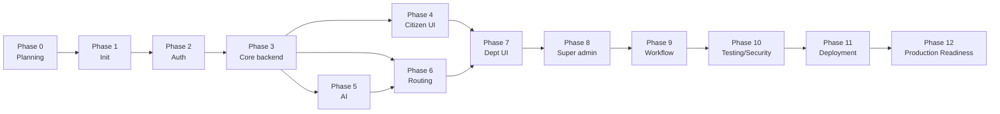

# CivicSense — Development Roadmap

| Field | Value |
|---|---|
| Document | `DEVELOPMENT_ROADMAP.md` |
| Version | 1.5 (Phase 12 completed locally) |
| Status | Phase 12 complete and checkpointed locally — hosted verification remains blocked |
| Last updated | 2026-11-22 |

---

## 1. Current status

| Phase | Status | Notes |
|---|---|---|
| **0 — Project planning** | ✅ Complete and approved | Five design documents; environment scanned; local-scope + Supabase decisions accepted |
| 1 — Project initialization | ⚠️ Scaffolding complete — **verification pending** | Code/config/migrations ready; Supabase credentials not configured, so DB/PostGIS/storage health checks are **not** verified. **Do not mark Phase 1 fully complete.** |
| 2 — Authentication & authorization | ✅ Complete and approved | JWT + rotating refresh cookie, BCrypt, rate limiting, roles, department verification, frontend guards; 9/9 automated tests passed (§6). Not verified against hosted Supabase. |
| 3 — Database & core backend | ✅ Complete and approved | V3–V7 migrations, 17 new entities/repositories, complaint lifecycle, reference data, service areas, notifications, audit/outbox; 35/35 automated tests pass (§7). Hosted Supabase/PostGIS execution still pending. |
| 4 — Citizen frontend | ✅ Complete and approved | Full citizen React app: landing, auth, dashboard, 4-step report wizard, tracking/detail, notifications, profile; real backend API integration; 8/8 frontend unit tests, `npm run build` and `npm run lint` green (§8). Photo/AI limitations were superseded by Phase 5. |
| 5 — AI image analysis | ✅ Complete and approved | Secure presign/confirm uploads via `ObjectStorage`, provider-independent `AiVisionClient`, async persisted analysis workflow, safety validation, frontend upload/analysis UI; 59/59 backend tests and 8/8 frontend tests green (§9). No real Supabase storage or paid provider call was available. Checkpoint `7a79c91`, tag `phase5-approved`. |
| 6 — Geographical routing engine | ✅ Complete and approved | Deterministic `routing-v1`, profile-specific PostGIS/JTS spatial matching, persisted decisions, idempotent reroutes, admin overrides; 76/76 backend tests green (§10). Hosted Supabase/PostGIS execution is still unverified. Checkpoint `3dc2d0f`, tag `phase6-approved`. |
| 7 — Department dashboard | ✅ Complete and approved | Verified department workspace: real analytics/activity, paged filterable queue, full detail/actions, private notes, secure evidence upload, profile/capabilities/team/service areas. 93/93 backend tests and 20/20 frontend tests green; build/lint green (§11). Hosted Supabase/PostGIS remains unverified. Checkpoint `1aa7efb`, tag `phase7-approved`. |
| 8 — Super administrator dashboard | ✅ Complete and approved | SUPER_ADMIN-only platform governance: real overview/analytics/activity, department verification/suspension/operations, user management, audit exploration, global complaint queue, append-only AI-history/override, forced reroute/manual assignment history, and seven admin screens. 107/107 backend tests and 30/30 frontend tests green; build/lint green (§12). Checkpoint `ef2ea7c`, tag `phase8-approved`. |
| 9 — Notifications & complete workflow | ✅ Complete and approved | Durable outbox dispatch with retry/dedupe, complete lifecycle event wiring, role-aware notification navigation, notification preferences, citizen info-reply, feedback/dispute visibility, and admin/department notification states. 116/116 backend tests and 33/33 frontend tests green; build/lint green (§13). Checkpoint `1614c79`, tag `phase9-approved`. Hosted Supabase/PostGIS and real providers remain unverified. |
| 10 — Testing & security | ✅ Complete and approved | Security headers/CSP, API rate limits, password reset, retention cleanup, Playwright E2E, RLS/Argon2id decisions, repeatable dependency/secret audits, and remediation of all high/critical advisories via Spring Boot 4.2.0. 127/127 backend tests, 39/39 frontend tests, and 5/5 E2E tests green (§14). Checkpointed as `phase10-approved`; no push. |
| 11 — Deployment | ✅ Complete and approved | Supabase + local-process path documented in `docs/DEPLOYMENT.md`; `.env.example` refreshed; Flyway/backup/restore/storage/logging guidance consolidated. Backup/restore dry run passed twice; local smoke check, 127 backend tests, 39 frontend tests, 5 E2E tests, package, lint, build, dependency audit and secret scan all green (§15). Checkpointed as `phase11-approved`; no push. Hosted verification still open. |
| 12 — Production readiness & infrastructure hardening | ✅ Complete locally — final checkpoint | All locally implementable work in §3 is done and verified; hosted Supabase/PostGIS, S3, SMTP delivery, hosted health and hosted backup/restore remain blocked by missing credentials/access. Results are in §16 and `docs/PHASE12_IMPLEMENTATION_CONTRACT.md §11`. No Phase 13; no push. |

**Rule:** only one phase is active at a time. A phase is not marked complete until its exit criteria are met and its report is written into this file.

> **Current-state note (Phase 12):** earlier phase reports below describe the
> state at their own checkpoints. Statements that called Phase 12, structured
> JSON logging, the global correlation filter, or SMTP delivery “future work”
> are historical and are superseded by §16. PostgreSQL RLS and Redis/shared rate
> limiting were evaluated but deliberately **not** enabled; hosted database,
> storage, email and deployment verification remain **blocked**, not verified.

---

## 1.1 Phase 1 — pending external verification (explicitly NOT complete)

Owner instruction 2026-11-21: **do not block development on Supabase credentials, and do not mark Phase 1 as fully verified.** The following items remain open and must be executed before Phase 1 can be marked complete:

| # | Pending verification | Status | Required evidence |
|---|---|---|---|
| 1 | Supabase credentials placed in root `.env` | ⬜ Pending | `.env` filled locally (git-ignored), values never committed |
| 2 | One-time Supabase setup (`docs\SUPABASE_SETUP.md`): extensions, private `civic-images` bucket, S3 access keys | ⬜ Pending | Supabase project configured |
| 3 | Flyway `V1__enable_extensions.sql` applied to Supabase | ⬜ Pending | `flyway_schema_history` contains V1 |
| 4 | Real plain SQL query (`SELECT 1`) | ⬜ Pending | Query result `1` |
| 5 | Real PostGIS spatial query (`ST_Intersects` / `postgis_version()`) | ⬜ Pending | Query returns expected `true` / version |
| 6 | Real S3 `HeadBucket` on `civic-images` | ⬜ Pending | Success response |
| 7 | Backend starts against Supabase; `/meta/health` + `/actuator/health` report `UP` | ⬜ Pending | HTTP 200 responses with real checks |
| 8 | Frontend → backend CORS call verified | ⬜ Pending | Browser/dev-server request succeeds |
| 9 | Phase 1 report written and owner approval obtained | ⬜ Pending | This file + approval |

**Explicitly not claimed:** no successful Supabase connection, database query, PostGIS query, storage check, or integration health result has been observed. Automated Phase 2 tests use **H2 in PostgreSQL compatibility mode as a local test double only**; they do not substitute for the checks above. Migrations are written and ready to execute once credentials exist.

---

## 2. Environment prerequisites (approved modifications)

Owner-approved constraints (2026-11-21): **local scope only** — nothing installed globally or on C: for this project; **no Docker Desktop / no Docker configuration**; **Supabase** provides hosted PostgreSQL + PostGIS and S3-compatible image storage in initial development; Spring Boot remains the sole business-logic/auth/AI/routing layer.

| Need | Source | Action |
|---|---|---|
| Java 21 | Pre-existing `21.0.9` | Use as-is; no system changes |
| Maven | Pre-existing `3.9.16` | Use as-is; local repository may be redirected to `E:\CivicSense\tools\maven-repo` via project `.mvn/maven.config` if needed |
| Git | Pre-existing `2.52.0` | `git init` in `E:\CivicSense` only |
| Node.js + npm | **Portable ZIP** from nodejs.org | Extract to `E:\CivicSense\tools\node\node-v<version>-win-x64`; verify SHA-256; no winget, no PATH modification |
| npm cache / global prefix | Project-local | `.npmrc` → `E:\CivicSense\tools\npm-cache` and `tools\npm-global` |
| Database | **Supabase Postgres + PostGIS** | Connection in root `.env`; Flyway on direct port 5432; one-time setup in `docs\SUPABASE_SETUP.md` |
| Object storage | **Supabase Storage (S3 API)** | Private bucket `civic-images`; S3 credentials in root `.env` |
| Local Postgres / MinIO | Not used in Phase 1 | Deferred; provider abstractions keep migration configuration-only |
| psql client | Not needed | JDBC/Flyway queries used for verification |
| AI API key | Not provided | `StubAiVisionClient` in dev/tests; real provider via env later |
| Geocoding API key | Not provided | Nominatim in dev (rate-limited); paid provider via env later |
| Supabase credentials | **Not yet supplied** | Required in `.env` for Phase 1 database verification; never commit |

**Credential rule:** root `.env` is git-ignored; `.env.example` has placeholders only; `scripts\dev-env.ps1` loads values into the current PowerShell session (no user/machine env changes).

---

## 3. Phase plans

### Phase 0 — Project planning ✅ (approved)
**Deliverables**
- `ARCHITECTURE.md`, `DATABASE_DESIGN.md` (incl. ER diagram), `API_DOCUMENTATION.md`, `AI_ROUTING_DESIGN.md`, `DEVELOPMENT_ROADMAP.md`.

**Exit criteria** — all five documents present, decisions justified, environment inspected, owner approval obtained.
**Tests:** none (documentation phase).

---

### Phase 1 — Project initialization (scaffolding complete; verification pending — see §1.1)
**Scope**
- `git init`, `.gitignore`, project-local `.npmrc`, portable Node LTS under `tools\node`, `scripts\dev-env.ps1`.
- `frontend\`: Vite + React + TypeScript scaffold, axios API client, CORS-tested health call, landing shell. All deps in `frontend\node_modules`.
- `backend\`: single-module Maven Spring Boot 4.2.0 (Phase 1 pinned 3.5.16; upgraded in Phase 10), Spring Web/Security/Validation/JPA/Actuator, PostgreSQL driver, Flyway, Springdoc, AWS SDK S3 (Supabase Storage endpoint).
- Supabase connectivity: Flyway `V1__enable_extensions.sql` (PostGIS/pgcrypto/pg_trgm in Supabase's `extensions` schema) via direct connection, no manually created app tables.
- `application.yml` + dev profile, root `.env` + `.env.example` (placeholders only), CORS allowlist, health indicators (`db`, `postgis`, `objectStorage`).
- `docs\SUPABASE_SETUP.md` documenting one-time Supabase-only configuration.

**Exit criteria**
- Portable `node --version` / `npm --version` work from `tools\node` with no PATH changes; npm cache resolves under `E:\CivicSense\tools`.
- Spring Boot starts successfully against Supabase; Flyway baseline applied and recorded in `flyway_schema_history`.
- **Actual database verification**: a plain SQL query (`SELECT 1`) and a **PostGIS spatial query** (`ST_Intersects` / `ST_Distance` with a concrete geometry) both execute and return expected values — connection alone is insufficient.
- Object-storage health indicator performs a real bucket check via the S3 API.
- `GET /api/v1/meta/health` returns 200; `GET /actuator/health` reports `db`, `postgis`, `objectStorage` as `UP`.
- React dev server starts; frontend successfully calls the backend health endpoint through CORS; `npm run build` succeeds.
- `.env` and all secret files are git-ignored; `.env.example` contains placeholders only.
- Phase 1 report written here with tests executed/passed/failed; **wait for owner approval before Phase 2**.

**Tests executed (to record here):** portable Node checksum + version, Maven compile, Spring context load, Flyway migration, JDBC plain query, PostGIS spatial query, S3 bucket check, health endpoints, frontend dev server + build, CORS browser-style check, Git ignore check.

---

### Phase 2 — Authentication & authorization (delivered; awaiting approval — see §6)
**Scope**
- Identity schema migration `V2__identity_and_departments.sql` (PostgreSQL/Supabase-ready, **not executed yet**).
- Citizen register/login, department self-registration (`PENDING_VERIFICATION`), super-admin bootstrap from env.
- JWT access + rotating refresh cookie, BCrypt, auth rate limiting, `@PreAuthorize`, frontend route guards.
- Department verification workflow endpoints; unverified departments cannot access `/department/**`.
- **All authentication/authorization logic lives in Spring Boot.** Supabase Auth is not used, configured, or called.
- Automated tests use H2 (PostgreSQL mode) test doubles only. Phase 1 hosted-service verification remains pending (§1.1).

**Exit criteria**
- All three roles can register/login/logout/refresh independently. ✅ (citizen + department admin + super-admin fixtures in tests)
- Department admin receives `403` until verified; after verification can reach `/department/*`. ✅
- Refresh rotation + reuse revocation tested. ✅
- Unauthorized access to another department's endpoint returns 404/403. ✅ (`403` via `@PreAuthorize` scope guard)

**Result:** all exit criteria met with local H2 test doubles; see §6 for the full report. Hosted Supabase verification remains explicitly pending (§1.1).

---

### Phase 3 — Database & core backend (delivered; awaiting approval — see §7)
**Scope**
- Migrations `V3–V7` (complaints, collaboration, governance, indexes/constraints, gated reference seeds). `V2` already existed from Phase 2.
- 17 new entities/repositories, DTOs and services for complaints, categories, jurisdictions, service areas, assignments, status history, comments, internal notes, feedback, notifications, reassignment, audit and outbox.
- `StatusTransitionPolicy`, audit AOP, persisted outbox events, real DB-backed filters/aggregates.
- Unit + MockMvc integration tests against the H2 PostgreSQL-compatibility test double.

**Exit criteria**
- Local CRUD/lifecycle services work against a real relational database; illegal transitions rejected with `409`; audit rows written. ✅
- Strict department-level isolation returns `404` for cross-department reads and writes; citizen ownership is enforced in repository queries. ✅
- `mvn test` and `mvn package` green with 35 tests. ✅
- Flyway applies the full schema on a clean PostGIS database. ⬜ Pending Supabase credentials (§1.1).
- Testcontainers integration tests. ⬜ Not used: no Docker by owner constraint; H2 test double used instead.

**Result:** Phase 3 implementation and all locally verifiable exit criteria are complete. Hosted PostGIS verification remains explicitly pending. See §7 for the full report.

---

### Phase 4 — Citizen frontend (delivered; awaiting approval — see §8)
**Scope**
- Landing, register, login, responsive citizen shell, dashboard, 4-step report wizard (details → photos → location → review), submission confirmation, My Complaints with filters, complaint detail with timeline/comments/reopen/feedback, notifications centre, profile/settings.
- TanStack Query for all server state, hand-written TypeScript API types matching the Phase 3 DTOs, RFC 7807 error helpers, shared emerald/light design system, loading/error/empty/success states.
- Real backend integration only (no mocks in production paths). Custom OSM tile map picker using existing env-configured tile URL/attribution (no map library was added).
- Local photo validation and preview with explicit pending-storage messaging; no fake upload/AI success.

**Deviations from the original plan**
- No Zod/React Hook Form: validation is implemented with typed form state and explicit checks against the backend constraints (10–2000 char description, lat/lon bounds, 20–1000 char reopen reason, etc.).
- No `openapi-typescript` generated types: deferred from Phase 2 because the generator's TypeScript peer range excludes the project's TS 7.0.2; types are hand-maintained against the Phase 3 records.
- No Leaflet dependency: a lightweight OSM tile picker was built from the existing `VITE_MAP_TILE_URL` / `VITE_MAP_TILE_ATTRIBUTION` env variables.
- No AI progress UI beyond an explicit "analysis pending — no result generated" notice; AI is Phase 5.
- Photo capture/validation works locally, but images are **not** uploaded or attached because the backend has no presign/confirm endpoint and no image fields on `SubmitComplaintRequest` / `ComplaintDetail`.

**Exit criteria**
- Citizen can submit a complaint (description + location + optional category/address) through the UI against the real backend. ✅ (photo attachment excluded — see §8.4)
- Complaint appears in history with status timeline; notifications render. ✅
- Responsive layouts verified via Tailwind breakpoints; `npm run build`, `npm run lint` and unit tests pass. ✅

---

### Phase 5 — AI image analysis (delivered — see §9)
**Scope**
- Secure upload lifecycle: presign → direct PUT → server-side confirm → attach on complaint submit; `ObjectStorage` abstraction over S3/S3-presigner.
- `AiVisionClient` + OpenAI-compatible provider + non-prod stub; strict JSON schema validation, retries, timeouts, confidence threshold, raw-response persistence (never logged).
- Async post-commit analysis worker, single-run guard, persisted status history, and citizen UI for upload progress, confirmation, analysis status/results, and advisory department hint.

**Exit criteria**
- ✅ Valid structured responses for all seeded categories; invalid/low-confidence/failed cases produce review flags and persisted raw responses.
- ✅ Provider can be swapped via env without touching routing code.
- ✅ Complaints persist when AI or storage fails; duplicate processing is prevented.
- ⏭️ Admin classification override is deferred to Phase 8; it must append a new analysis row and preserve the original.
- ⚠️ A local JDK HTTP stub replaced WireMock because the requested WireMock Jetty artifact was unavailable in the configured Maven repository. Tests remain HTTP-level and make **no** paid API calls.

---

### Phase 6 — Geographical routing engine (delivered — see §10)
**Scope**
- PostGIS jurisdiction/service-area queries behind `SpatialMatcher`; profile-specific JTS test double for H2; `RoutingEngine` with eligibility, scoring, outcomes, capacity and deterministic tie-breaks.
- Persisted decision history, idempotent triggers, forced reroutes, explicit unresolved queue, and super-admin classification/assignment override endpoints.
- Routing test matrix from `AI_ROUTING_DESIGN.md §8.2` plus geometry/coordinate and idempotency tests.

**Exit criteria**
- ✅ All routing scenarios (single, multiple, none, outside boundaries, pending dept, low confidence, capacity) pass locally.
- ✅ Routing decision rows persisted for every run; forced reroutes preserve history and one current decision.
- ✅ No complaint is silently dropped; unresolved cases remain in the admin review queue.
- ⚠️ Live Supabase/PostGIS query execution remains pending under §1.1; H2/JTS tests are not a substitute.

---

### Phase 7 — Department dashboard
**Scope**
- Department shell + overview, complaint queues (incoming/AI-assigned/pending/accepted/in progress/resolved/rejected), detail with map/photo/AI panel, accept/reject/request-info/reassign-request, status transitions, internal notes, evidence upload, analytics, service-area management, team management, notifications, profile.

**Exit criteria**
- Full department workflow against real data.
- Department-level isolation tests pass (ID manipulation cannot reveal another dept's complaint).
- `RESOLVED` guard requires AFTER evidence; analytics use real SQL aggregates.

---

### Phase 8 — Super administrator dashboard
**Scope**
- Platform overview, department approval queue + management, user management, global complaints, unassigned queue, routing corrections, jurisdiction management, category management, analytics, audit logs, settings.

**Exit criteria**
- Super admin can verify/reject a department, correct AI classification, manually assign, and view audit history.
- All analytics reflect real database values.

---

### Phase 9 — Notifications & complete workflow
**Scope**
- Wire every lifecycle event to outbox → notifications; notification centre for all roles; email channel interface (disabled by default).
- End-to-end acceptance scenario from §14 of the master prompt.

**Exit criteria**
- Full 20-step citizen→department→citizen scenario passes end to end.
- Unassigned, failed-AI, duplicate, unauthorized, invalid-registration edge cases verified.

---

### Phase 10 — Testing & security
**Scope**
- Unit, integration, API, frontend component, authorization, file-upload, AI, routing, E2E tests (Playwright).
- Security review: RLS defence in depth, Argon2id evaluation, CSP, dependency audit, rate-limit verification, secret scanning.

**Exit criteria**
- No critical/high vulnerabilities in dependency scan; all tests green; documented fixes for issues found.

**Delivery status:** implemented and locally verified. See the Phase 10 completion report in §14. All high/critical findings were remediated; no push or Phase 11 work was performed.

---

### Phase 11 — Deployment
**Scope**
- Production Dockerfiles/compose (only when Docker is reintroduced by explicit decision), `.env.example`, migration/backup/restore docs, storage setup, logging/monitoring, local run instructions. Until then, document the current Supabase + local-process setup as the supported development path.

**Exit criteria**
- Fresh clone → documented commands → full stack running with migrations applied.
- Backup/restore procedure documented and tested once.

---

### Phase 12 — Production Readiness & Infrastructure Hardening

**Status:** complete locally; final planned development phase; no Phase 13.
Definition added after owner authorization on 2026-11-22 because this phase did
not previously exist in the roadmap. It is derived from documented deferred work
and unresolved verification gates in §§1.1, 10, 11, 14 and 15, not from newly
invented product features. Actual results are recorded in §16.

**Objectives and scope**

Evaluate and implement the remaining production-readiness work below:

**A. Database and Supabase**
- Connect to the actual hosted Supabase project and verify PostgreSQL
  connectivity.
- Execute and validate Flyway migrations V1–V13; verify ordering, schema
  compatibility, indexes, and constraints.
- Verify PostGIS installation and real spatial queries, and test
  jurisdiction-based routing against real PostgreSQL/PostGIS.
- Document and safely resolve any incompatibilities.

**B. Object storage**
- Configure actual production object storage.
- Verify secure upload, confirmation, retrieval, and access control.
- Test invalid files, ownership restrictions, and failure scenarios.
- Ensure storage failures never cause complaint data loss.

**C. Notifications**
- Implement actual password-reset email delivery.
- Verify one-time token handling and expiration.
- Test delivery failures, retries, and duplicate prevention.
- Keep email and push configuration disabled when no provider is configured.

**D. Distributed infrastructure**
- Evaluate Redis or another appropriate shared rate-limiting mechanism.
- Implement distributed rate limiting only where justified by the existing
  architecture, preserving current limits and security behavior.
- Test cross-instance behavior where possible.

**E. Observability**
- Implement structured JSON logging and a global correlation-ID filter.
- Propagate correlation IDs through relevant application operations.
- Prevent secrets, tokens, personal information, and sensitive complaint data
  from leaking into logs.
- Document monitoring and troubleshooting procedures.

**F. Security review**
- Review application-layer authorization and database access.
- Evaluate PostgreSQL Row-Level Security; enable policies only after testing
  citizen, department-admin, and super-admin access patterns and only where
  they cannot break legitimate backend operations.
- Evaluate Argon2id migration from BCrypt. If justified, implement a gradual
  hash upgrade without forced password resets.
- Preserve all existing authentication and authorization guarantees.

**G. Production deployment verification**
- Perform a production-like deployment using the documented no-Docker
  approach.
- Verify backend health, frontend delivery, database connectivity, migrations,
  storage, and configured providers.
- Test backup/restore against the actual supported database where access is
  available; verify startup and recovery after restart.
- Document operational procedures and rollback steps.

**Dependencies**
- Phase 11 checkpoint `083a0e6` / `phase11-approved`; all earlier approved
  checkpoints remain intact.
- Existing Java 21 / Spring Boot 4.2.0 backend, React/TypeScript frontend,
  Flyway V1–V13, RBAC, audit history, department isolation, complaint lifecycle,
  durable outbox, and deployment documentation are reused rather than replaced.
- External verification in A, B, and G requires real Supabase PostgreSQL/PostGIS,
  S3-compatible storage credentials, and network access supplied locally in the
  git-ignored `.env`. Real email delivery requires an SMTP provider. No fake
  credentials, fake production data, or auth bypass may be used.
- Docker remains excluded under the standing owner decision.

**Exit criteria**
- Every locally implementable item in A–G is implemented, tested, and documented
  without weakening existing behavior.
- The full backend and frontend suites, package/build, lint/TypeScript checks,
  Playwright E2E where applicable, dependency audit, secret scan, authorization
  and isolation tests, rate-limit tests, storage/notification failure tests,
  backup/restore test, and `git diff --check` are executed with actual results
  reported.
- Any external item that cannot be exercised because credentials or access are
  missing is explicitly marked blocked, with the exact missing requirement
  named; it is never claimed as verified.
- `.env.example` covers every required runtime key, no real credential is
  committed, no obsolete configuration or unfinished TODO is silently ignored,
  and final documentation accurately reflects the implementation.
- Final commit and local `phase12-approved` tag are created after verification;
  no push is performed. The project is not represented as production-ready
  while external verification remains unavailable.

---

## 4. Dependency graph



---

## 5. Phase 0 completion report

**Files created**
1. `E:\CivicSense\ARCHITECTURE.md`
2. `E:\CivicSense\DATABASE_DESIGN.md`
3. `E:\CivicSense\API_DOCUMENTATION.md`
4. `E:\CivicSense\AI_ROUTING_DESIGN.md`
5. `E:\CivicSense\DEVELOPMENT_ROADMAP.md`

**Functionality implemented**
None — Phase 0 is design only. No source code, build files, or migrations were created, per instruction.

**Tests executed**
- Environment inspection commands: directory listing; `java -version`, `mvn -version`, `git --version`, Node/npm/Docker/psql availability checks, `where.exe` lookups, `Program Files` scan.

**Results**
- Passed: Java 21, Maven 3.9.16, Git 2.52 present; project directory confirmed empty.
- Noted: Node.js/npm absent → portable local install approved; Docker/psql absent → intentionally not installed, Supabase approved.

**Remaining issues**
- ✅ Resolved: owner approved the plan and the local-scope/Supabase modifications on 2026-11-21.
- Open for Phase 1: Supabase project credentials (DB URL/password, Storage S3 keys) must be supplied through the local `.env`; no real Supabase query can be claimed before they are available.
- No AI or geocoding API key available; stub/development providers planned, real providers configured via env when supplied.

**Exact commands to run (Phase 0 — inspection only)**
```powershell
Get-ChildItem -Force 'E:\CivicSense'
java -version
mvn -version
git --version
```

**Phase complete:** ✅ Yes — design phase delivered and approved; Phase 1 started after documentation updates.

---

## 6. Phase 2 completion report — Authentication & authorization

**Status:** implementation complete and locally verified. **Awaiting owner approval before Phase 3.**

### Functionality implemented

**Backend (Spring Boot 4.2.0, Java 21; Phase 1 originally pinned 3.5.16)**
- `V2__identity_and_departments.sql`: users, departments, department_admins, refresh_tokens, reference category/jurisdiction seeds — **migration written but not executed against Supabase**.
- BCrypt password hashing (strength 12), validation on all auth DTOs, normalized/lowercased emails.
- JWT access tokens (HS384, 15 min, configurable) with `sub`, `email`, `role`, `deptId` claims; department verification is read live from DB on each request and is never trusted from the token.
- Rotating refresh token stored as SHA-256 hash in DB, delivered as `HttpOnly; SameSite=Strict; Path=/api/v1/auth` cookie; reuse of a rotated token revokes the whole token family in a `REQUIRES_NEW` transaction.
- Login rate limiting (Bucket4j, per-IP) + 5-failure / 15-minute account lockout; RFC 7807 errors with correlation IDs.
- Method security (`@EnableMethodSecurity`), role rules (`CITIZEN`, `DEPARTMENT_ADMIN`, `SUPER_ADMIN`), `DepartmentAccessGuard` for cross-department denial.
- Super-admin bootstrap from local `.env` values (`!test` profile only) — never logs the password, never overwrites an existing account.
- Endpoints: `POST /auth/register/{citizen,department}`, `POST /auth/{login,refresh,logout}`, `GET /auth/me`, `GET /department/me`, `GET /admin/departments`, `POST /admin/departments/{id}/verify`.

**Frontend (Vite 8 / React 19 / TypeScript 7)**
- Axios client with in-memory access token, httpOnly refresh cookie, single-flight 401→refresh→retry interceptor.
- `AuthProvider` (TanStack Query), protected routes (`RequireAuth`, `RequireRole`), login/register/home/admin pages.
- No secrets or access tokens persisted to `localStorage`/`sessionStorage`.

**Documentation**
- `API_DOCUMENTATION.md` §2.1 documents the implemented Phase 2 subset and differences from the Phase 0 contract; §10 now uses `/api/v1/actuator/health`.

### Tests executed and results

| Command | Result |
|---|---|
| `mvn -B -DskipTests compile` | ✅ BUILD SUCCESS (39 source files) |
| `mvn -B test` | ✅ 9 tests run, **0 failures, 0 errors, 0 skipped** |
| `mvn -B package` | ✅ BUILD SUCCESS (boot jar produced) |
| `npm run build` (`tsc -b && vite build`) | ✅ built in ~131 ms, 133 modules |
| `npm run lint` (`oxlint`) | ✅ no errors, no warnings |

Test breakdown (`backend/target/surefire-reports`):
- `AuthFlowIntegrationTest` — 3 tests: register → login → `/auth/me` → refresh rotation → reuse revocation → logout; duplicate email 409; weak password 400; account lockout 429.
- `DepartmentAuthorizationIntegrationTest` — 2 tests: unverified dept admin gets 403; super-admin verification takes effect immediately on an already-issued token; own-dept probe 200 / other-dept probe 403; citizen cannot reach admin/department endpoints.
- `JwtServiceTest` — 3 tests: claims, tampered/expired token rejection, short-secret rejection.
- `RateLimitServiceTest` — 1 test: capacity enforcement + `Retry-After`.

### Design decisions recorded
- All auth/authz remains in Spring Boot; Supabase Auth is never used or configured.
- Automated tests use H2 in PostgreSQL compatibility mode as a **local test double only**; Flyway is disabled in the `test` profile.
- `refresh_tokens.ip_address` is `varchar(45)` instead of `inet` for JPA/H2 portability.
- Frontend types are hand-written placeholders; `openapi-typescript` generation is deferred because v7.13.0 requires TypeScript ^5.x (project uses 7.0.2).

### Not verified / still pending
- No Supabase credential has been supplied. No real DB query, PostGIS query, S3 `HeadBucket`, or health check has been executed; Phase 1 §1.1 remains **open** and Phase 1 is **not** marked complete.
- `V2__identity_and_departments.sql` is ready to execute once credentials are configured, but has not been applied to any hosted database.
- No browser-level end-to-end check against a running backend+Supabase was performed.

**Gate:** Phase 2 was approved by the owner on 2026-11-21; Phase 3 started after that approval.

---

## 7. Phase 3 completion report — Database & core backend

**Status:** implementation complete and locally verified. **Awaiting owner approval before Phase 4.**

### 7.1 Entity / relationship summary

Phase 3 added 17 mapped entities and 17 repositories; the application now has 21 entities and 21 repositories including Phase 2 identity classes.

| Area | Entities | Key relationships |
|---|---|---|
| Complaint core | `Complaint`, `ComplaintImage`, `AiAnalysis`, `ComplaintStatusHistory` | A complaint belongs to a citizen, optional category/subcategory, and optional related department; it has many images, analyses, and ordered history entries. |
| Assignment & routing | `ComplaintAssignment`, `ReassignmentRequest`, `RoutingDecision` | A complaint has many assignments (one active) and reassignment requests; assignments reference from/to departments and the approving admin. |
| Collaboration | `ComplaintComment`, `ComplaintInternalNote`, `ComplaintFeedback`, `Notification`, `OutboxEvent` | Comments/notes/feedback belong to a complaint; notifications reference a recipient user and optional complaint; outbox stores undelivered domain events. |
| Reference | `IssueCategory`, `DepartmentIssueCategory`, `Jurisdiction`, `ServiceArea` | Categories are a self-referencing tree; departments link to primary categories; service areas reference a department and optional jurisdiction. |
| Governance | `AuditLog` | Append-only rows reference the actor user and carry action/entity/correlation metadata. |

Migrations also define `geocoding_cache` and `platform_settings`; these have no dedicated repository/API in Phase 3. PostGIS geometry columns remain authoritative in production, with JPA using WKT companion columns for complaints and service areas.

### 7.2 API endpoints implemented

Detailed contracts and payloads are documented in `API_DOCUMENTATION.md §11`.

- **Public/reference:** `GET /meta/categories`, `GET /meta/jurisdictions`, `POST /admin/reference/categories`, `PATCH /admin/reference/categories/{id}`, `POST /admin/reference/jurisdictions`.
- **Citizen:** submit, list with filters, detail, timeline, comments (list/create), reopen, feedback under `/citizen/complaints`.
- **Department:** list with filters, detail, accept, reject, status patch, request-info, internal notes, reassignment request, real analytics, and service-area list/create/deactivate under `/department`.
- **Super admin:** all/unassigned/detail complaints, assign, unassign, pending reassignment list, reassignment review under `/admin`.
- **Notifications:** list, unread count, mark one read, mark all read under `/notifications`.

Isolation rules: department scope always comes from the verified JWT; cross-department complaint/service-area access returns `404`; citizen queries are constrained to the JWT citizen id; internal notes are department-only; notifications are recipient-only.

### 7.3 Flyway migrations

| Migration | Phase 3 status |
|---|---|
| `V3__complaints.sql` | Written. Complaints, images, AI analyses, assignments, status history, reassignment requests, `location_wkt`/`boundary_wkt` triggers. |
| `V4__collaboration.sql` | Written. Outbox events, comments, internal notes, notifications, feedback. |
| `V5__governance.sql` | Written. Routing decisions, geocoding cache, audit logs, platform settings, `complaint_number_seq`. |
| `V6__indexes_and_constraints.sql` | Written. Indexes, constraints, commented RLS scaffolding. |
| `V7__seed_reference_data.sql` | Written. Environment-gated category/jurisdiction/settings seed data. |

`V8__super_admin_seed.sql` was not created; Phase 2's `SuperAdminBootstrap` owns first-admin creation from local environment values. **None of V1–V7 has been applied to Supabase.**

### 7.4 Tests executed and results

| Command | Result |
|---|---|
| `mvn -B test` | ✅ 35 tests run, **0 failures, 0 errors, 0 skipped** |
| `mvn -B package` | ✅ BUILD SUCCESS; `backend\target\civicsense-backend-0.1.0.jar` produced |
| `npm run build`, `npm run lint` | Not rerun: no frontend source or generated types changed in Phase 3. Phase 2 results still stand. |

Test breakdown from `backend/target/surefire-reports`:

| Test class | Count | Coverage |
|---|---:|---|
| `AuthFlowIntegrationTest` | 3 | Phase 2 regression: registration, login, refresh rotation/reuse revocation, logout, validation, lockout |
| `DepartmentAuthorizationIntegrationTest` | 2 | Phase 2 regression: verification guard and department isolation |
| `ComplaintLifecycleIntegrationTest` | 12 | Submission/numbering, ownership, strict department isolation, assignment eligibility, status guards, evidence rule, feedback/reopen, internal notes, reassignment, real aggregates, filters/admin queues, timeline |
| `ReferenceAndNotificationIntegrationTest` | 5 | Category tree and admin writes, in-use deactivation conflict, service-area validation/isolation, notification recipient scope/read states, comment access |
| `StatusTransitionPolicyTest` | 5 | Allowed/forbidden actors, reassignment self-transition, reason/evidence flags, terminal `CLOSED`, documented coverage |
| `GeometryValidatorTest` | 4 | Valid polygon/multi-polygon WKT and rejection of blank/wrong/malformed/non-numeric boundaries |
| `JwtServiceTest` | 3 | Phase 2 regression: claims, tampering/expiry, weak secret |
| `RateLimitServiceTest` | 1 | Phase 2 regression: capacity and `Retry-After` |

### 7.5 Known limitations / incomplete functionality

- No Supabase credentials are configured. V1–V7 are unexecuted; no real PostgreSQL/PostGIS query, `ST_Intersects`, S3 `HeadBucket`, or hosted health check has succeeded. Phase 1 §1.1 remains open and Phase 1 is **not** marked fully verified.
- Geometry validation is structural only. `ST_IsValid`, spatial containment, and WKT→geometry triggers are unverified until a real PostGIS database is available.
- H2 is a local test double: geometry/jsonb/inet columns, triggers, and partial/function-based indexes are absent or simplified. The production partial unique index for one active assignment is supplemented by service-layer deactivation.
- No Testcontainers tests: Docker is excluded by the owner's local-scope constraint.
- Outbox events are persisted but no dispatcher/worker exists. No email/SMS/push delivery is implemented. *(Historical Phase 3 snapshot; the dispatcher was added in Phase 9 and the provider-gated SMTP reset channel in Phase 12.)*
- Upload presigning/confirmation, reverse geocoding, AI image analysis, AI classification overrides, `/meta/config`, and cross-admin analytics are not implemented. *(Historical Phase 3 snapshot; these were delivered in Phases 5–8.)*
- Notification delivery is polling-oriented; no WebSocket/SSE transport exists.
- All work remains uncommitted; no remote or push has been configured.

### 7.6 Exact backend run commands

From PowerShell at the repository root (`E:\CivicSense`):

```powershell
# Tests and package — test profile uses the H2 test double, no Supabase credentials needed
cd E:\CivicSense\backend
mvn -B test
mvn -B package
```

To start the application against a configured database, first fill the git-ignored root `.env` with real values, then:

```powershell
cd E:\CivicSense
powershell -ExecutionPolicy Bypass -File .\scripts\run-backend.ps1
```

Equivalent direct start after loading environment values into the current session:

```powershell
cd E:\CivicSense
. .\scripts\dev-env.ps1
cd backend
mvn -B spring-boot:run
```

The backend serves REST under `http://localhost:8080/api/v1`. Startup requires `SPRING_DATASOURCE_URL`, `SPRING_DATASOURCE_USERNAME`, `SPRING_DATASOURCE_PASSWORD`, and `CIVICSENSE_JWT_SECRET`; without real Supabase values, startup against the default profile is expected to fail and must not be reported as verified.

**Gate:** Phase 3 was approved by the owner on 2026-11-21; Phase 4 started after that approval.

---

## 8. Phase 4 completion report — Citizen frontend

**Historical snapshot.** The upload/AI gaps recorded in §8.4–§8.5 were closed in Phase 5 (§9); this section is retained for auditability.

**Status:** implementation complete and locally verified. **Awaiting owner approval before Phase 5.**

### 8.1 Screens delivered

| Route | Screen | Access | Notes |
|---|---|---|---|
| `/` | Landing | Public | Emerald hero, feature cards, CTA adapts to session state. |
| `/login`, `/register` | Sign in / register | Public | Citizen + department application modes, RFC 7807 error display. |
| `/forbidden` | Access denied | Public | Role-guard redirect target. |
| `/dashboard` | Citizen overview | `CITIZEN` | Live totals (total/pending/in-progress/resolved), recent reports, status distribution — all derived from `GET /citizen/complaints`. |
| `/complaints/new` | Report wizard | `CITIZEN` | 4 steps: details → photos → location → review. |
| `/complaints/:id/submitted` | Submission confirmation | `CITIZEN` | Complaint number, submitted date, explicit "analysis pending — no AI result" notice. |
| `/complaints` | My complaints | `CITIZEN` | Search, status, category, date-range filters; all handled by the backend query. |
| `/complaints/:id` | Complaint detail | `CITIZEN` | Full metadata, location, timeline, comments, department info, feedback/reopen, resolution evidence slots. |
| `/notifications` | Notifications centre | Authenticated | List, unread filter, mark one / mark all, live unread badge in nav. |
| `/profile` | Profile & settings | Authenticated | Read-only `/auth/me` identity, session security summary, explicit "settings not yet available" notes. |
| `/admin` | Department applications | `SUPER_ADMIN` | Retained Phase 2 verification screen, restyled to the new design system. |

### 8.2 Main workflow

1. Resident registers or signs in; access token stays in memory, refresh via httpOnly cookie through the existing interceptor.
2. Dashboard fetches only the authenticated resident's complaints; every statistic is computed client-side from those rows — nothing is hardcoded.
3. Report wizard validates description (10–2000 chars) and required location before enabling submission.
4. Photos: camera capture (`capture="environment"`) and multi-file device upload, image type/size (≤ 8 MB)/count (≤ 4)/duplicate validation, object-URL previews with cleanup, and rejection reasons. A persistent notice states that photos remain local and are **not** attached (no backend upload API).
5. Location: GPS via `navigator.geolocation`, interactive OSM tile map with click-to-pin, pan/zoom, "use map centre", and manual latitude/longitude entry; source is sent as `GPS | MANUAL | GEOCODED`.
6. Review step summarizes all inputs before `POST /citizen/complaints`; success navigates to the confirmation screen with the real `complaintNumber`.
7. Tracking/detail fetch `GET /citizen/complaints/{id}` and render the persisted timeline, comments, department/assignment fields, and feedback state; reopen and feedback call the existing endpoints with client-side constraint checks.
8. Notifications poll the backend (`GET /notifications`, unread count every 30 s) and mutation invalidation refreshes all affected views.

### 8.3 API integrations (all real endpoints, context path `/api/v1`)

- **Auth (reused):** `/auth/login`, `/auth/register/citizen`, `/auth/register/department`, `/auth/me`, `/auth/refresh`, `/auth/logout`; `/admin/departments`, `/admin/departments/{id}/verify`.
- **Reference:** `GET /meta/categories` (nested tree; top-level options + selected category's `children` for subcategories).
- **Complaints:** `POST /citizen/complaints`; `GET /citizen/complaints` with `status`/`categoryId`/`from`/`to`/`search`; `GET /citizen/complaints/{id}`; `GET .../timeline`; `GET/POST .../comments`; `POST .../reopen`; `POST .../feedback`.
- **Notifications:** `GET /notifications`, `GET /notifications/unread-count`, `PATCH /notifications/{id}/read`, `POST /notifications/read-all`.
- **Errors:** centralized RFC 7807 parser (`type`, `title`, `status`, `detail`, `instance`, `correlationId`, `errors[]`) with field-level messages and 404 detection; all queries/mutations render error and retry states.

### 8.4 Tests executed and results

| Command | Result |
|---|---|
| `npm run test` (`vitest run`) | ✅ 1 test file, **8 tests passed** |
| `npm run lint` (`oxlint`) | ✅ no errors, no warnings |
| `npm run build` (`tsc -b && vite build`) | ✅ built in 188 ms, 154 modules, 0 TS errors |

Unit test coverage (`frontend/src/test/utils.test.ts`):
- Dashboard aggregation: real counts/status distribution/recent ordering from supplied rows; all-zero empty state.
- Map math: lat/lon → tile → lat/lon round-trip; viewport click → valid coordinates.
- Image validation: accepted images, rejected non-images/oversized files, 4-photo cap, byte formatting.
- Display helpers: enum humanization.

Manual/visual checks are **not** claimed: no browser session was driven against a running backend, and no hosted Supabase call was made (Phase 1 §1.1 remains open).

### 8.5 Known limitations / external dependencies

- **Photo persistence blocked by backend contract:** there is no `/uploads/presign` or `/uploads/{imageId}/confirm` implementation, `SubmitComplaintRequest` has no image fields, and `ComplaintDetail` returns no image list. The UI therefore validates/previews photos locally and explicitly states they are not attached; no fake storage success is shown.
- **No AI:** `AI_ANALYSIS_PENDING`-style states come from the backend enum; the UI only displays a truthful "analysis not enabled" notice. AI is Phase 5.
- **No map library:** the OSM picker uses the configured tile URL/attribution and pure TS math; it needs network access to the tile host and the env values in `.env.example`.
- **Profile editing unavailable:** `/auth/me` is read-only; the settings page presents read-only identity data and says so.
- **Notifications are polling-based** (30 s unread badge); no WebSocket/SSE.
- **No E2E browser test framework** was added (Vitest + Testing Library unit tests only); no Playwright/Cypress run is claimed.
- **No React component tests** for form interaction/routing yet — only utility/unit tests. Backend 35/35 tests remain unchanged and green.
- **Hosted verification pending:** Supabase credentials still absent, so no frontend→backend CORS call or real-data browser flow was observed. Phase 1 §1.1 stays open.
- All work remains uncommitted; no remote or push configured.

### 8.6 Frontend run instructions

Portable Node is used; no global install:

```powershell
# From E:\CivicSense\frontend
$env:Path = "E:\CivicSense\tools\node\node-v26.13.1-win-x64;$env:Path"

npm install          # already installed; safe to re-run
npm run dev          # Vite dev server at http://localhost:5173
npm run test         # Vitest unit tests
npm run lint         # oxlint
npm run build        # tsc -b && vite build → dist/
npm run preview      # preview the production build
```

Configuration: copy root `.env.example` to git-ignored `.env` and set `VITE_API_BASE_URL` (default `http://localhost:8080/api/v1`), `VITE_MAP_TILE_URL`, and `VITE_MAP_TILE_ATTRIBUTION`.

### 8.7 Exact backend + frontend run commands

Backend (unchanged from §7.6; needed to serve real data to the frontend):

```powershell
cd E:\CivicSense\backend
mvn -B test
mvn -B package

cd E:\CivicSense
powershell -ExecutionPolicy Bypass -File .\scripts\run-backend.ps1
```

**Gate:** Phase 4 was approved by the owner before Phase 5 implementation began. Continue to §9 for the current status.

---

## 9. Phase 5 completion report — AI image analysis

**Historical status at delivery:** implementation complete and locally verified; awaiting owner approval before Phase 6. The owner subsequently approved Phase 5; checkpoint `7a79c91`, tag `phase5-approved`. Checkpoint before Phase 5 edits was `eab6937`, tag `phase4-approved`. No remote or push is configured.

### 9.1 Functionality implemented

**Backend**
- `ObjectStorage` abstraction with `S3ObjectStorage` using AWS SDK v2 `S3Client` + `S3Presigner` for S3-compatible Supabase Storage. No new storage provider dependency was added.
- Secure upload lifecycle: `POST /uploads/presign`, direct browser `PUT`, `POST /uploads/{imageId}/confirm`, `DELETE /uploads/{imageId}`, `GET /uploads/{imageId}/url`. Server validates MIME allowlist, declared and actual size, magic bytes, decodability, dimensions, SHA-256, and an 8×8 perceptual hash. Rows are bound to the JWT user; ownership is rechecked on confirm, discard, view, and complaint attachment.
- `SubmitComplaintRequest.imageIds` attaches only verified, owned, unattached images. Status becomes `AI_ANALYSIS_PENDING` and a `PENDING` `ai_analyses` row is created inside the same complaint transaction.
- `ComplaintSubmittedEvent` + `@TransactionalEventListener` + `@Async("aiTaskExecutor")` runs analysis only after commit. `ai_analysis_runs` enforces one run per complaint. Provider retries, timeouts, malformed JSON, and provider failures persist explicit statuses; the complaint is never rolled back.
- `AiVisionClient` interface with `StubVisionClient` (dev/test) and `OpenAiCompatibleVisionClient` (env-configured base URL/key/model). `AiResponseValidator` treats provider JSON as untrusted and validates category, subcategory, severity, description, safety/image-quality fields, and confidence. Human review is recomputed server-side. Department hints are stored as advisory text only.
- `ComplaintDetail` now returns `images` and `analysis`; RFC 7807 handlers cover upload and AI failures without exposing provider internals.

**Frontend**
- `src/lib/api/uploads.ts` + `useImageUploads.ts`: presign → direct PUT → confirm; partial failures discard already-confirmed uploads. No complaint is created unless every selected photo is verified.
- `ReportIssuePage` shows real upload progress/errors, sends `imageIds`, and replaced the "photos are local only" disclaimer with accurate safety/advisory wording.
- `ComplaintDetailPage` fetches short-lived view URLs, renders backend-confirmed images, and shows AI status plus validated results, review flags, confidence, safety concerns, image clarity, and the advisory department hint.
- `ComplaintSubmittedPage` and `CitizenDashboard` no longer claim AI is unavailable.

### 9.2 API contracts added/changed

See `API_DOCUMENTATION.md §4, §5 and §13`. Summary:

| Endpoint / shape | Phase 5 contract |
|---|---|
| `POST /uploads/presign` | `{fileName, contentType, sizeBytes, imageKind}` → `{imageId, uploadUrl, storageKey, contentType, expiresAt, headers}` |
| `POST /uploads/{imageId}/confirm` | → `{imageId, complaintId, storageKey, contentType, sizeBytes, width, height, uploadStatus, createdAt}` |
| `DELETE /uploads/{imageId}` | `200` empty body; attached images return `400` |
| `GET /uploads/{imageId}/url` | → `{imageId, url, expiresAt}`; short-lived capability URL |
| `POST /citizen/complaints` | Adds optional `imageIds`; returns full `ComplaintDetail` with `images` and `analysis` |
| `GET /citizen/complaints/{id}` | Adds `images[]` and `analysis` (nullable when no images) |
| AI status | `PENDING`, `PROCESSING`, `SUCCESS`, `COMPLETED`, `FAILED`, `TIMEOUT`, `INVALID_SCHEMA` |
| Complaint status | `SUBMITTED → AI_ANALYSIS_PENDING → AI_ANALYSIS_COMPLETED / AI_ANALYSIS_FAILED` |

Error mapping: invalid upload `400`, unowned upload `403`, missing upload/object `404`, storage or AI provider unavailable `503` (`504` for AI timeout), invalid AI response `502`. AI runs after commit, so these errors do not appear on a normal submit response.

### 9.3 Migration

| Migration | Change |
|---|---|
| `V8__phase5_image_analysis.sql` (new) | Allows `complaint_images.complaint_id` to be null while staged; adds `ai_description` and `visible_damage`; expands `ck_ai_status`; creates `ai_analysis_runs` with one row per complaint. |

`backend/src/test/resources/schema-test.sql` mirrors V8 for H2. V1–V8 have **not** been applied to Supabase; no credentials were available.

### 9.4 AI provider configuration

Environment variables (placeholders only in `.env.example`; never committed):

| Variable | Default / behaviour |
|---|---|
| `CIVICSENSE_AI_PROVIDER` | `stub` in dev/test; `openai-compatible` required in `prod` |
| `CIVICSENSE_AI_BASE_URL` | Required for `openai-compatible`, e.g. `https://api.openai.com/v1` |
| `CIVICSENSE_AI_API_KEY` | Required for `openai-compatible`; never logged or persisted |
| `CIVICSENSE_AI_MODEL` | `gpt-4o-mini` |
| `CIVICSENSE_AI_TIMEOUT_MS` | `20000` connect/read timeout |
| `CIVICSENSE_AI_MAX_ATTEMPTS` | `3` |
| `CIVICSENSE_AI_CONFIDENCE_THRESHOLD` | `0.75`; lower confidence forces human review |
| `CIVICSENSE_AI_PROMPT_VERSION` | `civic-v1`, persisted with each analysis |
| `CIVICSENSE_AI_MAX_IMAGES` | `5` |
| `CIVICSENSE_UPLOAD_MAX_BYTES` | `10485760` |
| `CIVICSENSE_UPLOAD_PRESIGN_TTL_SECONDS` / `CIVICSENSE_UPLOAD_VIEW_TTL_SECONDS` | `900` / `300` |

The system prompt forbids inferring addresses/coordinates from images and labels the department hint advisory. Prod startup fails closed if stub mode or missing provider config is detected.

### 9.5 Tests executed and results

| Command | Result |
|---|---|
| `mvn -B -DskipTests compile` | ✅ BUILD SUCCESS |
| `mvn -B test` | ✅ **59 tests run, 0 failures, 0 errors, 0 skipped** |
| `npm run test` | ✅ 1 file, **8 tests passed** |
| `npm run lint` | ✅ no errors, no warnings |
| `npm run build` | ✅ `tsc -b && vite build`, 156 modules, 0 TS errors |

New backend coverage (24 tests):

| Test class | Count | Coverage |
|---|---:|---|
| `Phase5UploadIntegrationTest` | 10 | MIME/size/count validation, magic-byte rejection, valid metadata, ownership, discard, view URL, storage failures during presign/confirm |
| `Phase5AiAnalysisIntegrationTest` | 8 | Verified-image attachment/enqueue, valid result, malformed JSON, low confidence, timeout, provider retry then success, duplicate-run guard, no-image path, detail fields |
| `Phase5OpenAiCompatibleClientTest` | 3 | HTTP request contents/auth/image URL, HTTP 500 mapping, provider-swap validator equivalence |
| `Phase5AiResponseValidatorTest` | 3 | All seeded categories, human-review triggers, malformed/out-of-range JSON |

The remaining 35 tests are Phase 2–4 regressions. AI HTTP tests use a local JDK `HttpServer` stub, not a paid provider. WireMock's `3.13.1` Jetty artifact was unavailable in the configured repository, so the JDK stub was used and the extra dependency was removed.

### 9.6 Known limitations / not verified

- Supabase credentials are still absent. No real Flyway V8 execution, PostgreSQL/PostGIS query, `HeadBucket`, real S3 upload, or hosted health check was observed. Phase 1 §1.1 remains open.
- No real AI provider was configured or billed. Stub and local HTTP stubs only; provider behaviour must still be verified with a real vision model.
- No browser-level end-to-end flow was driven against a running stack, and no CORS/browser upload check was performed.
- Perceptual hashes are persisted as duplicate indicators, but automatic cross-complaint duplicate detection is not implemented.
- No admin classification override endpoint in Phase 5; deferred to Phase 8 with original-analysis preservation.
- No background garbage collector for abandoned `PENDING` uploads. The frontend discards on known failures, but a closed browser can leave an orphan row/object.
- Department-side image/AI panels arrive with the Phase 7 dashboard.
- Phase 5 work is uncommitted after checkpoint `eab6937`; no remote is configured.

### 9.7 Exact run instructions

Backend (tests/package require no Supabase credentials because the test profile uses H2):

```powershell
cd E:\CivicSense\backend
mvn -B -DskipTests compile
mvn -B test
mvn -B package
```

Frontend (portable Node, no global install):

```powershell
$env:Path = "E:\CivicSense\tools\node\node-v26.13.1-win-x64;$env:Path"
cd E:\CivicSense\frontend
npm run test
npm run lint
npm run build
npm run dev
```

To exercise real storage/AI, copy `.env.example` to git-ignored `.env`, fill Supabase DB/S3 values and choose `CIVICSENSE_AI_PROVIDER`. In dev, the default `stub` works without an API key. For a real provider set `CIVICSENSE_AI_PROVIDER=openai-compatible`, `CIVICSENSE_AI_BASE_URL`, `CIVICSENSE_AI_API_KEY`, and optionally `CIVICSENSE_AI_MODEL`. Then:

```powershell
cd E:\CivicSense
powershell -ExecutionPolicy Bypass -File .\scripts\run-backend.ps1
```

Flyway applies V1–V8 on startup. Without real Supabase values, startup against the default profile will fail and must not be reported as verified.

**Gate (historical):** Phase 6 did not start until the owner approved this Phase 5 report. Approval was recorded locally as `phase5-approved`.

---

## 10. Phase 6 completion report — deterministic jurisdiction-aware routing

**Historical status at Phase 6 delivery:** implementation complete and locally verified; awaiting owner approval before Phase 7. Approval was subsequently recorded as `phase6-approved`. Checkpoint before Phase 6 edits: commit `7a79c91`, tag `phase5-approved`. Phase 6 work was committed at `3dc2d0f`; Phase 7 work is currently uncommitted and no remote or push is configured.

### 10.1 Functionality implemented

**Backend**
- `SpatialMatcher` has two profile-specific implementations: `PostgisSpatialMatcher` for production uses `ST_Intersects` against GiST-indexed `service_areas.boundary` and `jurisdictions.boundary` (with `ST_IsValid` guards); `JtsTestSpatialMatcher` is an explicit H2/JTS test double over WKT companion columns. No fake production spatial result is used.
- `RoutingEngine` implements ruleset `routing-v1`: geography scores polygon `1000`, ward `600`, zone `400`, city `200`; category scores subcategory `300`, category `240`, parent `150`; `total = geoScore + catScore + departments.routing_priority`. Tie-break is `total DESC`, then department `created_at ASC`, then id; an exact top tie between different departments is `AMBIGUOUS`.
- Eligibility requires `VERIFIED`, active, accepting complaints, auto-assign enabled, valid category capability, valid citizen coordinates, and active service-area coverage. Office proximity is never considered.
- Outcomes are `ASSIGNED`, `UNASSIGNED`, `AMBIGUOUS`, `LOW_CONFIDENCE`, `NON_CIVIC` and `NO_CAPACITY`. Unresolved runs remain in `GET /admin/complaints/unassigned` and notify super admins; no complaint is silently dropped or falsely assigned.
- AI output is advisory only. The department hint is stored but never scored. Missing or failed AI is `LOW_CONFIDENCE`; low confidence, review flags and non-civic results are never auto-assigned.
- Every run persists a `routing_decisions` row with ruleset version, advisory AI category, confidence, point WKT, matched jurisdiction, candidates JSON, selected department, outcome, reason and timestamp. Non-forced duplicate triggers return the existing decision; forced super-admin reroutes supersede the previous current row while retaining history.
- Routing is triggered after commit by `RoutingRequestedEvent`: no-image submit, AI success and AI failure paths. `RoutingListener` starts a new transaction via `routeAfterCommit`, so routing failures cannot roll back complaint submission or AI persistence.
- Super-admin endpoints: `GET /admin/complaints/{id}/routing-decisions`, `POST /admin/complaints/{id}/reroute`, `PATCH /admin/complaints/{id}/classification`. Manual admin assignment is now `ADMIN_CORRECTION`; all override paths require a reason and write audit + status history.
- `GeometryValidator` now parses WKT with JTS, checks polygon/multi-polygon type, coordinate ranges, finite values and `isValid`; V9 casts plain `POLYGON` WKT to `ST_Multi` for production `geometry(MultiPolygon,4326)` columns.

**Frontend**
- No frontend changes in Phase 6. The routing APIs are backend contracts; admin UI surfaces remain for Phase 8.

### 10.2 API contracts added/changed

See `API_DOCUMENTATION.md §5 and §14`. Summary:

| Endpoint / shape | Phase 6 contract |
|---|---|
| `GET /admin/complaints/{id}/routing-decisions` | Newest-first decision audit trail, including `current`, `outcome`, `candidates` and `rulesetVersion` |
| `POST /admin/complaints/{id}/reroute` | `{reason}` (min 10 chars); forced reroute, new current decision, `ADMIN_CORRECTION` assignment |
| `PATCH /admin/complaints/{id}/classification` | `{categoryCode, subcategoryCode, reason}`; appends `ADMIN_OVERRIDE` analysis, keeps original, reroutes |
| `GET /admin/complaints/unassigned` | Also includes complaints with an unresolved current routing decision and no active department |
| `GET /citizen/complaints/{id}` / admin detail | Adds `routingDecisions[]` |

`ComplaintDetail.routingDecisions[]` uses `RoutingDecisionResponse` (`id`, `rulesetVersion`, `aiCategoryCode`, `confidence`, `locationPointWkt`, `matchedJurisdictionId`, `candidates`, `selectedDepartmentId`, `outcome`, `reason`, `current`, `createdAt`).

### 10.3 Migration

| Migration | Change |
|---|---|
| `V9__phase6_routing.sql` (new) | Adds `routing_decisions.location_point_wkt` and `is_current`, a WKT→geometry trigger, a partial unique index allowing one current decision per complaint (cleaning pre-existing rows first), `NON_CIVIC` in the outcome constraint, and `ST_Multi` conversion for service-area WKT. |

`backend/src/test/resources/schema-test.sql` mirrors V9 for H2. V1–V9 have **not** been applied to Supabase; no credentials were available.

### 10.4 Local tests executed and results

| Command | Result |
|---|---|
| `mvn -B -DskipTests compile` | ✅ BUILD SUCCESS |
| `mvn -B test` | ✅ **77 tests run, 0 failures, 0 errors, 0 skipped** |
| `mvn -B package` | ✅ BUILD SUCCESS (same 77 tests) |
| `mvn -B "-Dtest=Phase6RoutingIntegrationTest,Phase6RoutingUnitTest" test` | ✅ **18 tests run, 0 failures, 0 errors** |

Phase 6 coverage (18 tests):

| Test class | Count | Coverage |
|---|---:|---|
| `Phase6RoutingIntegrationTest` | 15 | All 12 scenarios from `AI_ROUTING_DESIGN.md §8.2`, plus duplicate-trigger idempotency, no-image routing trigger, forced reroute history, admin override reason persistence, AI-failed override recovery, and audit checks |
| `Phase6RoutingUnitTest` | 3 | Missing/out-of-range/NaN coordinates, invalid self-intersecting polygon, valid polygon |

The remaining 59 tests are Phase 2–5 regressions. Spatial behaviour in these tests uses H2 plus the explicit JTS double; it verifies scoring, eligibility and persistence deterministically.

### 10.5 Local tests vs live verification

| Verification | Status |
|---|---|
| PostGIS `ST_Intersects` SQL text and GiST-indexed columns | ✅ Present in `PostgisSpatialMatcher` and V2/V6/V9 migrations |
| Actual hosted Supabase `ST_Intersects` / `postgis_version()` query | ⬜ **Not verified** — Phase 1 §1.1 remains open |
| Flyway V9 applied to Supabase | ⬜ **Not verified** — no credentials |
| H2/JTS routing matrix | ✅ 15 integration + 3 unit tests green locally |
| Production profile startup with real PostGIS | ⬜ **Not verified** |

No successful Supabase connection, PostGIS query, hosted health check or real spatial proof is claimed in this report.

### 10.6 Known limitations / not verified

- Hosted Supabase/PostGIS verification remains the blocking item from §1.1. The production matcher is profile-selected but has not run against real PostGIS.
- `jurisdictions.boundary` has no admin write path or WKT companion column; production jurisdiction matching therefore works only where boundaries are populated externally. Service-area polygon matching is the verified local path.
- At Phase 6 delivery no frontend admin UI existed; only backend endpoints and decision read models were available. Phase 7 has since added the department-admin screens documented in §11.
- No reverse-geocoding endpoint was added; citizen GPS/manual coordinates remain the routing input.
- Routing preserves the Phase 5 AI lifecycle status on first-pass unresolved decisions; the current decision row is the explicit review marker. A forced admin reroute that removes an assignment moves the complaint back to `PENDING_ASSIGNMENT`.
- H2 2.3 does not support PostgreSQL partial indexes, so V9's one-current-decision constraint is not exercised by the local schema. Tests assert the invariant after forced reroutes, and the engine flushes the superseded row before inserting its replacement.
- Duplicate-trigger idempotency combines a JVM-local complaint lock with the database partial unique index. Concurrent duplicate events on separate application instances are serialized only by the database constraint; a conflicting insert may fail and be retried rather than returning an existing decision in-process.
- No Node/npm frontend checks were rerun during Phase 6 because it changed no frontend files and the shell then had no portable Node toolchain. Phase 7 uses the bundled Node toolchain and reran all frontend checks (§11.5).
- At Phase 6 delivery the work was uncommitted after checkpoint `7a79c91`; it was later committed at `3dc2d0f` and tagged `phase6-approved`. No remote is configured.

**Gate (historical):** stop here. Phase 7 (department dashboard) did not start until the owner approved this Phase 6 report. Approval was recorded locally as `phase6-approved`.

---

## 11. Phase 7 completion report — department dashboard

**Historical status at delivery:** implementation complete and locally verified; awaiting owner approval before Phase 8. The owner previously approved Phase 6; checkpoint `3dc2d0f`, tag `phase6-approved`. Phase 7 changes are still uncommitted in the working tree; no remote or push is configured.

### 11.1 Delivered scope

**Backend**

- `GET /department/overview?periodDays=7|30|90` returns Department context + analytics + recent activity in one payload.
- `GET /department/analytics?periodDays=...`, `GET /department/activity?limit=20`, and `GET /department/complaints/queue` expose real persisted data. The queue supports `page`, `size`, `sort`, repeatable `status`, `categoryCode`, `ward`, `zone`, `severity`, `search`, `overdue`, `aiAssigned`, `from`, and `to`.
- `GET /department/complaints/{id}` includes photos, AI analysis, location, routing decisions, citizen description, status history and department-private notes. Citizens never receive internal notes.
- State-machine actions: accept, reject, request info, guarded status transition, resolve, reassign request, internal notes, and evidence attachment. `RESOLVED` requires existing verified `AFTER`/`EVIDENCE` rows.
- Department management: `GET/PATCH /department/profile`, `GET/PUT /department/capabilities`, `GET/PATCH /department/team/{userId}`, and `GET/POST/PATCH/DELETE /department/service-areas`.
- Flyway `V10__phase7_department_dashboard.sql` adds `resolution_summary` plus department/status/history indexes. The H2 test schema mirrors these columns for local integration tests.

**Frontend**

- Routes behind `RequireRole(['DEPARTMENT_ADMIN'])`: `/department`, `/department/complaints`, `/department/complaints/:id`, `/department/profile`.
- Dashboard: metric cards, workload/resolution SLA metrics, category/ward breakdowns, in-period trend bars, recent activity and period selector.
- Queue: debounced search, filters, sortable columns, pagination, desktop table and mobile card layout, empty/loading/error/retry states.
- Detail: photo gallery via secure image-view URLs, AI advisory panel, location, routing decision summary, citizen description, full status history, action forms, internal notes, and end-to-end evidence upload (presign → PUT → confirm → attach).
- Profile: verified identity/context, permitted settings edits, capabilities, team members and service-area management.

### 11.2 Principal workflows

1. **Dashboard:** verified department admin signs in → `/department` → context/analytics/activity load from `/department/overview`; period buttons call the same endpoint with `periodDays`.
2. **Triage:** queue loads `/department/complaints/queue`; filters are combined with the JWT department predicate; sort/pagination are server-side. Clicking a row opens the scoped detail page.
3. **Action:** detail page calls the backend state-machine endpoint. Reject requires a 10–1000 character reason; resolve requires a 10–2000 character summary and evidence gate; reassign request requires a target department and reason.
4. **Evidence:** admin selects JPEG/PNG/WebP and `BEFORE`/`AFTER`/`EVIDENCE`; client uses existing secure upload lifecycle, then attaches the confirmed image ID to the complaint. A failed attach discards the staged image.
5. **Private notes:** internal notes are stored per complaint and returned only to department admins in `internalNotes`.
6. **Administration:** profile/settings, category capabilities, team levels/primary flags and service-area polygons are read and written only for the caller's own department.

### 11.3 Department isolation and permission boundaries

- Both department controllers and the department service-area controller use `@PreAuthorize("@departmentGuard.isVerified(authentication)")`. Verification, active status and account status are re-read from the database on every request; a token alone cannot keep access after suspension.
- Service methods call `requireVerifiedDepartment(principal)` and take `departmentId` only from the JWT. No client-supplied department ID is accepted on any Phase 7 department route.
- Complaint reads/actions use `findByIdAndRelatedDepartmentId(id, principal.departmentId())`; cross-department IDs return `404` and are indistinguishable from missing resources.
- Service areas use `findByIdAndDepartmentId(...)` for updates/deactivation and `findAllByDepartmentIdAndActiveTrue(...)` for listing.
- Team management rejects members outside the caller's department; a department cannot remove its last primary admin. Capabilities require at least one active category, exactly one primary, no duplicates.
- Evidence attachment accepts only `VERIFIED` uploads owned by the acting admin, restricts kinds to `BEFORE`/`AFTER`/`EVIDENCE`, and refuses uploads already attached elsewhere.
- Super-admin routes are unchanged and remain forbidden for department admins/citizens; department routes are forbidden for super admins/citizens. Existing `/admin/*` tests still pass.

### 11.4 Frontend contract and UX notes

- The legacy `GET /department/complaints` still returns a plain `List<ComplaintSummary>`; the rich queue is a separate `/department/complaints/queue` endpoint, preserving Phase 2–6 clients.
- API client return types match backend records: `updateCapabilities` returns `CapabilityResponse[]`; `updateTeamMember` returns `TeamMemberResponse[]`; evidence upload uses the secure upload helpers rather than a raw image-ID form.
- Responsive classes render a table at `sm+` and cards below `sm`; both desktop and mobile representations were asserted in component tests.
- Retry buttons are available for dashboard, queue, detail and notes error states. Empty states are explicit for queue, activity, notes, capabilities, team and service areas.
- AI output is advisory only; no Phase 7 UI treats AI as an authorization or final routing decision.

### 11.5 Verification

Commands were run from the repository root with the bundled Node toolchain at `E:\CivicSense\tools\node\node-v26.13.1-win-x64` added to `PATH` for frontend checks.

```powershell
cd E:\CivicSense\backend
mvn -B test
mvn -B package

cd E:\CivicSense\frontend
$env:PATH = 'E:\CivicSense\tools\node\node-v26.13.1-win-x64;' + $env:PATH
npm run test
npm run lint
npm run build
```

| Check | Result |
|---|---|
| Backend `mvn -B test` | ✅ 93 tests, 0 failures, 0 errors, 0 skipped |
| Backend `mvn -B package` | ✅ `BUILD SUCCESS` |
| Frontend `npm run test` | ✅ 3 files, 20 tests passed |
| Frontend `npm run lint` | ✅ exit 0 (existing React effect warnings reported, no errors) |
| Frontend `npm run build` | ✅ `tsc -b && vite build` succeeded; only Vite's non-blocking 500 kB chunk-size advisory |

Backend Phase 7 integration coverage lives in `Phase7QueueAndAnalyticsIntegrationTest` (queue scoping/pagination/sort, persisted filter dimensions, period analytics, overview/activity/notifications, super-admin regression) and `Phase7DepartmentOperationsIntegrationTest` (state-machine actions, private notes, evidence/view authorization, profile/capabilities/team/service-area management, verification/reassignment regression, and inactive-department denial). Frontend coverage lives in `departmentAnalytics.test.ts` and `departmentPages.test.tsx`.

### 11.6 Known limitations / not verified

- Hosted Supabase/PostGIS execution, Flyway V9/V10 against a real PostgreSQL target, and Phase 1 §1.1 remain open; local H2/JTS tests are not a substitute.
- No real production AI provider call was made; AI remains advisory and provider-independent.
- The service-area list API intentionally omits `boundaryWkt`; the profile edit form therefore requires re-entering the polygon when changing a boundary.
- Trend buckets are daily for periods ≤31 days and weekly otherwise. Dates outside the selected period are excluded from trend buckets rather than folded into the first bucket.
- `npm run lint` reports `react(set-state-in-effect)` warnings in `DepartmentProfilePage.tsx`; they are non-blocking and do not fail CI locally.
- The frontend bundle exceeds Vite's 500 kB advisory threshold; code splitting was not introduced in Phase 7.
- Frontend browser-level E2E (Playwright) is not part of this phase; responsive behaviour is covered by component-level class/assertion tests.
- No Phase 7 commit or tag was created. Work remains in the working tree until the owner approves this report.

### 11.7 Gate

Phase 8 started only after the owner approved Phase 7. Checkpoint `1aa7efb`, tag `phase7-approved`.

---

## 12. Phase 8 completion report — super administrator dashboard

**Status at delivery:** implementation complete and locally verified; awaiting owner approval before Phase 9. The Phase 7 checkpoint `1aa7efb` / `phase7-approved` is preserved. Phase 8 is uncommitted in the working tree; no remote or push is configured.

### 12.1 Delivered scope

**Backend platform governance**

- `AdminController` is class-level `@PreAuthorize("hasRole('SUPER_ADMIN')")`. It serves `GET /admin/overview`, `GET /admin/analytics`, `GET /admin/activity`, `GET /admin/departments`, `GET /admin/departments/{id}`, `PATCH /admin/departments/{id}/status`, `PATCH /admin/departments/{id}/operations`, `GET /admin/users`, `PATCH /admin/users/{id}/status`, `PATCH /admin/users/{id}/role`, `GET /admin/audit-logs`, `GET /admin/categories`, `GET /admin/jurisdictions`, and `GET /admin/service-areas`. The existing `POST /admin/departments/{id}/verify` remains on `AuthService`.
- Platform overview/analytics aggregate persisted complaint, department, jurisdiction, category, status-history, routing-decision, audit-log, and notification rows. No client-supplied or hardcoded statistics are returned. `periodDays` is clamped to 1–365.
- Department suspension/reactivation uses `PATCH /admin/departments/{id}/status` with `VERIFIED|REJECTED|SUSPENDED`; access guards re-read database state, so an existing department session loses access immediately after suspension. There is no separate reactivate endpoint.
- Operations edits (`routingPriority`, `maxOpenComplaints`, `autoAssignEnabled`), department status/verification changes, user status/role changes, complaint actions, reroutes, and classification overrides all require a 10–1000 character reason.
- User management blocks self status/role changes and removal of the last active super admin; suspending/disabling a user revokes refresh-token families.
- Audit exploration filters by action, entity type/id, actor, and ISO-8601 date range with paging. `AuditLogEntry` exposes actor name/role, action, target, reason, correlation id, and timestamp; it never exposes tokens or secrets.
- `V11__phase8_admin_governance.sql` adds `audit_logs.reason`, `idx_audit_created_at`, and `idx_audit_entity_id`. The H2 test schema mirrors the new column.

**Backend complaint governance**

- New `GET /admin/complaints/queue` provides a platform-wide paged queue with the Phase 7 filters plus `departmentId`, `routingOutcome`, and `aiStatus`. It is a separate route, so legacy `/admin/complaints`, `/admin/complaints/unassigned`, and `/admin/complaints/{id}` are unchanged.
- New `GET /admin/complaints/{id}/analyses` exposes append-only AI/admin history with source (`AI` or `ADMIN_OVERRIDE`), status, category/subcategory, severity, description, confidence, civic/human-review flags, override reason, actor fields, and timestamp. Raw provider payloads, `storage_key`, tokens, and secrets are not serialized.
- `PATCH /admin/complaints/{id}/classification` now accepts optional `severity` and `description`, validates them server-side, appends an `ADMIN_OVERRIDE` analysis, and forces a new routing decision. Original AI rows are never mutated.
- `POST /admin/complaints/{id}/reroute`, `/assign`, `/unassign`, and `/reassignment-requests/{id}/review` preserve routing/assignment/status history and require audited reasons. Forced reroutes supersede the previous current decision instead of deleting it.
- `GET /uploads/{imageId}/url` authorizes an authenticated `SUPER_ADMIN` so evidence can be inspected without weakening verified-image ownership checks for other roles.

**Frontend**

- Routes behind `RequireRole(['SUPER_ADMIN'])`: `/admin`, `/admin/departments`, `/admin/users`, `/admin/complaints`, `/admin/complaints/:id`, `/admin/platform`, `/admin/audit`, and an `/admin/*` fallback to `/admin`.
- Seven admin screens reuse `AppLayout`, page headers, cards, badges, state panels, status badges, status timelines, buttons, fields, and the existing Tailwind design system.
- Dashboard and platform screens render only server-provided aggregates. Queue/detail/department/user/audit screens provide loading, empty, error/retry, and confirmation states with responsive table/card layouts.
- AI rows display `Generated by AI`; override rows display `Administrator override` with actor and reason. Routing candidate reasons, current/superseded decisions, and assignment/status history are visible.
- Typed client `frontend/src/lib/api/admin.ts` isolates admin DTOs from citizen/department shapes and sends mandatory reasons for every mutation. Frontend guards are convenience only; backend role checks remain authoritative.

### 12.2 Verification

Commands were run with the bundled Node toolchain at `E:\CivicSense\tools\node\node-v26.13.1-win-x64` added to `PATH` for frontend checks.

```powershell
cd E:\CivicSense\backend
mvn -B test
mvn -B package

cd E:\CivicSense\frontend
$env:PATH = 'E:\CivicSense\tools\node\node-v26.13.1-win-x64;' + $env:PATH
npm run test
npm run lint
npm run build

cd E:\CivicSense
git diff --check
```

| Check | Result |
|---|---|
| Backend `mvn -B test` | ✅ 107 tests, 0 failures, 0 errors, 0 skipped |
| Targeted `mvn -B -Dtest=Phase8* test` | ✅ 14 tests, 0 failures/errors/skips |
| Backend `mvn -B package` | ✅ `BUILD SUCCESS`, repackaged JAR produced |
| Frontend `npm run test` | ✅ 4 files, 30 tests passed |
| Frontend `npm run lint` | ✅ exit 0; only three pre-existing `react(set-state-in-effect)` warnings in `DepartmentProfilePage.tsx` |
| Frontend `npm run build` | ✅ TypeScript + Vite production build succeeded; non-blocking 500 kB chunk advisory remains |
| `git diff --check` | ✅ no whitespace errors (LF→CRLF warnings only) |

Backend coverage is in `Phase8PlatformIntegrationTest` (RBAC, persisted overview/analytics/activity, department suspension/reactivation, verification reasons, user guards, audit filters, reference reads) and `Phase8AiAndRoutingGovernanceIntegrationTest` (global queue filters/paging, AI history, override validation, forced reroute history, assignment/unassignment/reassignment history, department isolation, evidence URL authorization). Frontend coverage is in `adminPages.test.tsx`.

### 12.3 Security and integrity review

- Every new platform and complaint-governance controller is SUPER_ADMIN-only; citizens and department admins receive `403`, unauthenticated callers `404/401` according to the security chain, and cross-department complaint IDs remain inaccessible to department admins.
- No endpoint accepts a client-supplied actor, audit field, or department ID that broadens a department-scoped operation.
- AI remains advisory. Only human/admin actions change department assignment, and every override, reroute, assignment, unassignment, and reassignment review is appended to history.
- No fake production data, secrets, raw AI provider responses, storage keys, auth bypasses, or history deletion was introduced.

### 12.4 Known limitations / not verified

- Hosted Supabase/PostGIS, Flyway V1–V11 against real PostgreSQL, production object storage, and real AI-provider calls were not available. Local H2/JTS, mocked object storage, and stubbed AI are test doubles. Phase 1 §1.1 remains open.
- No jurisdiction polygon write API was added. The missing WKT geometry column on the production jurisdictions table remains a documented limitation; only read-only categories, jurisdictions, and service areas are exposed here.
- The frontend bundle remains above Vite's 500 kB advisory threshold; code splitting was not introduced in Phase 8.
- Browser-level Playwright E2E was not run; responsive behaviour is covered by component-level assertions.
- No Phase 8 commit, tag, or push was created. Work remains in the working tree until the owner approves this report.

### 12.5 Gate

**Stop here.** Phase 9 (notifications and complete workflow) must not start until the owner approves this Phase 8 report.

---

## 13. Phase 9 completion report — notifications and complete workflow

**Status at delivery:** implementation complete and locally verified; approved and checkpointed locally as `1614c79` / tag `phase9-approved`. The Phase 8 checkpoint `ef2ea7c` / tag `phase8-approved` is preserved. Phase 10 work is uncommitted in the working tree; no remote or push is configured.

### 13.1 Delivered scope

**Reliable notification delivery**

- Workflow services write durable `outbox_events` rows in the caller transaction; `NotificationService` no longer creates notification rows synchronously. A post-commit event dispatches immediately, and a production-only scheduled sweep catches missed or failed events.
- `OutboxEventProcessor` claims events atomically with a two-minute lease, creates at most one notification per `(outbox_event_id, recipient_user_id)`, retries retryable failures after 30 seconds up to five attempts, and keeps terminal `FAILED` rows with `last_error`. It runs in `REQUIRES_NEW` so delivery errors never roll back a complaint or audit write.
- `NotificationAsyncConfig` uses `SyncTaskExecutor` under the `test` profile and a bounded `civicsense-notify-*` pool elsewhere. The in-app channel is authoritative; email/push are represented only by a disabled channel and cannot be enabled through the API. *(Historical Phase 9 snapshot; Phase 12 added a provider-gated SMTP reset channel, but no provider is configured and push remains unavailable.)*
- `GET/PATCH /notifications/preferences` exposes owner-scoped `inAppEnabled`; attempts to enable email or push return `400`. `NotificationResponse` now includes `deliveryStatus` and `sentAt`.

**Complete workflow and event wiring**

- Citizen submission/assignment, department registration/verification, information requests and the new `POST /citizen/complaints/{id}/respond-info` reply, evidence attachment, resolution, feedback, confirmed closure, disputed reopening, and reassignment approval/rejection all emit the correct recipient-scoped events.
- Duplicate feedback now returns `409`. Status transitions, reasons, evidence requirements, department isolation, ownership checks, and append-only audit/history remain server-side and unchanged.
- `V12__phase9_notification_delivery.sql` adds the notification dedupe index and `notification_preferences` table. The H2 test schema mirrors both.

**Frontend**

- The notification centre uses the numeric unread count, supports unread-only filtering, manual refresh, 30-second polling, failed-delivery badges, error/retry states, and role-aware links: `/complaints/{id}`, `/department/complaints/{id}`, and `/admin/complaints/{id}`.
- Citizen detail exposes a pending information-request banner and dedicated reply action; department and admin detail show citizen feedback/dispute state; department dashboard has notification retry controls; admin dashboard has an unread summary with retry; all notification-producing mutations invalidate notification queries.
- `AppLayout` displays a visible warning when unread-count retrieval fails instead of silently showing zero.

### 13.2 Verification

Commands were run with the bundled Node toolchain at `E:\CivicSense\tools\node\node-v26.13.1-win-x64` added to `PATH` for frontend checks.

| Check | Result |
|---|---|
| Backend `mvn -B test` | ✅ 116 tests, 0 failures, 0 errors, 0 skipped |
| Targeted `mvn -B -Dtest=Phase9NotificationWorkflowIntegrationTest test` | ✅ 9 tests, 0 failures/errors/skips |
| Backend `mvn -B package` | ✅ `BUILD SUCCESS`, repackaged JAR produced |
| Frontend `npm run test` | ✅ 5 files, 33 tests passed |
| Frontend `npm run lint` | ✅ exit 0; only three pre-existing `react(set-state-in-effect)` warnings in `DepartmentProfilePage.tsx` |
| Frontend `npm run build` | ✅ TypeScript + Vite production build succeeded; non-blocking 500 kB chunk advisory remains |
| `git diff --check` | ✅ no whitespace errors (LF→CRLF warnings only) |

Backend Phase 9 coverage lives in `Phase9NotificationWorkflowIntegrationTest`; frontend coverage lives in `phase9WorkflowNotifications.test.tsx`, plus Phase 9 assertions added to `adminPages.test.tsx` and `departmentPages.test.tsx`.

### 13.3 Security and integrity review

- Notification reads, read mutations, and preferences derive the recipient from the authenticated principal; another user's notification ID is indistinguishable from a missing ID.
- All workflow mutations continue to enforce JWT ownership, department scope, status-transition policy, reason/evidence rules, and audited actor identity. No client-supplied actor or department scope broadens access.
- Delivery runs after commit and in a separate transaction; retries and failures cannot roll back or duplicate workflow history. Dedupe is enforced in both application and database layers.
- No fake production data, auth bypass, raw AI payload, storage key, token, secret, or internal department note is exposed through notification payloads or UI.

### 13.4 Known limitations / not verified

- Hosted Supabase/PostGIS, Flyway V1–V12 against real PostgreSQL, production object storage, real email/push providers, and real AI-provider calls were not available. Local H2/JTS, mocked storage, stubbed AI, and disabled external channels are test doubles. Phase 1 §1.1 remains open.
- Browser-level Playwright E2E was not run; responsive behaviour is covered by component-level assertions.
- The frontend bundle remains above Vite's 500 kB advisory threshold; code splitting was not introduced in Phase 9.
- No Phase 9 commit, tag, or push was created. Work remains in the working tree until the owner approves this report.

### 13.5 Gate

**Stop here.** Phase 10 (testing and security) must not start until the owner approves this Phase 9 report.

---

## 14. Phase 10 completion report — testing and security

**Status at delivery:** implementation complete and locally verified; owner approval was received on 2026-11-22. Phase 10 is checkpointed locally under the tag `phase10-approved`. The Phase 9 checkpoint `1614c79` / tag `phase9-approved` is preserved. No remote or push is configured.

### 14.1 Delivered scope

**Testing**

- Backend: security-header/CSP assertions, RFC 429 rate-limit assertions at the filter level (including reset confirmation), reset-token success/reuse/expiry/unknown-email/weak-password/invalid-token/refresh-revocation coverage, outbox isolation, and retention-cutoff coverage. The full suite now runs 127 tests, including 11 Phase 10-specific tests (Phase 9 baseline: 116).
- Frontend: Vitest now runs 39 tests across 6 files, including password-reset request/form behavior. Playwright E2E adds 5 browser tests using local Microsoft Edge and deterministic API stubs: citizen sign-in → notification → complaint detail → info reply; department/admin notification deep links; citizen forbidden-role behavior; forgot/reset form flow.
- Vitest is explicitly scoped to `src/**/*.{test,spec}.{ts,tsx}` so it does not load Playwright specs.

**Security implementation**

- `SecurityConfig` sets a configurable CSP (`CIVICSENSE_CSP`) and retains Spring Security frame, content-type, and other default protections. Inline styles are permitted only because Vite injects styles at runtime; no browser meta CSP was added.
- `ApiRateLimitFilter` enforces global 120/min/IP, complaint submit 3/min/user (IP fallback), and presign 10/min/user (IP fallback). Health, actuator, docs, error, and favicon paths are excluded. Auth/login and reset limits remain in `RateLimitService`. All limits return RFC 7807-shaped `429` responses with `Retry-After`.
- Password reset uses SHA-256 token hashes, 30-minute one-time tokens, a generic non-enumerating `forgot-password` response, password rules matching registration, lockout clearing, refresh-family revocation, and an `auth.password_reset_requested` outbox row for a future email channel *(historical Phase 10 wording; Phase 12 added the provider-gated SMTP channel)*. Raw tokens are never returned by APIs, written to in-app notifications, or stored in the token table.
- `DataRetentionService` deletes rows older than the configurable 24-month cutoff from `audit_logs`, `ai_analyses`, and `ai_analysis_runs`. Scheduling is disabled by default (`CIVICSENSE_RETENTION_ENABLED=false`, cron `-`); no deletion API was added.
- `V13__phase10_password_reset.sql` and the H2 `schema-test.sql` test double add the `password_reset_tokens` table and active-token index. V1–V12 are unchanged.

**Security review decisions**

- **RLS defence in depth:** V6 RLS scaffolding remains commented out/disabled. Application-layer role checks, ownership checks, and department-scoped repository queries remain authoritative. Enabling RLS now would risk the table-owner connection, background `REQUIRES_NEW` delivery/cleanup jobs, and the H2-only test environment; no RLS enforcement was exercised and none is claimed. Revisit when a least-privilege database role and a real PostgreSQL integration suite exist.
- **Argon2id:** *(Historical Phase 10 decision, superseded by §16.)* BCrypt strength 12 remained in use at that checkpoint. Argon2id would require a native/library dependency, a hash-version migration path, and revalidation of all auth flows; no compliance or threat-model trigger currently requires it. Phase 12 implemented the explicit rehash-on-login migration with prefixed Argon2id and legacy BCrypt verification.
- **Dependency remediation:** the initial audit found 22 high/critical Maven advisories on Spring Boot 3.5.16 (8 critical, 14 high) across Spring Framework, Tomcat, Netty, Jackson, HttpComponents Core, and PostgreSQL JDBC. Boot 3.5.16 is the final 3.5.x release and several fixes exist only in Spring Framework 7. The application was migrated coherently to Spring Boot 4.2.0 with springdoc 3.2.1 and Boot 4 modular starters. Source compatibility changes were limited to `HealthIndicator` imports, `AutoConfigureMockMvc` imports, and POM starter names. The final audit reports zero OSV advisories.
- **Secret scanning:** `scripts/secret-scan.ps1` scans tracked files for credential-like patterns and accidental env/secret filenames. It reported no findings across 284 tracked files. `.env` remains ignored and untracked.

### 14.2 Verification

Commands were run with the bundled Node toolchain at `E:\CivicSense\tools\node\node-v26.13.1-win-x64` added to `PATH` for frontend checks.

| Check | Result |
|---|---|
| Backend `mvn -B test` | ✅ 127 tests, 0 failures, 0 errors, 0 skipped |
| Backend `mvn -B package` | ✅ `BUILD SUCCESS`, repackaged JAR produced |
| Frontend `npm run test` | ✅ 6 files, 39 tests passed |
| Frontend `npm run lint` | ✅ exit 0; only three pre-existing `react(set-state-in-effect)` warnings in `DepartmentProfilePage.tsx` |
| Frontend `npm run build` | ✅ TypeScript + Vite production build succeeded; non-blocking 500 kB chunk advisory remains |
| Frontend `npm run test:e2e` | ✅ 5 Playwright tests passed using local Microsoft Edge and stubbed APIs |
| `git diff --check` | ✅ no whitespace errors (LF→CRLF warnings only) |
| `scripts/dependency-audit.ps1` | ✅ frontend `npm audit --audit-level=high`: 0 vulnerabilities; backend 212 Maven coordinates queried against OSV: no advisories |
| `scripts/secret-scan.ps1` | ✅ 284 tracked files scanned; no credential-like patterns or accidental secret files |

Backend Phase 10 coverage lives in `Phase10PasswordResetIntegrationTest`, `Phase10EndpointRateLimitIntegrationTest`, `Phase10DataRetentionIntegrationTest`, and `Phase10SecurityHeadersAndRateLimitIntegrationTest`. Frontend coverage lives in `phase10PasswordReset.test.tsx` and `e2e/phase10-workflows.spec.ts`.

### 14.3 Known limitations / not verified

- E2E uses browser automation against the local Vite dev server with deterministic API stubs. It does **not** verify hosted Supabase/PostGIS, real Flyway V1–V13 on PostgreSQL, production object storage, real email/SMS/push providers, or real AI-provider calls. Phase 1 §1.1 remains open.
- Password reset emits an outbox event only; no email is sent until a real email channel is implemented in later work. The raw token exists only in that outbox payload and the initial request, never in API responses or in-app notifications. *(Historical Phase 10 snapshot; Phase 12 added the provider-gated SMTP channel and bounded retries. Live delivery still requires an SMTP provider.)*
- API rate limiting is in-memory and single-instance. Redis or an equivalent shared store is required before horizontal scaling.
- RLS remains disabled; app-layer authorization is the only enforced isolation boundary.
- Retention scheduling is disabled by default and deletes only the three configured tables older than the cutoff. It has no API and was tested locally, not against hosted production data.
- CSP permits inline styles for Vite runtime injection, and the frontend bundle remains above Vite's 500 kB advisory threshold.
- At delivery no Phase 10 commit or tag existed; after owner approval the work was checkpointed locally as tag `phase10-approved`. No push was performed.

### 14.4 Gate

Owner approval was received on 2026-11-22 after review of this Phase 10 report.
Phase 11 started only after the local `phase10-approved` checkpoint; no push was
performed.

---

## 15. Phase 11 completion report (2026-11-22)

### 15.1 Scope actually implemented

The authoritative scope is §3 line 243 (`.env.example`, migration/backup/restore
docs, storage setup, logging/monitoring, local run instructions, with the
Supabase + local-process setup documented as the supported development path).
The implementation contract is `docs/PHASE11_IMPLEMENTATION_CONTRACT.md`.

| Deliverable | Result |
|---|---|
| `.env.example` | Refreshed with every Phase 10 runtime key: CSP, six rate-limit keys, three password-reset keys plus reset URL, and three retention keys. Added direct-port 5432 / no-pooler-DDL and TLS-cookie comments. All values remain placeholders. |
| Consolidated guide | `docs/DEPLOYMENT.md` added: decision record, prerequisites, fresh-clone → running stack, Flyway V1–V13, storage setup, backup/restore, logging/monitoring, security notes, and executed evidence. |
| Backup/restore | Two-part scope (Postgres + bucket), Supabase platform-backup responsibility, operator `pg_dump`/`pg_restore` and S3 `sync` commands, disposable-target-first restore, post-restore verification, rotation/encryption guidance, and a repeatable local dry run (`scripts/backup-restore-dry-run.ps1`). |
| Local run instructions | Two-terminal backend/frontend procedure, process-scoped environment loading, health-probe commands, and frontend test/build/E2E commands. |
| Cross-document updates | `ARCHITECTURE.md` §18; `DATABASE_DESIGN.md §6` deployment/backup note and corrected bootstrap env names; `API_DOCUMENTATION.md §20` health verification reference; `docs/SUPABASE_SETUP.md` cross-link; `frontend/README.md` start-here pointer. |
| Docker | **Not added.** Dockerfiles/compose are conditional on an explicit owner decision; the standing decision is no Docker. |

No Java/React source, API endpoint, Flyway migration, H2 test schema, RBAC rule,
audit behavior, or notification path changed.

### 15.2 Exit criteria evidence

**AC-1 — Fresh clone → documented commands → full stack running with migrations
applied.** The documented command sequence is in `docs/DEPLOYMENT.md §3`; the
Flyway sequence and verification queries are in §4. A live local-process smoke
check started the backend and Vite dev server and probed all three surfaces:

- `GET /api/v1/meta/health` → HTTP 503 under the `test` profile with
  `database=UP`, `postgis=DOWN`, `objectStorage=DOWN` (expected: H2 test double,
  Flyway disabled, no S3 endpoint).
- `GET /api/v1/actuator/health` → HTTP 503 with `db`, `diskSpace`, and
  `livenessState` `UP`; PostGIS/object storage `DOWN`.
- `GET http://localhost:5173/` → HTTP 200 (Vite-served SPA).

Both processes were stopped afterward. This proves local process startup and
SPA serving. Real Flyway V1–V13 on hosted PostgreSQL/PostGIS was **not**
executed because the root `.env` still holds placeholders; Phase 1 §1.1 stays
open. The roadmap criterion is therefore satisfied as documented procedure plus
local-process proof, not as a hosted deployment claim.

**AC-2 — Backup/restore procedure documented and tested once.** The procedure
is in `docs/DEPLOYMENT.md §6`. `scripts/backup-restore-dry-run.ps1` was executed
twice with identical snapshots
`users=1|audit_logs=1|settings=1|email=dryrun@example.test`: schema + seed →
zip backup → live file removed → restore into a fresh disposable database →
matching snapshot. This tests the ordered mechanics against the H2 test double
only; hosted Supabase/PostgreSQL/S3 backup and restore were not executed.

### 15.3 Verification

| Check | Result |
|---|---|
| Backend `mvn -B test` | 127 tests, 0 failures/errors/skips |
| Backend `mvn -B package` | BUILD SUCCESS |
| Frontend `npm run test` | 39 tests in 6 files, all passed |
| Frontend `npm run lint` / `npm run build` | exit 0 / success |
| Frontend `npm run test:e2e` | 5 Playwright tests passed (local Edge, stubbed APIs) |
| Dependency audit | 0 npm vulnerabilities; 0 OSV Maven advisories |
| Secret scan | No findings in tracked files |
| `git diff --check` | Clean |
| Local smoke check | Backend and SPA both served; processes stopped |
| Backup/restore dry run | Passed twice; hosted path not exercised |

### 15.4 Limitations

- Phase 1 §1.1 remains open: no Supabase credentials, no `SELECT 1`, no real
  PostGIS spatial query, no `HeadBucket`, no hosted health verification, no
  frontend→backend hosted CORS check, and no hosted report/approval.
- No real Flyway V1–V13 execution on PostgreSQL; H2 `schema-test.sql` is a test
  double and the dry run does not prove PostgreSQL backup/restore.
- No production object storage, AI/geocoding provider, or email/SMS/push
  integration was exercised.
- At the Phase 11 checkpoint, log aggregation, alerting, JSON-to-stdout logging
  and a global correlation filter were future work. Phase 12 implemented Boot ECS
  JSON console logging and the global correlation filter; aggregation/alerting
  remain operator-provided, and Redis/shared rate limiting remains deliberately
  not implemented until a shared store and scale-out decision exist.
- No Docker image, compose file, reverse proxy, TLS configuration, or
  monitoring stack was created.
- `.env.example` retains `CIVICSENSE_STORAGE_PROVIDER` and `CIVICSENSE_GEO_*`
  keys for provider portability; the current Spring Boot configuration does not
  read them.
- At delivery Phase 11 changes were uncommitted; after owner approval the work
  was checkpointed locally as tag `phase11-approved`. The Phase 10 checkpoint
  `d49e9a8` / `phase10-approved` is intact. No push was performed.

### 15.5 Gate

Owner approval was received on 2026-11-22 after review of this Phase 11 report.
Phase 12 started only after the local `phase11-approved` checkpoint; no push was
performed and hosted verification remains open.

---

## 16. Phase 12 final report — Production Readiness & Infrastructure Hardening

### 16.1 Scope decision

Phase 12 was authorized by the owner as the **final planned development phase**;
no Phase 13 was created. It was derived from deferred work and open verification
gates, not from new product features. The pre-implementation contract is
`docs/PHASE12_IMPLEMENTATION_CONTRACT.md`; its §11 records the final executed
results, and its earlier planning language is retained as historical context.

### 16.2 Implemented and evaluated outcomes

| Workstream | Result |
|---|---|
| A — Database/Supabase | Static V1–V13 review completed: 13 migration files, including `V8__phase5_image_analysis.sql`; only the unused `V8__super_admin_seed.sql` is absent. H2 tests passed. Hosted PostgreSQL/PostGIS, real Flyway application, spatial routing, hosted health/report/approval and hosted backup/restore remain **blocked** — exact missing requirements are named in §16.5. |
| B — Object storage | Secure upload/confirm/retrieval controls retained and locally hardened: explicit cross-user discard 403, presign rollback, missing/oversized object rejection, TTL assertions, storage-failure complaint survival, and ownership enforcement. Hosted `HeadBucket`, signed transfers and bucket policy verification remain **blocked**. |
| C — Notifications | Provider-gated SMTP reset channel added on top of the transactional outbox; disabled unless fully configured. Deterministic Message-ID, bounded retries, safe terminal failure handling, raw-token redaction and sanitised error text were implemented and tested. Real email delivery remains **blocked**. |
| D — Distributed infrastructure | Redis/shared rate limiting evaluated and deliberately **not implemented** because no shared store exists and deployment remains single-process. Existing in-memory Bucket4j limits, 429 responses and `Retry-After` behaviour are unchanged. Cross-instance testing is **blocked/not applicable**. |
| E — Observability | Boot 4.2 ECS structured JSON console logging enabled. Global correlation filter generates/echoes `X-Correlation-Id`, exposes it via CORS, and propagates it into MDC, async/scheduled work, error bodies, health responses and audit rows. No secrets, tokens, raw reset tokens, PII or complaint content is logged. Aggregation/alerting remain operator-provided. |
| F — Security/authz | Authorization/isolation regression tests passed. PostgreSQL RLS evaluated but **not enabled** because no least-privilege DB role/test matrix exists and background jobs could break. Gradual BCrypt → Argon2id upgrade implemented with `{argon2id}` prefix, legacy BCrypt verification and transparent rehash after successful login; Bouncy Castle upgraded to 1.85 after the dependency audit found 1.84 advisories. |
| G — Production-like verification | Local no-Docker smoke/restart check passed using the packaged jar, H2 test double and built SPA. Repeatable hosted preflight and backup/restore dry-run scripts are included. Hosted deployment, health, backup/restore and real providers remain **blocked**. |

### 16.3 Verification results

| Check | Executed result |
|---|---|
| Backend `mvn -B test` | **149 tests, 0 failures/errors/skips** |
| Backend `mvn -B package` | **BUILD SUCCESS**; executable jar produced |
| Focused Phase 12 tests | **16/16 passed**; broader focused suite also green after final fixes |
| Frontend `npm run test` | **39/39 tests in 6 files passed** |
| Frontend `npm run lint` | Exit 0; only pre-existing `DepartmentProfilePage.tsx` React warnings |
| Frontend `npm run build` | TypeScript check and Vite production build succeeded; non-blocking 500 kB chunk advisory |
| Frontend `npm run test:e2e` | **5/5 Playwright tests passed** with local Edge and stubbed APIs |
| Dependency audit | npm 0 vulnerabilities; Maven OSV 0 advisories after Bouncy Castle 1.85 |
| Secret scan | 307 tracked files scanned; no credential-like patterns or accidental secret files |
| Authorization/isolation, rate-limit, storage security, notification retry/dedupe | Covered by the passing backend suites, including Phase 12-specific tests |
| Backup/restore | Local H2 dry run passed; hosted path **not** exercised |
| No-Docker smoke/restart | Packaged backend, actuator, SPA and restart recovery passed; processes cleaned up |
| Hosted preflight | `scripts/phase12-hosted-preflight.ps1` reported hosted checks as **BLOCKED** with exact missing keys/tools; no values printed and no network calls |
| `git diff --check` | Clean at final pre-commit review |

### 16.4 Production-readiness assessment

Locally, the backend and frontend build and test cleanly, security and
observability controls are in place, and operational procedures are documented
and dry-run where possible. Externally, the project is **not yet verified as
production-ready**: no hosted database, storage, email or deployment check was
executed. Phase 1 §1.1 therefore remains open. This report distinguishes
**local**, **mocked** and **actual hosted** evidence; no hosted result is
claimed.

### 16.5 Exact missing external requirements

1. Real Supabase direct PostgreSQL host/port 5432, database name, user and
   password in the git-ignored `.env`, plus network access.
2. Real Supabase Storage S3 endpoint, private `civic-images` bucket, access key
   and secret, plus network access and an S3 client.
3. SMTP host, port, security mode, username, password, sender address and
   `CIVICSENSE_MAIL_ENABLED=true` for real password-reset delivery.
4. A hosting account/deployment target and network access for hosted health,
   report/approval and restart checks.
5. Trusted operator clients `psql`, `pg_dump` and `pg_restore` (or equivalent)
   and `aws` for hosted backup/restore evidence.
6. A shared Redis-compatible store and an operator scale-out decision before
   distributed rate limiting can be implemented or cross-instance tested.
7. A least-privilege DB role and hosted PostgreSQL test matrix before RLS can
   be enabled safely.

### 16.6 Final gate

Phase 12 changes were reviewed, committed locally, and tagged
`phase12-approved`. All earlier commits and tags remain intact, no remote was
added, and no push was performed. This is the final phase checkpoint; no
Phase 13 was created.
